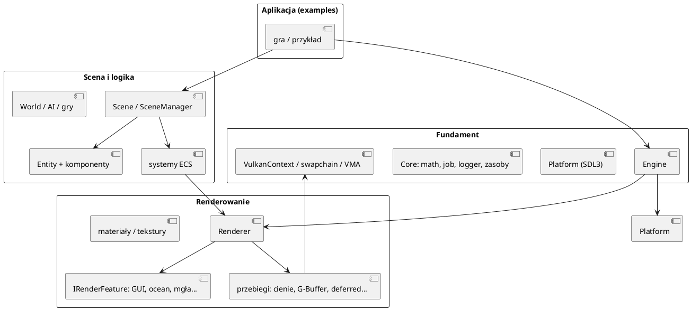
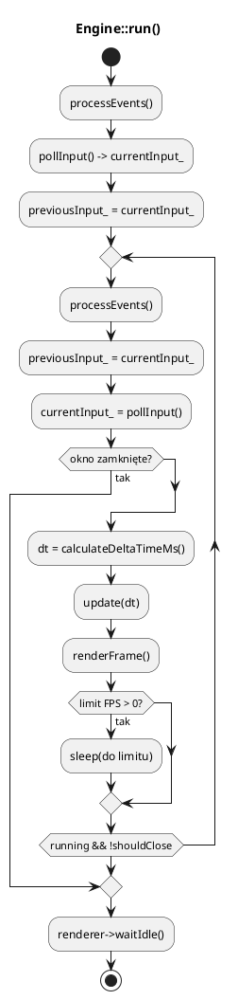
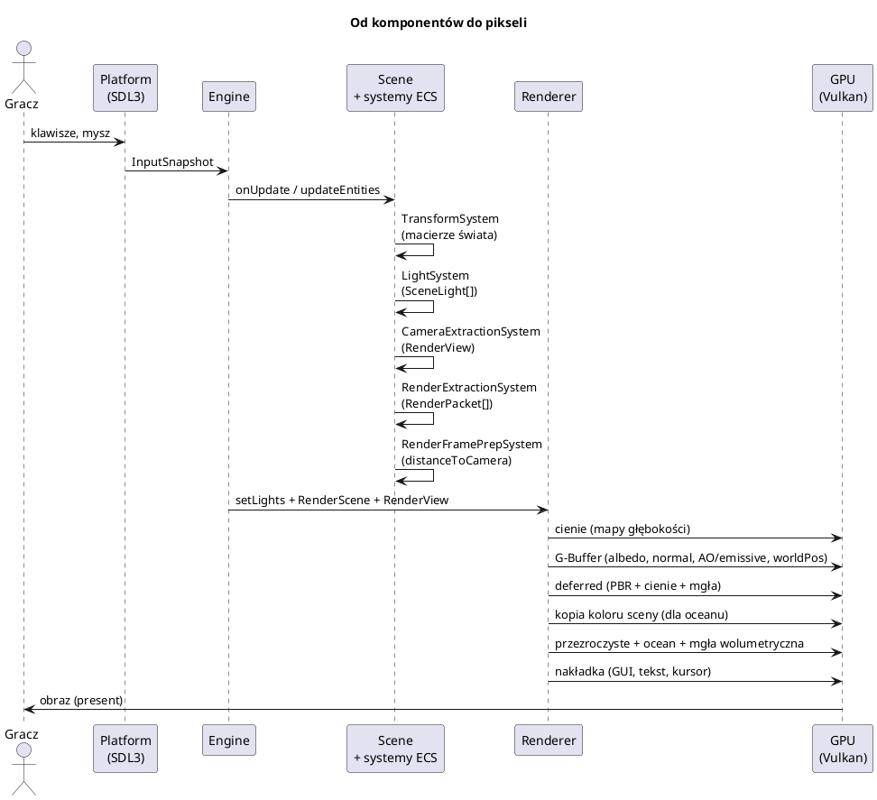
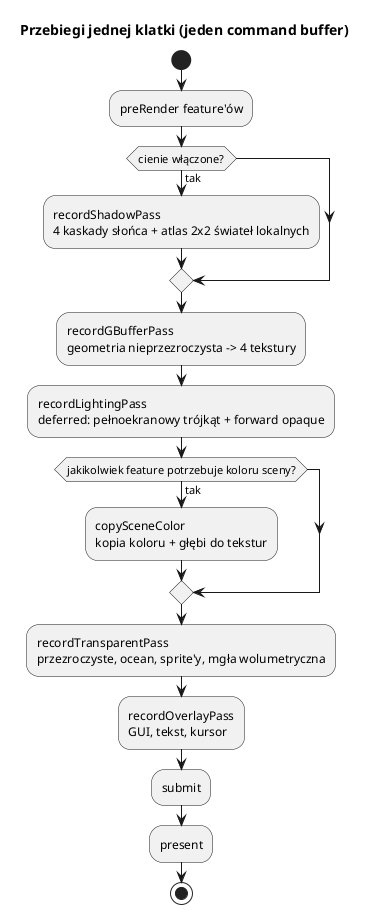

# Architektura silnika

Ten dokument jest mapą całości: co jest czym, kto kogo zna, w jakiej kolejności
dzieje się klatka. Szczegóły modułów są w dokumentach 02–21.

---

## 1. Filozofia

Silnik jest **edukacyjny**, więc stawia na jawne, czytelne mechanizmy zamiast
magii frameworka. Cztery zasady przewodnie:

1. **Separacja odpowiedzialności.** Gra (`World`, `SettlersApp`) nie dotyka Vulkana.
   Renderer nie zna pojęcia „budynek” ani „gracz” — dostaje tylko paczki geometrii
   i widok kamery.
2. **Dane oddzielone od logiki (ECS-lite).** `Entity` to identyfikator i worek
   komponentów. Systemy (`ISceneSystem`) przetwarzają całe grupy encji.
3. **Jedno źródło prawdy.** Oświetlenie i powierzchnia są opisane raz, w
   `assets/shaders/shared/` — nie kopiuje się ich do shaderów. Układ push
   constants jest jeden (`render/push_constants.h` + odpowiedni `.hlsl`).
4. **Klatka jako przepływ danych.** Wejście → aktualizacja → ekstrakcja →
   renderowanie → prezentacja. Każdy etap ma własne struktury danych.

---

## 2. Warstwy

* **Fundament** nie wie nic o grze. Można go użyć w dowolnej aplikacji.
* **Scena** zna komponenty i systemy, ale nie wydaje poleceń Vulkan.
* **Renderowanie** operuje na spłaszczonych danych (`RenderPacket`, `RenderView`).
* **Aplikacja** decyduje, co jest w świecie i jak reaguje na wejście.

---

## 3. Własność obiektów

| Obiekt | Właściciel | Cykl życia |
|---|---|---|
| `VulkanContext`, `VulkanSwapchain` | `Engine` (przez `Renderer`) | `initialize` → `cleanup` |
| `Renderer` | `Engine` (`unique_ptr`) | `initialize` → `cleanup` |
| `Scene` | `SceneManager` (`unique_ptr`) | `createScene` → `removeScene`/koniec |
| `Entity` | `Scene` (`vector<unique_ptr>`) | `createEntity` → `removeEntity` |
| `Component` | `Entity` (`vector<unique_ptr>`) | `addComponent` → zniszczenie encji |
| `MeshData` w RAM | `MeshManager` (nazwa → `GpuMesh`) | `loadMesh` → `removeMesh` |
| tekstura GPU | `Renderer` (mapa nazwa → `TextureResources`) | `loadTexture` → `retireTexture` |
| `Material` (dane) | `MaterialManager` | `add` → koniec |
| `MaterialInstance` (potok) | `MaterialSystem` (cache) | na żądanie, do końca |

`Entity*` i `Component*` są **nietrwałe** — wektor encji może się przebudować.
W kodzie gry trzymaj `EntityId` albo nazwę, a wskaźnik pobieraj na bieżąco.
W `10_settlers` służą do tego `Ref<T>` (indeks + generacja).

---

## 4. Pętla gry

`Engine::run()` to klasyczna pętla „input → update → render → limiter”.

### `update(dt)` — kolejność

1. `MeshManager::beginFrame()` — odlicza wiek buforów wycofanych z użycia.
2. Aktualizacja `aspectRatio` kamer (`autoAspect`).
3. `onUpdate(dt, engine)` — logika aplikacji.
4. `ShaderHotReload::check()` (jeśli włączony).
5. Równolegle: animacje glTF (kości) i MD2 (morfing) przez `JobSystem::parallelFor`.
6. `Scene::updateEntities(dt)` — `Component::update` każdej encji.
7. `SceneManager::update(dt)` — systemy ECS w kolejności dodania.

### `renderFrame()` — kolejność

1. `renderScene.clear()`; ustawienie zbierania cieni.
2. `renderer->setLights(scene->frameLights())`.
3. Skopiowanie `scene->mutableRenderPackets()` do `RenderScene` (przenoszenie, bez kopii).
4. `MeshManager::flushUploads()` — nowe siatki trafiają na GPU.
5. `renderer->render(renderScene, renderView)`.

`RenderView` jest liczone przez `CameraExtractionSystem` w fazie systemów,
więc w `renderFrame` jest już gotowe.

---

## 5. Przepływ danych klatki

Dlaczego ekstrakcja jest osobnym krokiem?

* renderer nie odpyta encji w trakcie rysowania (brak zależności zwrotnej),
* paczki można policzyć **równolegle** (`JobSystem`),
* można narysować scenę z innego wątku / opóźnieniem jednej klatki,
* łatwo dodać drugi renderer (np. minimapę) bez duplikowania logiki.

---

## 6. Przebiegi renderera

`Renderer::render` nagrywa polecenia w jednym buforze komend, w tej kolejności:

Kolejność wynika z zależności:

* cienie muszą powstać **przed** G-Bufferem i deferred (są próbkowane),
* G-Buffer musi być gotowy **przed** deferred (deferred czyta 4 tekstury),
* kopia koloru musi powstać **po** deferred, a **przed** oceanem (ocean czyta
  odbicia i załamania),
* nakładka GUI ma własny wyczyszczony bufor głębokości i jest ostatnia.

Szczegóły: [09_render_potoki.md](09_render_potoki.md).

---

## 7. Wątki

| Wątek | Co robi |
|---|---|
| główny | pętla, wejście, `onUpdate`, ECS, nagrywanie komend, submit |
| `JobSystem` (N wątków) | `parallelFor`: ekstrakcja paczek, dystanse do kamery, animacje glTF/MD2, cząsteczki |
| audio (SDL callback) | miksowanie efektów i muzyki, **bez muteksów i alokacji** |
| strumień muzyki | dekodowanie OGG z wyprzedzeniem ~1 s |
| (opcjonalnie) wątek zasobów | obecnie brak asynchronicznego ładowania |

Zasady:

* `JobSystem::parallelFor` wykonuje też wątek wołający. Bufory „na wątek”
  indeksuj `jobs.currentSlot()` (rozmiar `threadCount() + 1`).
* Wątki robocze nie mogą wołać `VulkanContext`/`MeshManager::updateMesh`.
  Wyniki zbieraj i wysyłaj z wątku głównego.
* Wątek audio nie bierze muteksu gry — komunikacja idzie przez kolejkę poleceń.

---

## 8. Jak czytać kod

Kolejność lektury dla nowej osoby:

1. `engine/core/engine.h` + `engine.cpp` — pętla i orkiestracja.
2. `engine/scene/scene.h` + `engine/core/entity.h` — model świata.
3. `engine/scene/*_system.cpp` — co dzieje się z danymi przed renderem.
4. `engine/render/renderer.h` + `renderer_core.cpp` — wejście renderera.
5. `engine/render/renderer_impl.h` — komplet stanu i podział przebiegów.
6. `engine/core/mesh_manager.*`, `engine/render/material_*` — zasoby GPU.
7. `assets/shaders/shared/*.hlsl` — wspólna matematyka oświetlenia.

Dopiero potem przykłady (`examples/`), zaczynając od `01`, `03`, `07`, `10`.
