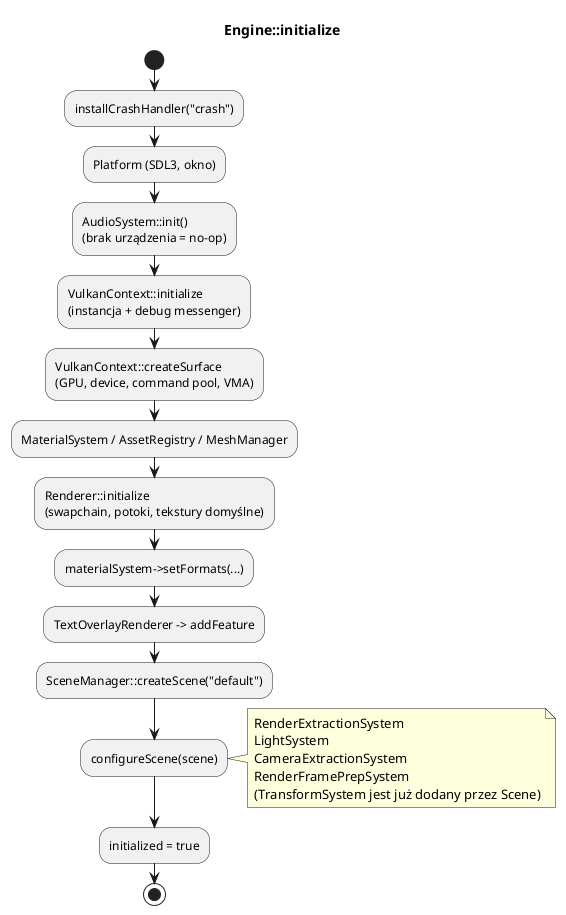
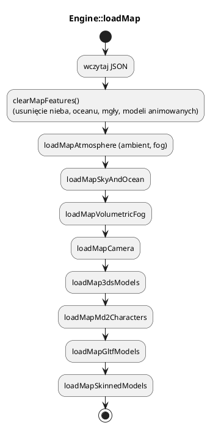

# Core: `Engine` — orkiestrator aplikacji

Plik: `engine/core/engine.h`, `engine/core/engine.cpp`, `engine/core/engine_map.cpp`.

`Engine` spina wszystkie podsystemy i prowadzi pętlę. Sam nie implementuje
renderowania ani logiki gry — **deleguje**:

* `Renderer` — komunikacja z GPU,
* `SceneManager` — światy i encje,
* `AssetRegistry`, `MeshManager`, `MaterialManager`, `TextureManager`, `FontManager`,
* `Platform` — okno i wejście,
* `JobSystem` — pula wątków,
* `AudioSystem`, `TextOverlayRenderer`, `ShaderHotReload`.

Wzorzec: **fasada + orkiestrator**. Aplikacja rozmawia z jednym obiektem
`Engine`, a ten wywołuje właściwe moduły w dobrej kolejności.

---

## 0. Struktury, którymi zarządza `Engine`

| Struktura | Co to jest | Rola |
|---|---|---|
| `Engine` | Fasada i orkiestrator | Pętla, `onUpdate`, dostęp do podsystemów |
| `Platform` | Warstwa SDL3 | Okno, zdarzenia, migawka wejścia |
| `InputSnapshot` | Stan wejścia na klatkę | Spójny odczyt klawiszy/myszy |
| `InputActionMap` | Mapa akcji | Nazwy intencji → scancody |
| `GameSettings` | Ustawienia gracza | JSON + zastosowanie do silnika/audio |
| `SceneManager` | Rejestr scen | Aktywna scena, tworzenie/usuwanie |
| `Renderer` | Fasada GPU | Rysowanie klatki, zasoby, ustawienia graficzne |
| `AudioSystem` | Mikser dźwięku | Efekty, 3D, muzyka |
| `JobSystem` | Pula wątków | `parallelFor` dla zadań silnika i gry |

Pełny słownik: [00_slownik_pojec.md](00_slownik_pojec.md).

---

## 1. Typowe użycie

```cpp
#include "core/engine.h"

int main() {
    engine3d::Engine engine;

    if (!engine.initialize("moja gra", 1280, 800)) {
        return 1;                       // initialize loguje powód (LOG_ERROR/LOG_CRITICAL)
    }

    // ... budowa sceny, materiałów, siatek, callback onUpdate ...

    engine.run();                       // blokuje do zamknięcia okna
    return 0;                           // ~Engine -> cleanup()
}
```

`initialize` wykonuje po kolei: instalacja crash handlera → okno SDL3 → audio →
instancja Vulkan → surface i urządzenie → menedżery zasobów → renderer →
domyślna scena `"default"` → systemy ECS (`configureScene`).



---

## 2. Dostęp do podsystemów

```cpp
Renderer*         r  = engine.getRenderer();
Platform*         p  = engine.getPlatform();
SceneManager*     sm = engine.getSceneManager();
Scene*            s  = sm->activeScene();
MaterialManager*  mm = engine.getMaterialManager();
MaterialSystem*   ms = engine.getMaterialSystem();
MeshManager*      meshes = engine.getMeshManager();
AssetRegistry*    assets = engine.getAssetRegistry();
JobSystem&        jobs = engine.getJobSystem();
CameraController* cam = engine.getCameraController();
AudioSystem*      audio = engine.getAudio();   // zawsze nie-null; bez urządzenia = no-op
```

`AudioSystem` jest tworzony zawsze, nawet gdy nie ma karty dźwiękowej.
Dzięki temu kod gry nie musi sprawdzać `nullptr` przy każdym `play`.

---

## 3. Wejście

`Engine` przechowuje dwie migawki:

* `previousInput_` — stan z poprzedniej klatki (do wykrycia „wciśnięto teraz”),
* `currentInput_` — stan bieżącej klatki.

Akcje nazwane definiuje `InputActionMap` (szczegóły: [06_platforma.md](06_platforma.md)).

```cpp
engine.inputActions().bindKey("move.forward", SDL_SCANCODE_W);
engine.inputActions().bindKey("skok", SDL_SCANCODE_SPACE);

engine.onUpdate = [](float dt, Engine& e) {
    if (e.actionDown("move.forward")) { /* trzymany */ }
    if (e.actionPressed("skok"))      { /* wciśnięty w tej klatce */ }
    if (e.mousePressed(0))            { /* LPM kliknięty w tej klatce */ }
    if (e.keyPressed(SDL_SCANCODE_ESCAPE)) e.requestQuit();
};
```

Dostępne metody:

| Metoda | Znaczenie |
|---|---|
| `actionDown(name)` | akcja wciśnięta (dowolny klawisz) |
| `actionPressed(name)` | akcja wciśnięta **pierwszy raz** w tej klatce |
| `keyPressed(scancode)` | surowy klawisz, bez akcji |
| `mouseDown/ Pressed/ Released(button)` | 0 = LPM, 1 = PPM, 2 = środkowy |
| `input()` | cała `InputSnapshot` (x, y, delta, kółko, klawisze) |

Kółko myszy: używaj `input().mouseWheelF` (float). Wersja `int` akumuluje
pełne ząbki i gubi precyzję touchpadów.

---

## 4. Ustawienia graficzne i atmosfera

Większość metod `Engine` to wygodne przekierowania do `Renderer`:

```cpp
engine.setShadowsEnabled(true);
engine.configureDirectionalShadow(/*halfSize*/ 1200.0f, /*start*/ 0.0f, /*lambda*/ 0.6f);
engine.setLightingEnabled(true);
engine.setAmbientStrength(0.3f);
engine.setAmbientColor(0.45f, 0.48f, 0.55f);

engine.setFogEnabled(true);
engine.setFogColor(0.7f, 0.8f, 0.9f);
engine.setFogStart(150.0f);
engine.setFogEnd(3500.0f);

engine.setWindTime(t);
engine.setWindStrength(0.4f);          // roślinność
engine.setTessellationEnabled(true);
engine.setTessellationLevel(4.0f);
engine.setWireframeEnabled(false);

engine.setPresentMode(PresentMode::Fifo);       // V-Sync
engine.setSynchronizationMode(SynchronizationMode::Timeline);
engine.setFrameRateLimit(0);                    // 0 = bez limitu
engine.setFullscreen(true);
engine.setWindowSize(1920, 1080);
```

### Mgła wojny

```cpp
engine.setFogOfWar(true, originX, originZ, worldSize, /*exploredBrightness*/ 0.45f);
engine.updateFogOfWar(visibility);   // kFogOfWarSize * kFogOfWarSize bajtów
```

Wartości komórek: `0` = nieodkryte, `128` = odkryte (widoczny teren, nie jednostki),
`255` = widoczne. Tekstura działa w przebiegu deferred, więc obejmuje teren,
roślinność i budynki. Szczegóły: [17_mgly.md](17_mgly.md).

### Cienie słońca

`configureDirectionalShadow(halfSize, startDistance, splitLambda)`:

* `halfSize` — połowa zasięgu ortogonalnego cienia (im większy, tym mniejsza
  rozdzielczość na metr),
* `startDistance` — od jakiej głębokości widoku startują kaskady (kamera RTS
  widzi teren z daleka, więc nie marnujemy kaskad na pustkę),
* `splitLambda` — 0 = podział równomierny, 1 = logarytmiczny (gęściej blisko kamery).

---

## 5. `onUpdate` — logika aplikacji

```cpp
engine.onUpdate = [](float dt, Engine& e) {
    Scene* scene = e.getSceneManager()->activeScene();
    // dt w sekundach; ruch * dt = niezależny od FPS
    if (auto* entity = scene->getEntity("gracz")) {
        entity->transform().position.x += 3.0f * dt;
    }
};
```

Callback jest wołany **przed** `Scene::updateEntities` i systemami ECS. Dzięki
temu zmiany transformacji zrobione w `onUpdate` są widoczne w tej samej klatce
w `TransformSystem` i renderze.

`requestQuit()` kończy pętlę po bieżącej klatce.

---

## 6. Tekst HUD i czcionki

```cpp
engine.loadFont("times", "assets/fonts/times.ttf", 32);
engine.setTextLabel("Witaj!", "times", 20, 40, 1.0f, {1, 1, 1, 1});
float w = engine.measureText("Witaj!", 1.0f);
```

`loadFont` ładuje TTF i buduje atlas glifów. `setTextLabel` dodaje napis do
nakładki 2D na jedną klatkę (trzeba wołać co klatkę). Szczegóły:
[13_fonty_tekst.md](13_fonty_tekst.md).

---

## 7. Shader hot reload

```cpp
engine.enableShaderHotReload(true);
engine.reloadShader("gbuffer");
```

Hot reload monitoruje `assets/shaders/` przez `inotify`, kompiluje zmieniony
`.hlsl` przez `dxc` lub `glslangValidator` i unieważnia potoki materiałów.
Wymaga katalogu `bin/assets/shaders/` i kompilatora w `PATH`.
Nie używaj w wersji wydanej graczom — to narzędzie deweloperskie.

---

## 8. Ładowanie mapy z JSON

`Engine::loadMap(path, scene)` to gotowy loader scen demonstracyjnych.
Każda sekcja jest opcjonalna; brak pola = wartość domyślna.

```json
{
  "ambient": { "strength": 0.28, "color": {"r": 0.35, "g": 0.38, "b": 0.45} },
  "fog": { "enabled": true, "color": {"r":0.57,"g":0.68,"b":0.88},
           "start": 150, "end": 3500, "density": 0.83 },
  "skydome": { "enabled": true, "time_of_day": 10, "cloud_coverage": 0.4 },
  "ocean": { "enabled": true, "water_level": 30, "wave_amplitude": 1.4 },
  "camera": { "position": {"x":0,"y":80,"z":-200},
              "target": {"x":0,"y":0,"z":0}, "fov": 45 },
  "static_models_3ds": [
    { "file": "assets/models/3ds/ludz/chlop.3ds",
      "positions": [ {"x":0,"y":0,"z":0} ],
      "scale": {"x":1,"y":1,"z":1}, "snap_to_terrain": true }
  ],
  "characters_md2": [ { "file": "assets/models/md2/goblin/goblin.md2",
                        "position": {"x":0,"y":0,"z":0} } ],
  "gltf_models": [ { "file": "assets/models/gLTF/toycar/toycar.gltf",
                     "position": {"x":0,"y":0,"z":0} } ],
  "gltf_skinned_models": [ { "file": "assets/models/gLTF/Suzanne/Suzanne.gltf" } ]
}
```



Modele z mapy są zwykle tworzone jako **encja-korzeń** + encje-dzieci na każdą
siatkę. Dzięki hierarchii jedna transformacja przesuwa cały model.

---

## 9. `GameSettings` — ustawienia gracza

Plik: `engine/core/game_settings.h`.

```cpp
engine3d::GameSettings s;
s.load("save/moja_gra.json");       // brak pliku = zostają domyślne
s.applyDisplay(engine, /*startup*/ true);
s.applyAudio(engine.getAudio());
s.save("save/moja_gra.json");
```

Pola: `musicOn`, `sfxOn`, `musicVolume`, `sfxVolume`, `masterVolume`,
`windowW`, `windowH`, `fullscreen`, `presentMode` (0 FIFO / 1 Immediate / 2 Mailbox),
`syncMode` (0 Standard / 1 Timeline / 2 Off), `fpsLimit` (0 = bez limitu), `shadows`.

`resolutionList(engine)` zwraca rozdzielczości mieszczące się na ekranie, a
`presentModeNames()` / `syncModeNames()` — gotowe napisy do list wyboru w GUI.
Wartości są przycinane do bezpiecznych zakresów, więc uszkodzony plik nie
wyłączy gry.

W trybach testowych (np. `SETTLERS_UITEST`) ustawienia nie są wczytywane ani
zapisywane — testy muszą być powtarzalne.

---

## 10. Sprzątanie

`~Engine()` woła `cleanup()`:

1. `AudioSystem::shutdown()` — **przed** `SDL_Quit`.
2. `clearMapFeatures()` — usuwa niebo/ocean/mgłę/modele animowane.
3. `Renderer::cleanup()` — czeka na GPU i niszczy zasoby.
4. `TextOverlayRenderer`, `MeshManager`, `AssetRegistry`, `MaterialSystem`,
   `VulkanContext`, `Platform`.

Kolejność jest istotna: zasoby GPU muszą zniknąć przed zniszczeniem urządzenia,
a wątek audio przed zamknięciem SDL.
