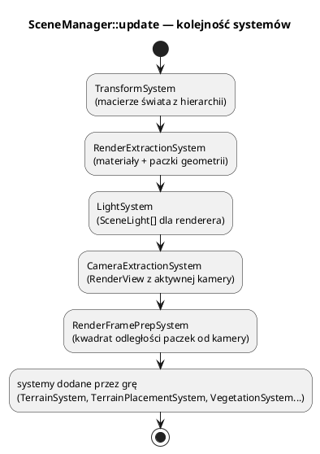
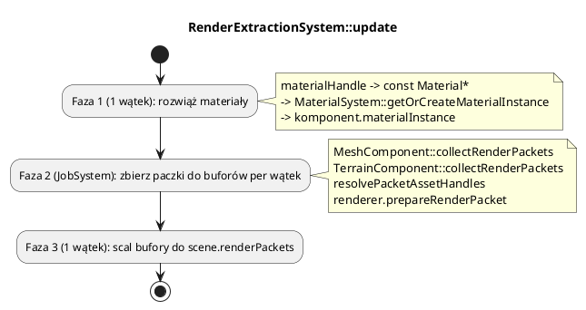

# ECS-lite: encje, komponenty, scena i systemy

Pliki: `engine/core/entity.*`, `engine/core/component.*`, `engine/core/*_component.h`,
`engine/scene/*`.

Silnik używa **uproszczonego ECS** (Entity–Component–System), a nie pełnego ECS
z archetypami. Chodzi o czytelność i łatwość rozszerzania, nie o maksymalną
wydajność cache.

---

## 0. Najważniejsze struktury sceny

| Struktura | Co to jest | Rola |
|---|---|---|
| `Entity` | Pojemnik na komponenty + `EntityId` + nazwa | Obiekt w świecie; sam nie ma logiki |
| `Component` | Bazowy komponent | `initialize/update`, właściciel, `active` |
| `TransformComponent` | Pozycja/rotacja/skala + `worldMatrix` | `TransformSystem` wylicza macierz świata |
| `MeshComponent` | Siatka + `MaterialHandle` | Mówi rendererowi, co narysować |
| `LightComponent` | Parametry światła | `LightSystem` zamienia na `SceneLight` |
| `CameraComponent` | FOV, near/far, target | `CameraExtractionSystem` tworzy `RenderView` |
| `HierarchyComponent` | Rodzic + dzieci | Hierarchia transformacji i usuwanie drzewa |
| `Scene` | Encje + systemy + paczki klatki | Jeden świat gry |
| `SceneManager` | Rejestr scen | Wybór aktywnej sceny |
| `ISceneSystem` | Interfejs systemu | Logika masowa w kolejności dodania |
| `RenderView` | Macierze kamery na klatkę | Wejście renderera |
| `SceneLight` | Spłaszczone światło dla GPU | Wynik `LightSystem` |

Pełny słownik: [00_slownik_pojec.md](00_slownik_pojec.md).

---

## 1. Encja

`Entity` to:

* stabilny `EntityId` (`uint64_t`),
* nazwa,
* flaga `active`,
* zawsze obecny `TransformComponent`,
* wektor komponentów (`std::vector<std::unique_ptr<Component>>`).

```cpp
Entity* e = scene->createEntity("drzwi");
e->transform().position = {10, 0, 4};

auto* mesh = e->addComponent<MeshComponent>("drzwi");
mesh->materialHandle = materialHandle;

CameraComponent* cam = e->addComponent<CameraComponent>();
```

`getComponent<T>()` przeszukuje komponenty od końca. Typ jest sprawdzany przez
`dynamic_cast`, więc działa też dla klas pochodnych. `addComponent` ustawia
właściciela i woła `initialize()`.

> **Ważne:** wskaźniki `Entity*`/`Component*` są ważne do najbliższej modyfikacji
> wektora encji (np. `createEntity` może realokować). W kodzie trzymaj `EntityId`
> lub nazwę i pobieraj wskaźnik na bieżąco.

---

## 2. Komponenty silnika

| Komponent | Plik | Rola |
|---|---|---|
| `TransformComponent` | `core/transform_component.h` | pozycja/rotacja/skala + `worldMatrix` |
| `MeshComponent` | `core/mesh_component.h` | nazwa siatki, `MaterialHandle`, cienie, warstwy terenu |
| `LightComponent` | `core/light_component.h` | typ, kolor, intensywność, zasięg, kąty |
| `CameraComponent` | `camera/camera_component.h` | FOV, near/far, target, up, aspect |
| `HierarchyComponent` | `core/hierarchy_component.h` | `parent` + `children` |
| `TerrainComponent` | `object/terrain/terrain_component.h` | `shared_ptr<Terrain>` + warstwy |
| `TerrainPlacementComponent` | `object/terrain/terrain_placement_component.h` | przyklejenie Y do terenu |

### Transformacja

`TransformComponent::getLocalMatrix()` składa TRS:

```text
local = T(position) * Rz * Ry * Rx * S(scale)
world = parent.world * local
```

Rotacje są w **radianach**, w kolejności X→Y→Z. `worldMatrix` wypełnia
`TransformSystem`; nie ustawiaj go ręcznie, chyba że świadomie nadpisujesz
hierarchię.

### Hierarchia

`Scene::setParent(child, parent)`:

* ustawia `HierarchyComponent::parent` i dopisuje do `children`,
* odrzuca cykl (wchodzi po rodzicach i sprawdza, czy nie trafi na dziecko),
* jest używane przez `TransformSystem` do liczenia macierzy świata.

Polityki usuwania (`HierarchyRemovalPolicy`):

| Polityka | Efekt |
|---|---|
| `RemoveSubtree` | usuwa rodzica i całe poddrzewo |
| `ReparentChildrenToParent` | dzieci przechodzą pod dziadka |
| `DetachChildren` | dzieci zostają bez rodzica (korzeń) |

---

## 3. Scena

`Scene` jest właścicielem encji i systemów.

```cpp
Scene* scene = engine.getSceneManager()->activeScene();

Entity* sun = scene->createDirectionalLight("sun", {2, 3, 2}, {1, 1, 0.9f}, 3.0f);
Entity* lamp = scene->createPointLight("lamp", {5, 3, 0}, {1, 0.7f, 0.4f}, 2.0f, 20.0f);

scene->setActiveCamera(camera);
scene->addSystem(std::make_unique<TerrainSystem>(...));
```

`SceneManager` trzyma wiele scen (menu, poziom, edytor):

```cpp
Scene* menu = engine.getSceneManager()->createScene("menu");
engine.getSceneManager()->setActiveScene("menu");
```

Tylko sceny aktywnej dotyczy `update` i renderowanie. `Scene` ma też mapy
`id → Entity*` i `nazwa → Entity*` do szybkiego wyszukiwania.

---

## 4. Systemy ECS i kolejność

`Scene` w konstruktorze dodaje `TransformSystem`. `Engine::configureScene`
dodaje cztery kolejne. Kolejność wykonania = kolejność dodania:



Dlaczego `RenderExtractionSystem` jest przed `CameraExtractionSystem`?
Paczki nie potrzebują kamery — potrzebują materiałów i siatek. Dystans do kamery
liczy dopiero `RenderFramePrepSystem`, już po ekstrakcji widoku.

`TransformSystem` musi być **pierwszy** — inaczej ekstrakcja przeczyta stare
macierze świata.

Przed systemami `Engine::update` woła `Scene::updateEntities`, czyli
`Component::update(dt)` każdej encji. Tam trafia logika pojedynczych obiektów;
systemy robią rzeczy masowe.

---

## 5. Ekstrakcja renderu

`RenderExtractionSystem` zamienia komponenty na `RenderPacket` — płaskie struktury
gotowe dla renderera.



### `RenderPacket`

Najważniejsze pola (pełna definicja: `render/render_types.h`):

| Pole | Znaczenie |
|---|---|
| `vertexBuffer`, `indexBuffer` | uchwyty GPU siatki |
| `transform` | macierz świata |
| `material` | `MaterialInstance` (potok, stany) |
| `diffuseTextureIndex` itd. | indeksy w tablicy bindless |
| `terrain` | `shared_ptr<TerrainSurface>` (warstwy) |
| `distanceToCamera` | kwadrat odległości (sortowanie) |
| `castShadows`, `shadowOnly` | udział w mapach cieni |
| `forwardOpaquePass`, `gbufferMaterialPass` | który przebieg rysuje |
| `hasBounds` + `boundsMin/Max` | dopasowanie cieni |

Paczka jest **spłaszczona**: nie ma w niej wskaźników do encji ani komponentów.
Dzięki temu renderer nie zna sceny.

### Bezpieczeństwo wątkowe

* `localBuffers[slot]` — każdy wątek pisze tylko do swojego bufora
  (`currentSlot()`),
* `getMesh()` — tylko odczyt (mesh manager nie jest w tym czasie modyfikowany),
* `getWorldMatrix()` — tylko odczyt (TransformSystem już skończył),
* `materialInstance` — tylko odczyt (faza 1 skończyła),
* `AssetRegistry` — bezpieczny (`shared_mutex`).

`prepareRenderPacket` uzupełnia indeksy tekstur i bufory. **Nie zmieniaj**
wspólnych `TerrainSurface` w fazie równoległej — robi to `resolveTerrainSurfaces`
w `Renderer::render` na jednym wątku.

---

## 6. Systemy świateł i kamery

`LightSystem`:

* czyści `scene.frameLights()`,
* dla każdej aktywnej encji z `LightComponent` kopiuje dane do `SceneLight`,
* pozycję bierze z `TransformComponent`, kierunek normalizuje.

Maksymalnie **16 świateł** trafia do GPU (`kMaxLights`). Nadmiar jest ignorowany.

`CameraExtractionSystem`:

* bierze `scene.activeCamera()`,
* liczy `view = getViewMatrix()`, `projection = getProjectionMatrix()`,
* liczy `cameraRight`, `cameraUp` (dla billboardów, cząsteczek, sprite'ów),
* zapisuje `RenderView` w scenie.

Brak aktywnej kamery = brak `RenderView` = scena się nie rysuje.

---

## 7. Przykład: hierarchia i obrót

```cpp
Entity* root = scene->createEntity("wiatrak");
Entity* blades = scene->createEntity("lopaty");
scene->setParent(blades, root);

blades->transform().position = {0, 10, 0};
root->transform().position = {50, 0, 50};

engine.onUpdate = [&](float dt, Engine&) {
    blades->transform().rotation.z += dt * 2.0f;   // obraca się względem wieży
};
```

`TransformSystem` policzy `world = root.world * blades.local`, więc łopaty
obracają się wokół własnej osi, ale stoją tam, gdzie wieża.

---

## 8. Pułapki

* **Nie trzymaj `Entity*` długo.** Wektor może się przebudować. Używaj
  `EntityId`/nazwy albo `Ref<T>` (jak w `10_settlers`).
* **Nie zmieniaj hierarchii w wątku roboczym.** `setParent`/`removeEntity`
  modyfikują wektory sceny.
* **Nowy komponent = nowa odpowiedzialność.** Jeśli dodajesz dane do encji,
  przemyśl, czy nie lepiej zrobić nowego komponentu niż puchnąć `MeshComponent`.
* **Systemy nie mają własnego stanu gry.** Stan trzymaj w komponentach/scenie;
  system ma być funkcją stanu.
* Po zmianie `materialHandle` wyzeruj `materialInstance` — inaczej zostanie
  stary potok.
