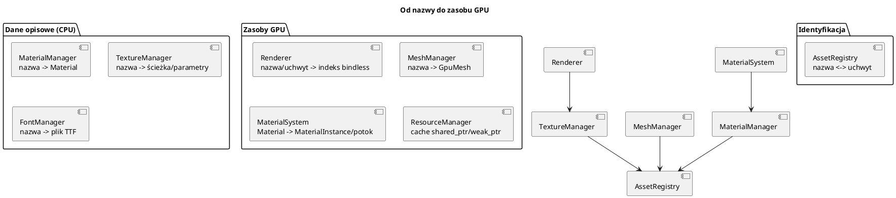
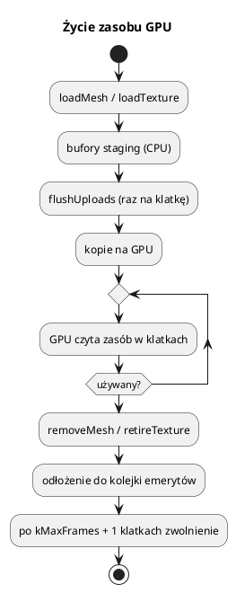

# Zasoby: uchwyty, siatki, materiały, tekstury, rejestry

Pliki: `engine/core/asset_registry.*`, `engine/core/resource_manager.h`,
`engine/core/mesh_manager.*`, `engine/core/mesh_builder.*`,
`engine/render/material_manager.*`, `engine/render/texture_manager.*`,
`engine/feature/font/font_manager.*`.

Ten dokument opisuje **wspólny model zasobów**. Szczegóły potoków i tekstur GPU:
[09_render_potoki.md](09_render_potoki.md), [10_render_materialy.md](10_render_materialy.md),
[11_render_tekstury.md](11_render_tekstury.md).

---

## 0. Najważniejsze struktury zasobów

| Struktura | Co to jest | Rola |
|---|---|---|
| `AssetHandle<Tag>` | Typowany uchwyt (`uint32_t` + tag) | Bezpieczne ID zasobu |
| `MaterialHandle`, `TextureHandle`, `MeshHandle` | Uchwyty konkretnych typów | Przekazywane zamiast nazw/wskaźników |
| `AssetRegistry` | Mapa nazwa ↔ uchwyt | Wspólny słownik zasobów |
| `Material` | Dane materiału | Opis powierzchni dla `MaterialSystem` |
| `MaterialManager` | Rejestr materiałów | `add`, `get`, `require`, `handle` |
| `TextureManager` | Rejestr opisów tekstur | Nazwa → ścieżka/parametry |
| `MeshData` | Wierzchołki + indeksy w RAM | Wejście `MeshManager::loadMesh` |
| `GpuMesh` | Bufory GPU + liczniki + granice | Gotowa siatka do rysowania |
| `MeshManager` | Właściciel siatek GPU | Ładowanie, aktualizacja, zwalnianie, instancje |
| `MeshBuilder` | Helper do siatek z brył | Proceduralne modele low-poly |

Pełny słownik: [00_slownik_pojec.md](00_slownik_pojec.md).

---

## 1. Dlaczego uchwyty zamiast stringów

W runtime nie przekazujemy nazw tekstur ani wskaźników do GPU. Używamy
**typowych uchwytów**:

```cpp
MaterialHandle  mat;
TextureHandle   tex;
MeshHandle      mesh;
```

`AssetHandle<Tag>` to po prostu `uint32_t value` + sprawdzenie `isValid()`.
Tag (pusta struktura) uniemożliwia pomylenie uchwytu materiału z teksturą na
etapie kompilacji — to tzw. *strong typedef*.

`AssetRegistry` mapuje:

```text
nazwa  <->  uchwyt
```

i nadaje kolejne ID. Jest bezpieczny wątkowo (`std::shared_mutex`: wielu
czytelników, jeden pisarz).

```cpp
AssetRegistry* reg = engine.getAssetRegistry();

MaterialHandle m = reg->registerMaterial("złoto");
TextureHandle  t = reg->registerTexture("piasek");
MeshHandle     h = reg->registerMesh("dom");

auto name = reg->textureName(t);          // std::optional<std::string>
auto h2   = reg->textureHandle("piasek"); // std::optional<TextureHandle>
```

Rejestracja tego samego zasobu pod tą samą nazwą zwraca istniejący uchwyt.

---

## 2. Trzy warstwy zasobów



* **Rejestry** (`*Manager`) przechowują dane opisowe i nadają uchwyty.
* **AssetRegistry** jest wspólnym słownikiem nazw i uchwytów.
* **Zasoby GPU** są tworzone leniwie lub przy `loadMesh`/`loadTexture`.

`ResourceManager<T>` to prosty cache `shared_ptr` z `weak_ptr` w środku:
`get(name)` zwraca `nullptr`, gdy zasób został już zwolniony; `load(name, loader)`
tworzy go raz i współdzieli. Używany m.in. przez `MaterialSystem`.

---

## 3. `MeshManager` — siatki na GPU

`MeshData` to wektory wierzchołków i indeksów w pamięci CPU:

```cpp
struct Vertex { float position[3], normal[3], color[3], texCoord[2]; };
struct MeshData { std::vector<Vertex> vertices; std::vector<uint32_t> indices; };
```

`MeshManager` trzyma mapę `nazwa → GpuMesh` (bufory Vulkan + liczniki + granice).

### Wysyłanie siatki

```cpp
MeshManager* meshes = engine.getMeshManager();
meshes->loadMesh("skrzynia", meshData);   // zapisuje dane, kopiuje na GPU w flushUploads
```

`loadMesh`:

1. tworzy bufory `DEVICE_LOCAL` (vertex, index) i bufory pośrednie (staging),
2. kopiuje dane CPU → staging,
3. zapisuje `PendingCopy` do kolejki,
4. `flushUploads` (wołane przez `Engine::renderFrame`) nagrywa kopie i wysyła je
   na kolejkę graficzną.

Dlaczego tak? Duże bufory w VRAM są najszybsze, ale CPU ich nie mapuje.
Staging + `vkCmdCopyBuffer` to standardowa droga. Wysłanie partii kopii raz na
klatkę jest tańsze niż osobne submity przy każdym `loadMesh`.

### Zmiana siatki co klatkę

```cpp
meshes->updateMesh("trawa", noweWierzcholki);
```

`updateMesh` używa buforów **host-visible** (CPU może mapować), bo siatka zmienia
się często (animacja MD2, fale, deformacje). Wysyłanie przez staging byłoby
marnowaniem pasma.

### Usuwanie i bezpieczeństwo

```cpp
meshes->removeMesh("stara_siatka");
meshes->removeMeshesWithPrefix("swiat_");
```

Bufory nie są niszczone od razu — GPU może jeszcze czytać poprzednie klatki
(`kMaxFrames`). `MeshManager` odkłada je do `retired_` i zwalnia po
`kBufferRetireFrames` (4) klatkach w `beginFrame`. **Nie usuwaj siatek w trakcie
rysowania w innym wątku.**

Tworzenie siatek w trakcie gry bez usuwania = wyciek VRAM. W `10_settlers`
siatki świata mają prefiks i są zwalniane w `~World`.

### Granice (bounds)

`GpuMesh` liczy `boundsMin/boundsMax` z wierzchołków. Renderer używa ich do
dopasowania cieni (obiekt poza kadrem, ale blisko kamery, może rzucać cień).
Dla instancji granice mogą być nieznane (`hasBounds == false`).

### Bufory instancji

```cpp
meshes->loadInstanceBuffer("trawa", sizeof(ParticleInstanceData) * max);
meshes->updateInstanceBuffer("trawa", dane, rozmiar, liczbaInstancji);
```

Używane przez cząsteczki, sprite'y i roślinność — jeden bufor wierzchołków +
jeden bufor instancji = jeden draw call.

---

## 4. `MeshBuilder` — proceduralne low-poly

`MeshBuilder` składa model z prostych brył. Każda bryła ma własny kolor
w wierzchołkach, więc cały model może używać jednego materiału.

```cpp
#include "core/mesh_builder.h"

MeshBuilder b;
b.box({0, 1, 0}, {2, 2, 2}, {0.8f, 0.7f, 0.5f});
b.gableRoof({0, 2, 0}, 2.4f, 2.4f, 1.2f, {0.7f, 0.2f, 0.1f});
b.cylinder({-2, 0, 0}, 0.4f, 3.0f, 8, {0.5f, 0.4f, 0.3f});
b.sphere({2, 0.5f, 0}, 0.5f, 8, 12, {0.2f, 0.6f, 0.2f});

engine.getMeshManager()->loadMesh("dom", b.build());
```

Dostępne bryły:

| Metoda | Uwagi |
|---|---|
| `box(center, size, color)` | prostopadłościan |
| `cylinder(baseCenter, radius, height, segments, color, topRadius)` | walec / ścięty stożek |
| `cone(...)` | stożek |
| `sphere(center, radius, rings, segments, color)` | sfera UV |
| `gableRoof(...)` | dach dwuspadowy (kalenica wzdłuż X) |
| `pyramid(...)` | ostrosłup |
| `ring(...)`, `disk(...)` | płaskie znaczniki w XZ |
| `polygon(points, insidePoint, color)` | dowolny wypukły wielokąt |
| `append(mesh)` | doklejenie istniejącej siatki |

Cechy:

* **płaskie cieniowanie** (flat shading) — każdy trójkąt ma własne wierzchołki,
* normalne skierowane **na zewnątrz** bryły (względem środka),
* kolor w wierzchołku mnoży się przez kolor materiału i teksturę,
* orientacja CCW zgodna z domyślnym back-face culling.

`MeshBuilder` jest używany w `10_settlers` do wszystkich budynków, jednostek,
drzew i dróg — cała gra działa bez plików modeli.

---

## 5. `MaterialManager`

```cpp
Material m;
m.name = "metal";
m.textureHandle = engine.getRenderer()->loadTexture("metal", "assets/textures/metal.bmp");
m.metallicFactor = 1.0f;
m.roughnessFactor = 0.25f;

MaterialHandle h = engine.getMaterialManager()->add(m);
```

* `add` rejestruje materiał i nadaje `MaterialHandle`,
* `get(name)`, `get(handle)`, `require(name)`,
* `handle(name)` zwraca `std::optional<MaterialHandle>`.

`MaterialManager` przechowuje `Material` (dane), a `MaterialSystem` tworzy z nich
`MaterialInstance` (potoki). Szczegóły: [10_render_materialy.md](10_render_materialy.md).

---

## 6. `TextureManager`, `FontManager`

`TextureManager` przechowuje **opis** tekstury: nazwę, ścieżkę, `mirroredRepeat`.
Samo ładowanie do GPU robi `Renderer::loadTexture` (i rejestruje w tablicy
bindless).

```cpp
engine.getTextureManager()->add("trawa", "assets/textures/trawa.dds", true);
auto* asset = engine.getTextureManager()->get("trawa");
```

`FontManager` robi to samo dla czcionek TTF (`name → ścieżka + pixelHeight`).
`Engine::loadFont` łączy rejestrację z zbudowaniem atlasu glifów.

---

## 7. Cykl życia i pułapki



* **Brak `vkDeviceWaitIdle` przy podmianie tekstur.** Używaj `retireTexture` +
  `queueDescriptorWrite`; inaczej zablokujesz GPU na klatkę.
* **Nie usuwaj siatki, gdy renderer może ją czytać.** `MeshManager` sam odracza
  zwolnienie — nie rób `delete` na `GpuMesh`.
* **Unikalne nazwy bez sprzątania = wyciek VRAM.** `MeshManager::meshCount()`
  pomaga wykryć wyciek.
* Siatki `loadMesh` są `DEVICE_LOCAL`; `updateMesh` — host-visible. Mylenie tych
  trybów kończy się brakiem zmian na ekranie albo błędem walidacji.
* `MaterialHandle{}` (wartość 0) = brak materiału. Ustaw `materialInstance` na
  `nullptr` po zmianie uchwytu.
