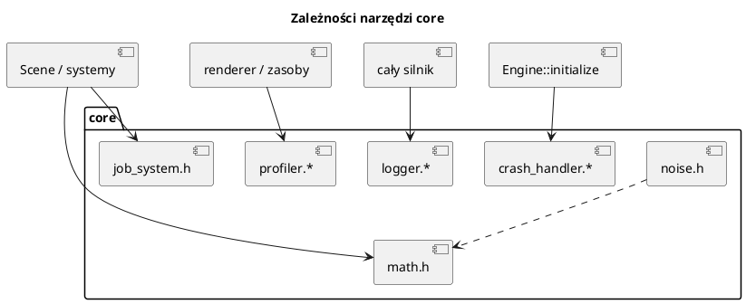

# Narzędzia core: matematyka, szum, wątki, logi, profil, awarie

Pliki: `engine/core/math.h`, `engine/core/noise.h`, `engine/core/job_system.h`,
`engine/core/logger.*`, `engine/core/profiler.*`, `engine/core/crash_handler.*`.

Te elementy nie należą do żadnego „dużego” modułu, ale są używane wszędzie.
Warto je znać, bo pozwalają pisać krótszy i bezpieczniejszy kod.

Motywacja podziału pracy na kawałki, licznik atomowy i bufory na wątek:
[29_algorytmy_silnika.md](29_algorytmy_silnika.md).

## 0. Najważniejsze struktury i klasy

| Nazwa | Co to jest | Rola |
|---|---|---|
| `Vec3`, `Quaternion`, `Matrix4` | Matematyka 3D | Pozycje, obroty, macierze |
| `ValueNoise` | Szum 2D + fbm | Teren proceduralny, rozmieszczanie |
| `JobSystem` | Pula wątków | `submit`, `parallelFor`, `currentSlot` |
| `Logger` / `LogLevel` | Logowanie | Komunikaty i ostatnie wpisy dla raportu awarii |
| `Profiler` / `ProfileScope` | Pomiar czasu | Sekcje klatki (`ENGINE_PROFILE=1`) |
| `GameSettings` | Ustawienia gracza | JSON, okno, dźwięk, VSync, FPS |

Pełny słownik: [00_slownik_pojec.md](00_slownik_pojec.md).

---



---

## 1. Matematyka (`core/math.h`)

Nagłówek-only, typy i funkcje w `namespace engine3d`. Brak zależności od glm —
wszystko jest jawnie napisane, żeby można było się nauczyć, co robi.

### Typy

```cpp
struct Vec3      { float x = 0, y = 0, z = 0; };
struct Quaternion{ float w = 1, x = 0, y = 0, z = 0; };
struct Matrix4   { float values[16]; static Matrix4 identity(); };
```

`Matrix4` jest w układzie **kolumnowym** (jak w HLSL/GLSL): translacja to
`values[12..14]`.

### Funkcje

| Grupa | Funkcje |
|---|---|
| Wektory | `add`, `subtract`, `multiply(vec, scalar)`, `dot`, `cross`, `normalize`, `lerp` |
| Kąty | `radians(deg)`, `rotateY`, `angleLerp`, `smoothstep`, `distanceXZ` |
| Kwaterniony | `normalize`, `conjugate`, `multiply`, `quaternionFromAxisAngle`, `rotateVector` |
| Macierze | `translation`, `rotationX/Y/Z`, `scale`, `multiply`, `perspective`, `ortho`, `lookAt`, `inverse`, `removeTranslation` |
| Punkty | `transformPoint`, `projectPoint` |

Przykład: kamera patrząca na cel.

```cpp
Vec3 eye{0, 10, -20};
Vec3 target{0, 0, 0};
Matrix4 view = lookAt(eye, target, {0, 1, 0});
Matrix4 proj = perspective(radians(60.0f), 16.0f / 9.0f, 0.1f, 1000.0f);
```

Przykład: ruch po okręgu (bez gimbal lock, kwaternion).

```cpp
Quaternion q = quaternionFromAxisAngle({0, 1, 0}, angle);
Vec3 forward = rotateVector(q, {0, 0, 1});
```

> Kolejność rotacji w `TransformComponent`: `Rz * Ry * Rx`. Jeśli mieszasz
> kwaterniony z Eulerami, pamiętaj o tej konwencji.

`distanceXZ(a, b)` ignoruje Y — przydatne w grach RTS, gdzie odległość liczy się
na płaszczyźnie.

---

## 2. Szum (`core/noise.h`)

`ValueNoise` to tani szum wartości 2D z interpolacją smoothstep i funkcją `fbm`
(fractal Brownian motion). Ten sam `seed` daje zawsze ten sam wynik — mapę można
odtworzyć z ziarna.

```cpp
ValueNoise noise{12345};
float h = noise.fbm(x / 200.0f, z / 200.0f, 5);   // -1..1, 5 oktaw
```

Skala wejścia decyduje o rozmiarze struktur: `x / 200` = wzgórza co ~200 jednostek.
`fbm` sumuje kolejne oktawy (2× drobniejsze, 2× słabsze), więc dostajemy duże
wzgórza i drobne nierówności naraz.

Zastosowania: proceduralny teren, rozmieszczanie lasów, chmury, wariacje kolorów.

---

## 3. `JobSystem` — pula wątków

Plik: `engine/core/job_system.h`. Jedna pula na cały silnik (`Engine::getJobSystem()`).

### `submit` — pojedyncze zadanie

```cpp
auto future = jobs.submit([] { return kosztowneObliczenia(); });
// ... rób coś innego ...
int wynik = future.get();
```

### `parallelFor` — dzielenie zakresu

```cpp
std::vector<float> wyniki(n);
jobs.parallelFor(n, [&](size_t begin, size_t end) {
    for (size_t i = begin; i < end; ++i) {
        wyniki[i] = przetworz(i);
    }
});
```

* dzieli `[0, count)` na kawałki (domyślnie ~1 na wątek),
* wątek wołający **też** liczy kawałki,
* czekając na pomocników, wykonuje inne zadania z kolejki — zagnieżdżone
  `parallelFor` nie zakleszcza puli,
* nie alokuje na kawałek (kontekst na stosie wołającego).

### Bufory „na wątek”

```cpp
const size_t slots = jobs.threadCount() + 1;
std::vector<std::vector<RenderPacket>> local(slots);

jobs.parallelFor(count, [&](size_t begin, size_t end) {
    auto& mine = local[jobs.currentSlot()];
    for (size_t i = begin; i < end; ++i) mine.push_back(...);
});
```

`currentSlot()` zwraca `0..N-1` dla wątków roboczych i `N` dla wołającego.
**Nie używaj `currentWorkerIndex()`** do indeksowania buforów — wołający nie jest
wątkiem roboczym.

### Kiedy nie używać

* `MeshManager::updateMesh`, `VulkanContext`, `setParent`, `createEntity` —
  tylko wątek główny,
* małe zakresy (< ~256 elementów) — narzut kolejki może przewyższyć zysk;
  dlatego `RenderFramePrepSystem` ma próg 256.

---

## 4. `Logger`

Plik: `engine/core/logger.h`. Singleton z backendem (konsola/plik/oba).
Formatowanie przez `std::format`.

```cpp
LOG_TRACE("szczegół {}", x);
LOG_INFO("wczytano {} modeli", count);
LOG_WARN("brak tekstury {}, używam domyślnej", path);
LOG_ERROR("nie można otworzyć {}", path);
LOG_CRITICAL("brak Vulkan 1.4: {}", reason);
```

Poziomy: `Trace < Info < Warn < Error < Critical`. Domyślnie loguje `Info` i wyżej.

```cpp
auto& log = engine::core::Logger::getInstance();
log.setLevel(engine::core::LogLevel::Warn);
log.useBothBackends("engine.log");
```

Cechy:

* bezpieczny wątkowo (`std::mutex` w momencie zapisu),
* `remember` trzyma ostatnie 64 wpisy dla raportu awarii,
* przy błędzie formatowania zapisuje surowy tekst zamiast się wywalać.

W kodzie silnika używamy `LOG_*`; `std::cout` jest zarezerwowane dla wyjątków
(np. help w przykładzie).

---

## 5. `Profiler`

Plik: `engine/core/profiler.h`. Włączany `ENGINE_PROFILE=1`.

Co 3 sekundy wypisuje do logu średni czas sekcji na klatkę:

```text
[profil] klatka 16.4 ms (61 fps) | update 9.1 | gra 8.3 | render.cienie 2.0 | ...
```

Dwa sposoby pomiaru:

```cpp
void aktualizuj() {
    PROFILE_SCOPE("update.gra");     // mierzy do końca bloku
    // ...
}

void dlugaFunkcja() {
    Profiler::get().lap("etap A");
    // ...
    Profiler::get().lap("etap B");
}
```

`lap(name)` mierzy czas od poprzedniego `lap` / początku klatki. `count(name, n)`
dodaje licznik (np. liczbę draw calli).

Używaj, gdy coś jest wolne: najpierw profil, potem optymalizacja. Nie zgaduj.

---

## 6. Raport awarii (`crash_handler`)

`Engine::initialize` instaluje handler. Przy SIGSEGV/SIGBUS/SIGFPE/SIGILL/
SIGABRT lub nieobsłużonym wyjątku C++ powstaje:

```text
crash/<program>_<data>.log
```

Zawiera:

* rodzaj awarii i adres,
* miejsce awarii (plik:linia, łańcuch funkcji inline),
* stos wywołań z nazwami funkcji (jeśli jest `addr2line` z binutils),
* ostatnie 64 wpisy logu.

Test: `ENGINE_CRASH_TEST=segv|abort|throw`.

Lekcja projektowa: w handlerze sygnału wolno wołać tylko funkcje bezpieczne dla
sygnałów (`write`, `open`, `backtrace_symbols_fd`). Dlatego najpierw zapisujemy
surowe dane, a dopiero potem próbujemy „ładnych” rzeczy (nazwy C++, `addr2line`).

---

## 7. Przykład: własny system z `JobSystem`

```cpp
class UpdateParticles : public engine3d::ISceneSystem {
public:
    explicit UpdateParticles(engine3d::JobSystem& jobs) : jobs_(jobs) {}

    void update(engine3d::Scene& scene, float dt) override {
        auto& packets = scene.mutableRenderPackets();
        jobs_.parallelFor(packets.size(), [&](size_t b, size_t e) {
            for (size_t i = b; i < e; ++i) {
                // aktualizacja niezależna dla każdej paczki
            }
        });
    }
    const char* name() const override { return "UpdateParticles"; }
private:
    engine3d::JobSystem& jobs_;
};
```

Pamiętaj: system jest wołany w kolejności dodania. Jeśli zależy ci na tym, by
działał po `TransformSystem`, dodaj go po nim (albo w konstruktorze sceny).
