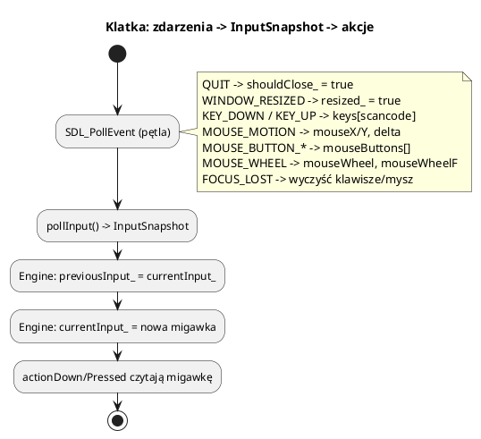

# Platforma: SDL3, okno i wejście

Pliki: `engine/platform/platform.h`, `platform.cpp`, `engine/core/input_actions.h`.

`Platform` to cienka warstwa nad SDL3. Odpowiada za:

* okno i kontekst systemowy (surface Vulkana jest tworzona w `VulkanContext`),
* pętlę zdarzeń (`processEvents`),
* migawkę wejścia (`pollInput`),
* tryb pełnoekranowy, rozmiar okna, minimalizację,
* przechwytywanie kursora (`grabPointer`).

Reszta silnika **nie woła SDL3 bezpośrednio** (poza pojedynczymi miejscami, jak
pushing quit event w przykładach). Dzięki temu wymiana platformy jest ograniczona
do jednego modułu.

---

## 1. Inicjalizacja

`Engine::initialize` tworzy `Platform`, a `Platform`:

1. `SDL_Init(SDL_INIT_VIDEO | SDL_INIT_EVENTS)`,
2. `SDL_CreateWindow(title, width, height, SDL_WINDOW_VULKAN | SDL_WINDOW_RESIZABLE)`,
3. przygotowuje ukryty kursor (do trybu własnego kursora GUI).

Błąd SDL3 kończy się wyjątkiem `std::runtime_error`, który `Engine` łapie i loguje
jako `LOG_CRITICAL`.

---

## 2. Zdarzenia i migawka wejścia



`InputSnapshot` (w `platform.h`):

```cpp
struct InputSnapshot {
    bool keys[256];          // indeks = SDL_Scancode
    int mouseDeltaX, mouseDeltaY;
    bool mouseButtons[5];    // 0 LPM, 1 PPM, 2 środkowy
    int mouseX, mouseY;
    int mouseWheel;          // pełne ząbki (z akumulacją)
    float mouseWheelF;       // dokładna wartość
};
```

Dwie migawki w `Engine` pozwalają odróżnić „trzymany” od „wciśnięty w tej klatce”:

```cpp
if (input.keys[SDL_SCANCODE_W]) { /* trzymany */ }
if (engine.keyPressed(SDL_SCANCODE_W)) { /* pierwszy raz w tej klatce */ }
```

### Kółko myszy

Zawsze używaj `mouseWheelF`:

```cpp
const float wheel = engine.input().mouseWheelF;
if (wheel != 0.0f) cameraDistance *= std::pow(0.9f, wheel);
```

`mouseWheel` (int) akumuluje ułamki i nadaje się tylko do rzeczy „skokowych”.

---

## 3. Akcje wejściowe

`InputActionMap` mapuje nazwę akcji na wiele klawiszy:

```cpp
auto& map = engine.inputActions();
map.clearAll();
map.bindKey("move.forward", SDL_SCANCODE_W);
map.bindKey("move.forward", SDL_SCANCODE_UP);     // alternatywny klawisz
map.bindKey("skok", SDL_SCANCODE_SPACE);

if (engine.actionDown("move.forward")) { /* ... */ }
if (engine.actionPressed("skok"))      { /* ... */ }
```

Zaleta: gra pyta o **intencję** (`move.forward`), a nie o klawisz. Można zmienić
bindingi w ustawieniach bez zmiany kodu logiki.

`InputActionMap` ma tylko trzy rzeczy: `clearAll`, `bindKey`, `isDown`/`wasPressed`.
Nie ma akcji na mysz — do myszy używaj `mouseDown/Pressed/Released`.

---

## 4. Okno i tryby wyświetlania

```cpp
engine.setFullscreen(true);
bool fs = engine.isFullscreen();

engine.setWindowSize(1920, 1080);      // tryb okienkowy, okno wyśrodkowane
uint32_t dw, dh;
engine.getDisplaySize(dw, dh);         // użyteczny obszar ekranu (bez paska zadań)

engine.setPresentMode(PresentMode::Mailbox);
engine.setFrameRateLimit(144);
```

Po `SDL_EVENT_WINDOW_RESIZED` ustawiana jest flaga `resized_`. Renderer sprawdza
ją na początku klatki i przebudowuje swapchain. Nie rób tego ręcznie.

Gdy okno jest zminimalizowane, powierzchnia ma rozmiar 0×0 — renderer **pomija
klatkę** (`isMinimized()`). Bez tego Vulkan zgłosiłby błąd tworzenia swapchaina.

### Przechwytywanie kursora

```cpp
platform->grabPointer(true);   // tryb FPS: kursor schowany i zamknięty w oknie
platform->grabPointer(false);  // tryb GUI: normalny kursor
```

`Engine::run` domyślnie woła `grabPointer(true)`. Gry z GUI przełączają to
zależnie od stanu (menu vs rozgrywka).

---

## 5. Zdarzenia a GUI

Kolejność w klatce:

1. `Platform::processEvents()` aktualizuje surowy stan,
2. `GuiMgr::update(input, platform, screenW, screenH)` (jeśli dodane) konsumuje
   kliknięcia w okna,
3. logika gry sprawdza `isPointerOverGui()` przed reakcją na klik w świat.

Dzięki temu klik w przycisk nie zaznacza jednocześnie jednostki pod spodem.

---

## 6. Minimalna aplikacja bez `Engine`?

Można użyć `Platform` i `VulkanContext` bez `Engine`, ale tracisz pętlę,
scenę i menedżery. Do nauki Vulkan to sensowne; do gry używaj `Engine`.

```cpp
engine3d::Platform platform("test", 800, 600);
while (!platform.shouldClose()) {
    platform.processEvents();
    auto input = platform.pollInput();
    if (input.keys[SDL_SCANCODE_ESCAPE]) break;
    // ... własna logika ...
}
```

---

## 7. Pułapki

* **Pozycja myszy przed pierwszym ruchem to (0, 0).** Przewijanie krawędzią
  ekranu włączaj dopiero po pierwszym `mouseDelta`/ruchu.
* **`SDL_Scancode` vs `SDL_Keycode`.** Silnik używa scancode (fizyczny klawisz,
  niezależny od układu). `bindKey` przyjmuje scancode.
* **Fokus okna.** Przy `WINDOW_FOCUS_LOST` silnik czyści klawisze — inaczej po
  Alt+Tab gracz wraca z „wciśniętym” W.
* **Nie wołaj `pollInput` dwa razy w klatce** — drugie wywołanie może zgubić
  zdarzenia i wyzerować delty.
* **Nie ustawiaj rozmiaru okna co klatkę.** To przebudowuje swapchain i zabija FPS.
