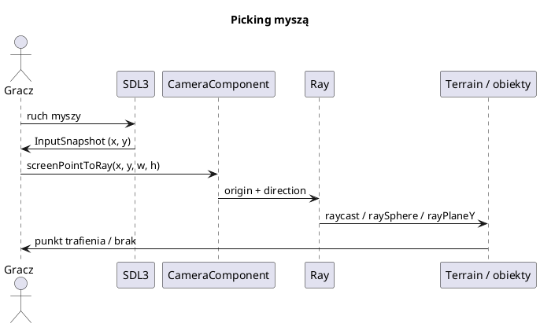

# Kamera, sterowanie i picking

Pliki: `engine/camera/*`.

Kamera w silniku jest **komponentem encji** (`CameraComponent`). Dzięki temu może
być dzieckiem postaci (kamera pierwszoosobowa), jeździć na wieży (kamera RTS) albo
być zupełnie niezależna (kamera debugowa).

## 0. Najważniejsze struktury kamery

| Struktura | Co to jest | Rola |
|---|---|---|
| `CameraComponent` | Komponent kamery | FOV, near/far, target, up, aspect |
| `CameraController` | Kontroler FPS/fly | Yaw/pitch, ruch z tarciem |
| `RtsCameraController` | Kontroler RTS | Orbita wokół focusu, pan/zoom/rotate/tilt |
| `Ray` | Półprosta | Picking myszą i raycast |
| `RenderView` | Macierze klatki | Wynik `CameraExtractionSystem` dla renderera |

Pełny słownik: [00_slownik_pojec.md](00_slownik_pojec.md).

---



---

## 1. `CameraComponent`

```cpp
struct CameraComponent : Component {
    Vec3 target{0, 0, 0};       // punkt patrzenia
    Vec3 up{0, 1, 0};           // wektor "góra"
    float fieldOfViewDegrees = 45.0f;
    float nearPlane = 0.1f;
    float farPlane = 10.0f;
    float aspectRatio = 4.0f / 3.0f;
    bool autoAspect = true;     // Engine co klatkę wpisuje proporcje okna
};
```

Pozycja kamery to `owner->transform().position`. Kierunek to
`normalize(target - position)`.

### Macierz widoku

`getViewMatrix()` robi `lookAt(position, target, up)`. Zamienia współrzędne
świata na przestrzeń kamery (kamera w środku, patrzy w `-Z`).

### Macierz projekcji

`getProjectionMatrix()` robi `perspective(fov, aspect, near, far)`:

* `fov` w stopniach → radiany,
* `aspect = szerokość / wysokość`,
* `near` i `far` definiują zakres głębokości.

> `nearPlane` nie może być 0. `farPlane` musi być większy od `nearPlane`.
> Zbyt duży stosunek `far/near` pogarsza precyzję bufora głębokości (z-fighting).

### `autoAspect`

Jeśli `autoAspect = true`, `Engine::update` co klatkę ustawia `aspectRatio` na
proporcje okna. Robi to **przed** `onUpdate`, żeby picking myszą był poprawny
w tej samej klatce. Ustaw `false`, jeśli renderujesz do tekstury o innych
proporcjach.

---

## 2. Kamera w scenie

```cpp
Entity* camE = scene->createEntity("kamera");
CameraComponent* cam = camE->addComponent<CameraComponent>();
camE->transform().position = {0, 30, -60};
cam->target = {0, 0, 0};
cam->fieldOfViewDegrees = 55.0f;
cam->farPlane = 5000.0f;

scene->setActiveCamera(cam);
```

Tylko jedna kamera na scenę jest aktywna. `CameraExtractionSystem` zamienia ją
na `RenderView` (macierze + wektory `cameraRight`/`cameraUp` + pozycję).

---

## 3. `CameraController` — kamera swobodna (FPS/fly)

`CameraController` trzyma własne `yaw`/`pitch` i prędkości, a `update` wpisuje
pozycję/target do `CameraComponent`.

```cpp
CameraController* ctrl = engine.getCameraController();
ctrl->setPositionAndTarget({0, 5, -10}, {0, 0, 0});
ctrl->moveSpeed = 12.0f;
ctrl->mouseSensitivity = 0.2f;

engine.onUpdate = [ctrl](float dt, Engine& e) {
    const InputSnapshot& in = e.input();
    ctrl->rotateYaw(in.mouseDeltaX * ctrl->mouseSensitivity);
    ctrl->rotatePitch(in.mouseDeltaY * ctrl->mouseSensitivity);
    if (e.actionDown("move.forward")) ctrl->moveForward(ctrl->moveSpeed * dt);
    ctrl->update(dt, *e.getSceneManager()->activeScene()->activeCamera());
};
```

Cechy:

* `pitch` ograniczony do `[-89°, 89°]` (brak gimbal lock),
* ruch z tarciem (`friction`) — płynne hamowanie,
* `moveForward/moveRight/moveUp` zmieniają prędkość, nie pozycję.

### `FlyCamera` — gotowy zestaw

```cpp
FlyCamera::bindDefaultKeys(engine.inputActions());   // W/S/A/D, spacja, Ctrl

engine.onUpdate = [](float dt, Engine& e) {
    FlyCamera::update(e, dt, 15.0f);                 // obrót myszą + ruch
};
```

`FlyCamera` to cienka warstwa: mapuje akcje `move.*` i woła `CameraController`
dla aktywnej kamery sceny. Idealna do zwiedzania sceny (przykład `03_flyaround`).

---

## 4. `RtsCameraController` — kamera strategiczna

Kamera orbituje wokół punktu na ziemi (`focus`):

* **pan** — przesuwanie focusu w XZ (`pan(right, forward)`),
* **zoom** — `zoom(steps)` (dodatnie przybliża),
* **rotate** — obrót wokół Y (`rotate(deg)`),
* **tilt** — kąt nachylenia (`tilt(deg)`),
* **moveTo** — płynny przelot.

Wszystkie wartości docelowe są wygładzane wykładniczo (`smoothing`).

```cpp
RtsCameraController rts;
rts.setFocus({0, 0, 0});
rts.setDistance(120.0f);
rts.setPitch(55.0f);

rts.groundHeight = [terrain](float x, float z) { return terrain->getHeight(x, z); };

engine.onUpdate = [&](float dt, Engine& e) {
    const auto& in = e.input();
    rts.pan(in.mouseDeltaX * 0.5f, -in.mouseDeltaY * 0.5f);
    rts.zoom(in.mouseWheelF);
    if (e.actionDown("rotate.left"))  rts.rotate(-60.0f * dt);
    if (e.actionDown("rotate.right")) rts.rotate( 60.0f * dt);
    rts.update(dt, *e.getSceneManager()->activeScene()->activeCamera());
};
```

Parametry: `minDistance`, `maxDistance`, `minPitch`, `maxPitch`,
`zoomStepFactor`, `smoothing`, `minClearance`, `boundsMin/Max`.
`groundHeight` (opcjonalne) trzyma focus na wysokości terenu.

`RtsCameraController` jest używany w `10_settlers` (kamera osady).

---

## 5. Picking myszą

Plik: `camera/camera_picking.h`. Cztery funkcje:

```cpp
Ray screenPointToRay(const CameraComponent& cam, float px, float py, float sw, float sh);
bool worldToScreen(const CameraComponent& cam, const Vec3& world, float sw, float sh,
                   float& outX, float& outY);
bool rayPlaneY(const Ray& ray, float planeY, Vec3& outHit);
bool raySphere(const Ray& ray, const Vec3& center, float radius, float& outT);
```

### Promień z kamery

`screenPointToRay` **nie odwraca macierzy projekcji**. Liczy kierunek z FOV
i proporcji:

```text
ndcX = (2*px / sw) - 1
ndcY = 1 - (2*py / sh)
dir  = forward + right * ndcX * tan(fov/2) * aspect + up * ndcY * tan(fov/2)
```

To jest szybkie i stabilne. Współrzędne piksela liczone są od **lewego górnego**
rogu (jak w SDL/GUI).

### Trafienie w teren

```cpp
const auto& in = engine.input();
Ray ray = screenPointToRay(*camera, in.mouseX, in.mouseY,
                           (float)renderer->width(), (float)renderer->height());

Vec3 hit;
if (terrain->raycast(ray, 5000.0f, hit)) {
    // hit = punkt na powierzchni terenu
}
```

`Terrain::raycast` to ray marching + bisekcja (szczegóły: [19_teren.md](19_teren.md)).

### Trafienie w płaszczyznę

```cpp
Vec3 ground;
if (rayPlaneY(ray, 0.0f, ground)) {
    // punkt na płaszczyźnie y = 0 (np. dla gier bez terenu)
}
```

### Zaznaczanie ramką

```cpp
// dla każdej jednostki:
float sx, sy;
if (worldToScreen(*camera, unitPos, (float)w, (float)h, sx, sy)) {
    if (sx >= x0 && sx <= x1 && sy >= y0 && sy <= y1) zaznacz(unit);
}
```

`worldToScreen` zwraca `false`, gdy punkt jest **za kamerą** — wtedy nie ma
sensownego współrzędnego ekranu.

---

## 6. Typowe błędy

* **Zapomniany `setActiveCamera`** → brak `RenderView` → czarny ekran.
* **`farPlane` za mały** → obiekty znikają. Dla dużych map ustaw np. 5000–10000.
* **`nearPlane` za mały przy dużym `far`** → z-fighting (migające powierzchnie).
* **Mysz w GUI i w świecie naraz** → sprawdzaj `gui.isPointerOverGui()`.
* **Pozycja myszy (0,0) na starcie** → nie włączaj przewijania krawędzią ekranu,
  dopóki nie było ruchu myszy.
* **Kamera RTS „przebija” teren** → ustaw `groundHeight` i `minClearance`.
