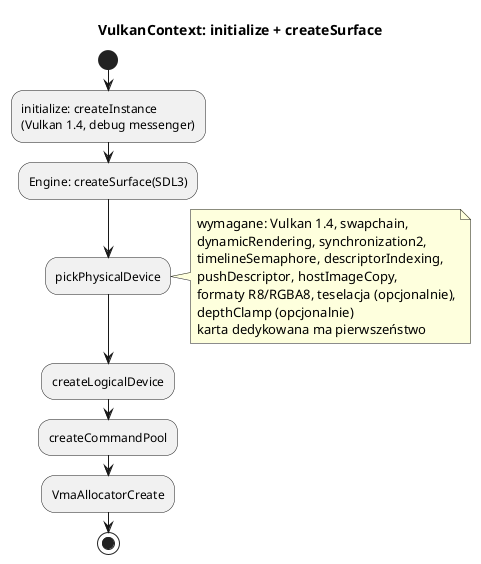

# Backend Vulkan 1.4

Pliki: `engine/render/backend/*`, `engine/render/vulkan_util.*`,
`engine/render/pipeline_builder.*`.

Silnik wymaga **Vulkan 1.4** i używa jego funkcji wprost — nie ma ścieżek
zapasowych dla 1.3. To świadoma decyzja edukacyjna: jeden nowoczesny sposób,
mniej kodu, mniej błędów.

Jeśli uczysz się tych pojęć, zacznij od
[Vulkan od podstaw](27_vulkan_od_podstaw.md): CPU/GPU, swapchain, sloty klatek,
fence/semafory, dobór barier, deskryptory i bindless. Poniżej jest opis API
i organizacji backendu w tym repozytorium.

---

## 0. Struktury backendu — co to jest

| Struktura | Co to jest | Do czego służy |
|---|---|---|
| `VulkanContext` | Właściciel instancji, karty, urządzenia, kolejek i VMA | Wybiera GPU, tworzy surface/device, udostępnia uchwyty |
| `VulkanSwapchain` | Zestaw obrazów koloru + głębi | `acquireNextImage`/`present`, przebudowa po resize |
| `VulkanBuffer` | Bufor + alokacja VMA (RAII) | `upload` dla host-visible, staging dla `DEVICE_LOCAL` |
| `ImageBarrier` | Opis jednej bariery synchronization2 | Czytelne przejścia layoutu i zależności etapów |
| `TextureUploadData` | Zdekodowane piksele, format, regiony kopiowania | Wynik loadera tekstur, wejście uploadu |
| `GraphicsPipelineBuilder` | Helper tworzący `VkPipeline` | Podajesz tylko różnice od domyślnych ustawień |
| `ShaderModule` | RAII na moduł SPIR-V | Ładuje `.spv` i zwalnia go po zbudowaniu potoku |
| `VulkanPipeline` | Para `VkPipeline` + `VkPipelineLayout` | Gotowy potok, który binduje `MaterialInstance` |

### `GraphicsPipelineBuilder` — co to właściwie jest

To **nie jest obiekt rysowany co klatkę** ani menedżer zasobów. To helper
używany **raz, przy tworzeniu potoku**. Potok graficzny (`VkPipeline`) jest
niezmiennym opisem całego stanu rysowania: shaderów, formatu wierzchołków,
topologii, rasteryzacji, testu głębokości, blendingu i formatów celów.
W czystym Vulkanie to ~120 linii struktur, w których łatwo pominąć pole.

Builder:

* ustawia rozsądne wartości domyślne (trójkąty, cull BACK, depth LESS,
  dynamiczny viewport/scissor, brak blendingu),
* pozwala dopisać tylko to, co wyjątkowe (np. `depthClamp`, `BlendMode::Alpha`,
  teselacja, drugi bufor wierzchołków),
* może zbudować kilka wariantów z tego samego kodu (cień słońca i cień światła
  lokalnego),
* żyje tylko w funkcji `create*Pipeline` — po `build()` można go zniszczyć.

Czego nie robi: nie alokuje pamięci, nie tworzy deskryptorów, nie binduje
potoku i nie nagrywa komend. `VkPipeline` trzeba jawnie zniszczyć w `cleanup`.

Powiązania:

```text
ShaderModule ─┐
vertex input  ├──> GraphicsPipelineBuilder ──> VkPipeline ──> VulkanPipeline
stany/formaty ┘                                              (pipeline + layout)
                                                                    │
                                                          MaterialCompiler (cache)
                                                                    │
                                                          MaterialInstance (bind)
```

---

## 1. Inicjalizacja



`initialize` loguje używaną wersję API i powód pominięcia każdej karty. Gdy
zabraknie Vulkan 1.4, program kończy się czytelnym błędem, a nie losowym
crash em.

### Włączane cechy

| Cecha | Do czego |
|---|---|
| `dynamicRendering` | `vkCmdBeginRendering` zamiast `VkRenderPass`/framebufferów |
| `synchronization2` | bariery `vkCmdPipelineBarrier2`, czytelne etapy/dostępy |
| `timelineSemaphore` | tryb synchronizacji `Timeline` |
| `descriptorIndexing` | tablica tekstur bindless (1024 sloty) |
| `pushDescriptor` | deskryptory podawane w buforze komend (G-Buffer, GUI) |
| `hostImageCopy` | kopiowanie pikseli z CPU prosto do obrazu (mgła wojny, minimapa) |
| teselacja | teren (opcjonalna, sprawdzana) |
| `depthClamp` | kaskady słońca (opcjonalny) |

---

## 2. Swapchain i klatki w locie

`VulkanSwapchain` trzyma obrazy koloru i osobne obrazy głębokości (jeden na
obraz swapchaina). `Renderer` ma `kMaxFrames = 3` klatki w locie.

```text
CPU przygotowuje klatkę N+2, GPU rysuje N, prezentacja pokazuje N-1
```

Dzięki temu CPU nie czeka na GPU po każdej klatce. `vkWaitForFences` czeka tylko
na klatkę, której slot chcemy ponownie użyć.

Po zmianie rozmiaru okna `recreateSwapChain` niszczy i tworzy swapchain oraz
obrazy zależne (G-Buffer, kopia sceny). Nie rób tego w trakcie nagrywania komend.

---

## 3. Synchronizacja

Trzy tryby (`SynchronizationMode`):

| Tryb | Mechanizm | Uwagi |
|---|---|---|
| `Standard` | binarny semafor + fence | klasyka, domyślny |
| `Timeline` | semafor timeline z wartością | CPU czeka na numer zakończonej pracy slotu |
| `Off` | obecnie ta sama ścieżka fence co `Standard` | nazwa opcji nie oznacza wyłączenia czekania w aktualnym `render()` |

W `Standard`:

* `imageAvailableSemaphores_[frame]` — sygnalizowany przez `acquireNextImage`,
* `renderFinishedSemaphores_[imageIndex]` — sygnalizowany po rysowaniu,
  **per obraz swapchaina** (nie per klatka; prezentacja może jeszcze używać
  semafora poprzedniej klatki),
* `inFlightFences_[frame]` — CPU czeka przed ponownym użyciem slotu.

W `Timeline` zamiast fence używany jest `vkWaitSemaphores` z wartością
monotoniczną. Implementacja ma semafor timeline na slot klatki; binarny
semafor prezentacji jest per obraz.

---

## 4. Pamięć — VMA i `VulkanBuffer`

Silnik używa **Vulkan Memory Allocator (VMA)**. `VulkanBuffer`:

```cpp
VulkanBuffer buf(context, size, usage, properties);
buf.upload(dane, size);   // tylko dla host-visible
```

* `DEVICE_LOCAL` — pamięć lokalna urządzenia. Statyczne siatki silnika są
  wypełniane przez staging. Sam ten bit nie wyklucza `HOST_VISIBLE` na sprzęcie,
  który udostępnia obie właściwości jednocześnie.
* `HOST_VISIBLE | HOST_COHERENT` — CPU mapuje bezpośrednio. Używana do UBO i
  siatek zmienianych co klatkę (`updateMesh`).

`VmaAllocator` dobiera typ pamięci i dzieli duże bloki dla zasobów używających
VMA. Część obrazów silnika, np. głębia swapchaina, nadal jest alokowana ręcznie.
Przy rozszerzaniu kodu zachowaj zgodność sposobu alokacji i zwalniania.

---

## 5. Bariery (synchronizacja 2)

Zamiast ręcznych `VkImageMemoryBarrier` jest `vk::ImageBarrier` z nazwanymi polami:

```cpp
vk::imageBarrier(cmd, {
    .image     = img,
    .oldLayout = VK_IMAGE_LAYOUT_UNDEFINED,
    .newLayout = VK_IMAGE_LAYOUT_COLOR_ATTACHMENT_OPTIMAL,
    .srcStage  = VK_PIPELINE_STAGE_2_NONE,
    .srcAccess = VK_ACCESS_2_NONE,
    .dstStage  = VK_PIPELINE_STAGE_2_COLOR_ATTACHMENT_OUTPUT_BIT,
    .dstAccess = VK_ACCESS_2_COLOR_ATTACHMENT_WRITE_BIT,
});
```

Bariera mówi: „zanim etap `dstStage` zacznie `dstAccess`, muszą skończyć się
zapisy `srcAccess` z etapów `srcStage`; przy okazji zmień układ obrazu”.
Pola czyta się jak zdanie — to główna zaleta synchronization2.

Wiele obrazów naraz: `vk::imageBarriers(cmd, tablica, count)` — jedno polecenie.
Bufory: `vk::memoryBarrier(cmd, srcStage, srcAccess, dstStage, dstAccess)`.

### Najczęstsze przejścia

| Z | Do | Kiedy |
|---|---|---|
| `UNDEFINED` | `COLOR_ATTACHMENT_OPTIMAL` | pierwsze użycie obrazu w klatce (clear) |
| `COLOR_ATTACHMENT_OPTIMAL` | `SHADER_READ_ONLY_OPTIMAL` | G-Buffer po zapisie, przed deferred |
| `COLOR_ATTACHMENT_OPTIMAL` | `TRANSFER_SRC_OPTIMAL` | kopia koloru sceny |
| `DEPTH_STENCIL_ATTACHMENT_OPTIMAL` | `DEPTH_STENCIL_READ_ONLY_OPTIMAL` | przezroczyste/ocean próbkują głębię |
| `TRANSFER_DST_OPTIMAL` | `SHADER_READ_ONLY_OPTIMAL` | tekstura po kopii |

---

## 6. Push descriptors

W Vulkanie 1.4 deskryptory można podać **wprost w buforze komend**, bez puli i
setów na każdą klatkę:

```cpp
VkDescriptorImageInfo images[4] = { ... };
vk::pushImageSamplers(cmd, layout, /*set*/ 1, images, 4);
vkCmdDraw(cmd, 3, 1, 0, 0);
```

Stosowane w:

* przebiegu deferred — 4 tekstury G-Buffera + mapa cieni,
* GUI — biała tekstura 1×1 / obrazek.

Layout potoku musi mieć flagę
`VK_DESCRIPTOR_SET_LAYOUT_CREATE_PUSH_DESCRIPTOR_BIT`. Nie ma `vkUpdateDescriptorSets`
ani `vkCmdBindDescriptorSets` na obiekt.

---

## 7. Bindless

Set 0 jest wspólny dla wszystkich shaderów:

* `b0` — UBO klatki (`GlobalUBO` z `renderer_impl.h`),
* `s1`/`t1` — sampler + tablica tekstur (`textures[]`),
* binding 2 — tablica map cieni (forward, tekstura i sampler porównujący).

Materiał przekazuje **indeksy** do `textures[]` w push constants. Dzięki temu
jeden set obsługuje wszystkie tekstury i nie trzeba rebindować deskryptorów
między obiektami. Limit: `kMaxBindlessTextures = 1024`.

Tekstury dołączane są w `Renderer::registerTextureInBindless`; podmiana w locie
używa `queueDescriptorWrite` (per klatka), a stare obrazy trafiają do
`retireTexture` (zwalniane po `kMaxFrames`).

---

## 8. `GraphicsPipelineBuilder`

Ręczne wypełnianie `VkGraphicsPipelineCreateInfo` to ~120 linii. Builder podaje
sensowne domyślne wartości:

* `TRIANGLE_LIST`, wypełnianie, cull BACK, przód CCW,
* test i zapis głębokości `LESS` (gdy podano format),
* brak blendingu, brak MSAA,
* viewport i scissor jako stan dynamiczny.

```cpp
const vk::ShaderModule vert(device, "bin/assets/shaders/skybox/skybox.vert.spv");
const vk::ShaderModule frag(device, "bin/assets/shaders/skybox/skybox.frag.spv");

layout_ = vk::createPipelineLayout(device, {descriptorSetLayout}, sizeof(Push),
                                   VK_SHADER_STAGE_VERTEX_BIT | VK_SHADER_STAGE_FRAGMENT_BIT,
                                   "skybox");

pipeline_ = vk::GraphicsPipelineBuilder()
    .shaders(vert, frag)
    .vertexInput(Vertex::bindingDescription(),
                 vk::filterVertexAttributes(vert.code(), Vertex::attributeDescriptions()))
    .topology(VK_PRIMITIVE_TOPOLOGY_TRIANGLE_STRIP)
    .cull(VK_CULL_MODE_NONE)
    .depth(true, false, VK_COMPARE_OP_LESS_OR_EQUAL)
    .colorFormat(colorFormat)
    .depthFormat(depthFormat)
    .build(device, layout_, "skybox");
```

`filterVertexAttributes` usuwa z opisu atrybuty, których shader nie czyta
(kompilator je wyciął) — inaczej walidacja zgłasza ostrzeżenia wydajnościowe.

Mieszanie: `vk::BlendMode::Opaque/Alpha/Premultiplied/Additive` albo
`customBlend`. Teselacja: `.patches(3)` + etapy hull/domain przez `.shader(...)`.
Drugi bufor wierzchołków (kości, instancje) — kolejne `.vertexInput`.

Ten sam builder można zbudować dwa razy (np. mapy cieni: wariant świateł
lokalnych bez `depthClamp` i słońca z `depthClamp`).

---

## 9. Kopiowanie z CPU (hostImageCopy)

Zamiast staging + `vkCmdCopyBufferToImage` + `vkQueueWaitIdle`:

```cpp
vk::hostTransitionToCopyLayout(device, image);
vk::hostCopyToImage(device, image, pixels, width, height);
```

Wymaga `VK_IMAGE_USAGE_HOST_TRANSFER_BIT` i układu `vk::hostCopyLayout()`.
Używane przez mgłę wojny i obrazki GUI (minimapa). Obraz nie może być w tym
momencie czytany przez GPU — dlatego mgła ma osobną kopię na każdą klatkę
w locie.

---

## 10. Walidacja i debugowanie

* W Release walidacja jest **wyłączona** (zjadała ~90% czasu klatki na CPU).
* Po zmianach w rendererze uruchom:

```bash
ENGINE_VALIDATION=1 ./bin/06_terrain_example
```

* `ENGINE_VALIDATION=0` wyłącza walidację nawet w Debug.
* Komunikaty walidacji trafiają do `Logger` (poziom ERROR/WARN).
* `ENGINE_PROFILE=1` pokazuje czasy sekcji klatki ([05_narzedzia_core.md](05_narzedzia_core.md)).

---

## 11. Pułapki

* **Zły `oldLayout`** — walidacja zgłasza błąd, a obraz może zawierać śmieci.
  Przy pierwszym użyciu w klatce używaj `UNDEFINED` tylko wtedy, gdy zawartość
  ma być wyczyszczona.
* **Brak udostępnienia wcześniejszego zapisu** — przy zależności zapis → odczyt
  dobierz `srcAccess` i `dstAccess`. Pusta maska bywa poprawna dla samej
  zależności wykonania albo braku poprzedniego użycia; zobacz [27](27_vulkan_od_podstaw.md).
* **Niszczenie zasobów w trakcie klatki** — zawsze `waitIdle` albo kolejka emerytów.
* **Włączenie `depthClamp` na mapach cieni świateł lokalnych** — psuje
  obcinanie w tym wariancie perspektywicznym; używamy go tylko dla kaskad słońca.
* **Teselacja bez sprawdzenia wsparcia** — pytaj `isTessellationSupported()`;
  shadery terenu mają wariant bez teselacji.
