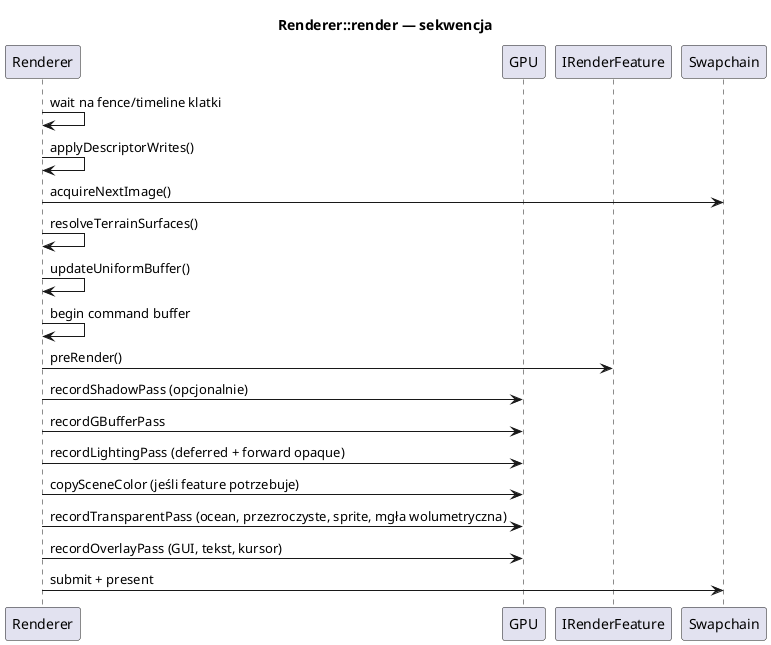

# Renderer i przebiegi klatki

Pliki: `engine/render/renderer.h`, `renderer_impl.h` (prywatny),
`renderer_core.cpp`, `renderer_shadow_pass.cpp`, `renderer_gbuffer_pass.cpp`,
`renderer_deferred_pass.cpp`, `renderer_scene_copy.cpp`,
`renderer_overlay_pass.cpp`, `renderer_textures.cpp`, `renderer_fog_of_war.cpp`.

Renderer to **fasada** (`Renderer`) + **jedna implementacja**
(`Renderer::RendererImpl`). Klasa jest jedna, bo przebiegi dzielą zasoby
(G-Buffer, mapy cieni, UBO, deskryptory), ale metody są rozłożone po plikach
według przebiegów.

Wyjaśnienie idei deferred, PBR, kaskad cieni, PCF i normal mappingu:
[29_algorytmy_silnika.md](29_algorytmy_silnika.md).

---

## 1. Wejście renderera

```cpp
renderer->render(const RenderScene& scene, const RenderView& view);
```

* `RenderScene` — paczki geometrii (`opaquePackets`, `transparentPackets`,
  `shadowOnlyPackets`) + referencje do paczek rzucających cień,
* `RenderView` — `view`, `projection`, `cameraPosition`, `cameraRight`, `cameraUp`.

Renderer nie zna `Scene`, `Entity` ani `CameraComponent`. Dzięki temu jest
testowalny i można go użyć do drugiego widoku (np. minimapy).

---

## 0. Struktury, które dostaje renderer

| Struktura | Co to jest | Rola |
|---|---|---|
| `RenderScene` | Paczki geometrii jednej klatki | Listy opaque/transparent/shadowOnly + refy casterów |
| `RenderView` | Macierze i baza kamery | `view`, `projection`, `cameraPosition`, `cameraRight/Up` |
| `RenderPacket` | Spłaszczona paczka rysowania | Bufory, transformacja, materiał, indeksy tekstur, flagi |
| `TerrainSurface` | Wspólne dane powierzchni terenu | Warstwy/maski/wysokość dzielone przez paczki |
| `IRenderFeature` | Dodatek do potoku | `preRender/render`, etap, `needsSceneColor` |
| `IRenderPass` | Przebieg geometrii | `OpaquePass`, `TransparentPass`, `TransparentDepthPrepass` |
| `GlobalUBO` | Dane klatki dla shaderów (wewnętrzna) | Macierze, światła, cienie, mgła, wiatr |
| `LightData` | Światło w formacie GPU (wewnętrzna) | Pozycja, kierunek, kolor, stożek, warstwa cienia |
| `ShadowCaster` | Światło rzucające cień (wewnętrzna) | Kaskada/atlas i liczba warstw |

`Scene` (z ECS) to **świat gry**; `RenderScene` to **lista rzeczy do narysowania
w tej klatce**. Renderer dostaje tylko to drugie.

Pełny słownik: [00_slownik_pojec.md](00_slownik_pojec.md).

---

## 2. Kolejność i zależności



Dlaczego tak:

1. **Cienie przed G-Bufferem** — deferred próbkuje mapy cieni.
2. **G-Buffer przed deferred** — deferred czyta 4 tekstury.
3. **Kopia sceny po deferred, przed oceanem** — ocean czyta kolor i głębię.
4. **Nakładka na końcu** — GUI ma własny wyczyszczony depth i ma być na wierzchu.

---

## 3. Cienie (`renderer_shadow_pass.cpp`)

Jedna **tablica tekstur głębokości** `D32` o wymiarach `2048×2048`,
`kShadowLayerCount = 5` warstw:

| Warstwa | Zawartość |
|---|---|
| 0–3 | 4 kaskady słońca (pierwsze światło kierunkowe) |
| 4 | atlas 2×2 dla 4 świateł lokalnych (każde ćwiartka 1024×1024) |

Dzięki temu zamiast 16 świateł × 4 warstwy (~1 GB VRAM) mamy ~80 MB.

`assignShadowSlots(cameraPos)` wybiera:

* słońce — dostaje 4 kaskady, zawsze,
* światła lokalne (point/spot) — do 4 najbliższych kamerze, których zasięg
  sięga obszaru cieni,
* pozostałe świecą, ale bez cienia (`position.w = -1`).

Kaskady słońca:

* `computeCascadeSplits` — mieszanka podziału logarytmicznego i równomiernego
  (`splitLambda`),
* `updateVisibleDepthRange` — zakres głębokości, w którym kamera widzi geometrię
  (z granic paczek); kamera wysoko nad terenem nie marnuje kaskad na pustkę,
* `buildDirectionalCascadeMatrix` — ortograficzna macierz z przycięciem do siatki
  tekseli (stabilizacja cieni, brak migotania).

Potoki cieni:

* zwykłe siatki i animowane (`shadow_depth`, `shadow_depth_skinned`),
* teren teselowany (`terrain_shadow`) — ta sama teselacja i wysokość co na ekranie,
* wariant słońca ma `depthClamp`, wariant lokalny nie (perspektywa).

---

## 4. G-Buffer (`renderer_gbuffer_pass.cpp`)

Cztery tekstury koloru + głębia swapchaina:

| Załącznik | Format | Zawartość |
|---|---|---|
| 0 | `RGBA16F` | albedo RGB + metaliczność A |
| 1 | `RGBA16F` | normalna świata (zakodowana 0..1) + chropowatość A |
| 2 | `RGBA16F` | AO w R + emisja GBA |
| 3 | `RGBA32F` | pozycja świata XYZ + maska W=1 |

**Dlaczego pozycja w 32 bitach?** `RGBA16F` ma 11 bitów mantysy; przy
współrzędnych ~300 krok to 0,25 jednostki. Cienie liczone z takiej pozycji miały
regularne paski (shadow acne) niezależnie od biasu. 32-bitowy float rozwiązuje
problem.

Geometria nieprzezroczysta (`MaterialCompiler::writesGBuffer`) zapisuje G-Buffer.
Kolejność rysowania:

* grupa 0 — zwykłe siatki (sortowane po pierścieniach odległości, potem po
  potoku, żeby ograniczyć zmiany stanu),
* grupa 1 — animowane (skinning),
* grupa 2 — własny materiał zapisujący G-Buffer (teren z teselacją).

Po przebiegu G-Buffer przechodzi w `SHADER_READ_ONLY_OPTIMAL`.

`RenderPacket` niesie m.in. `gbufferMaterialPass`, `forwardOpaquePass`,
`castShadows`, `shadowOnly`, `hasBounds`. `shadowOnly` pozwala rzucić cień
obiektem, którego nie widać na ekranie (np. wzgórze za kamerą).

---

## 5. Deferred (`renderer_deferred_pass.cpp`)

Pełnoekranowy trójkąt (bez bufora wierzchołków — pozycje z `SV_VertexID`):

1. próbkuje 4 tekstury G-Buffera,
2. odtwarza `SurfaceData` (albedo, metal, roughness, AO, emisja, normalna, worldPos),
3. woła `shadeSurface` (PBR, światła, cienie) i `applyAtmosphere` (mgła, mgła wojny),
4. zapisuje kolor na swapchain.

Mapa cieni jest w **secie 1** (push descriptors). Forward opaque (jeśli jest)
rysuje się w tym samym przebiegu.

Oświetlenie widocznej powierzchni jest liczone w pełnoekranowym przebiegu,
po wybraniu geometrii zapisanej w G-Bufferze. Shader nadal wykonuje pętlę
po światłach (do 16), więc koszt rośnie z ich liczbą. Zysk deferred polega
na ograniczeniu powtarzania pełnego oświetlenia dla zasłoniętych powierzchni.

---

## 6. Kopia sceny (`renderer_scene_copy.cpp`)

Wykonywana tylko, gdy jakiś aktywny feature ma `needsSceneColor() == true`
(np. ocean). Kopiuje:

* kolor swapchaina → `sceneColorImages_[frame]`,
* głębię → układ `DEPTH_STENCIL_READ_ONLY_OPTIMAL` (próbkowana przez ocean).

Brak oceanu = brak kopii = oszczędność ~8 MB na klatkę przy 1080p.

---

## 7. Przezroczyste i ocean (`renderer_overlay_pass.cpp`)

Część 2 klatki:

* głębia jest tylko do odczytu (test głębokości, bez zapisu),
* rysowane są materiały `blendMode != Disabled`,
* ocean (`IRenderFeature`, `AfterTransparent`) czyta kopię koloru i głębi,
* sprite'y i cząsteczki (jeśli używają forward).

Sortowanie przezroczystych: od najdalszego do najbliższego (`distanceToCamera`),
potem `renderPriority`. Materiały z `depthPrepass = true` najpierw zapisują
głębokość w części 1, dzięki czemu złożony model nie pokazuje wnętrza warstwami.

---

## 8. Nakładka (`renderer_overlay_pass.cpp`)

Część 3:

* własny, wyczyszczony bufor głębokości (GUI ma być zawsze na wierzchu),
* `IRenderFeature` ze `Stage::Overlay`: `GuiMgr`, `TextOverlayRenderer`,
* kursor (feature GUI).

Kolejność feature'ów w overlay jest odwrócona (`rbegin`), żeby ostatnio dodany
był rysowany pierwszy (spójne z „na wierzchu”).

---

## 9. `IRenderFeature` — rozszerzanie potoku

```cpp
class MojaMgla : public engine3d::IRenderFeature {
public:
    void init(engine3d::Renderer* r) override { /* utwórz potoki */ }
    void render(VkCommandBuffer cmd, uint32_t frame, const engine3d::RenderView& v) override {
        if (!isActive()) return;
        // nagraj rysowanie
    }
    bool isActive() const override { return wlaczona_; }
    const std::string& getName() const override { static std::string n = "MojaMgla"; return n; }
    Stage getStage() const override { return Stage::AfterTransparent; }
    bool needsSceneColor() const override { return false; }
};
```

Etapy:

| Stage | Kiedy |
|---|---|
| `BeforeOpaque` | niebo (skybox/skydome) — tło, zanim narysuje się geometria |
| `AfterOpaque` | siatka, obiekty po deferred |
| `AfterTransparent` | ocean, mgła wolumetryczna |
| `Overlay` | GUI, tekst, kursor |

`preRender` służy do rzeczy przed wszystkimi przebiegami (np. upload obrazków GUI).
`needsSceneColor` decyduje o kopii koloru sceny.

---

## 10. `RenderPacket` i `DrawBindCache`

`RenderPacket` (skrót; pełna definicja w `render/render_types.h`):

```cpp
struct RenderPacket {
    VkBuffer vertexBuffer, indexBuffer, skinVertexBuffer, instanceBuffer;
    uint32_t indexCount, instanceCount;
    Matrix4 transform;
    std::shared_ptr<MaterialInstance> material;
    uint32_t diffuseTextureIndex, normalTextureIndex, ...;
    std::shared_ptr<TerrainSurface> terrain;
    float distanceToCamera;
    bool forwardOpaquePass, gbufferMaterialPass, castShadows, shadowOnly;
    bool hasBounds; Vec3 boundsMin, boundsMax;
};
```

`packet_draw.h` (`DrawBindCache`) pamięta ostatnio zbindowany potok, bufor
wierzchołków, indeksów i deskryptory. Jeśli kolejna paczka używa tego samego,
nie woła `vkCmdBind*` ponownie. To ważne przy tysiącach obiektów.

Push constants materiału: `push_constants.h` (`MaterialPushConstants`, 240 B).
Układ **musi** się zgadzać z `assets/shaders/shared/material_push.hlsl` —
`static_assert` pilnuje rozmiaru.

---

## 11. Mgła wojny (`renderer_fog_of_war.cpp`)

* tekstura `R8` `kFogOfWarSize × kFogOfWarSize` (256×256),
* osobna kopia na każdą klatkę w locie (hostImageCopy),
* dane z CPU wgrywane na początku klatki, po fence tej klatki,
* indeks w tablicy bindless w UBO (`fowTextureIndex`),
* shadery czytają `fogOfWarVisibility()` w `applyAtmosphere`.

Wartości: 0 = nieodkryte, 128 = odkryte, 255 = widoczne. Szczegóły:
[17_mgly.md](17_mgly.md).

---

## 12. Profilowanie przebiegów

`ENGINE_PROFILE=1` daje:

```text
[profil] klatka 16.4 ms | update 9.1 | gra 8.3 | render.cienie 2.0 |
         render.gbuffer 1.1 | render.deferred 2.3 | render.przezr. 0.4 |
         render.submit 0.2 | render.present 0.1
```

Gdy klatka jest wolna, patrz najpierw na `render.cienie` i `render.deferred`
(liczba świateł, rozmiar G-Buffera, rozdzielczość cieni), potem na `update`.

---

## 13. Pułapki

* **Nie dodawaj świateł ponad `kMaxLights = 16`** — nadmiar jest cicho ignorowany.
* **`depthClamp` tylko dla kaskad słońca** — w perspektywie psuje obcinanie.
* **Pozycja świata w G-Bufferze musi być `RGBA32F`** — inaczej shadow acne.
* **Cienie terenu muszą używać tej samej teselacji i wysokości** co ekran
  (`shared/terrain_height.hlsl`), inaczej pojawią się „cienie znikąd”.
* **Nie kopiuj oświetlenia do shaderów** — wszystko idzie przez
  `shared/surface_lighting.hlsl`.
* **Zmiana formatu załącznika** wymaga zmiany `gbufferAttachmentFormat`,
  potoku G-Buffera i shaderów — trzymaj to w jednym miejscu.
