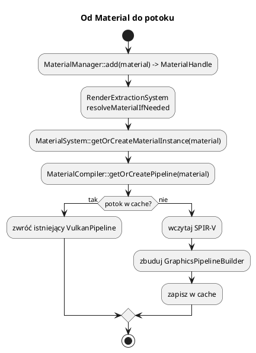

# Materiały, potoki i shadery

Pliki: `engine/core/types.h` (`Material`), `engine/render/material_manager.*`,
`material_system.*`, `material_compiler.*`, `base_material_instance.*`,
`shader_hot_reload.*`, `assets/shaders/`.

Materiał opisuje **jak powierzchnia wygląda i jak reaguje na światło**.
W silniku są dwie warstwy:

* `Material` — dane (kolor, tekstury, blending, głębokość...),
* `MaterialInstance` — gotowy potok Vulkan + sposób bindowania.

---

## 0. Najważniejsze struktury materiałów

| Struktura | Co to jest | Rola |
|---|---|---|
| `Material` | Dane materiału (PBR, mapy, blending, głębokość) | Opis wyglądu powierzchni |
| `MaterialManager` | Rejestr `Material` | `add`, `get`, `require`, `handle` |
| `MaterialInstance` | Interfejs instancji | `bind`, `getPipeline`, gettery tekstur |
| `BaseMaterialInstance` | Konkretna instancja | Trzyma dane i pyta kompilator o potok |
| `MaterialSystem` | Cache instancji | `getOrCreateMaterialInstance`, unieważnianie |
| `MaterialCompiler` | Kompilator i cache potoków | Klucz `PipelineKey` → `VulkanPipeline` |
| `GraphicsPipelineBuilder` | Helper tworzenia `VkPipeline` | Podajesz tylko różnice od domyślnych ustawień |
| `MaterialPushConstants` | 240 B danych obiektu | Macierz, kolory, PBR, indeksy tekstur |
| `TextureHandle` | Uchwyt tekstury | Pośrednio indeks w tablicy bindless |

Pełny słownik: [00_slownik_pojec.md](00_slownik_pojec.md).

---

## 1. `Material` — dane

```cpp
struct Material {
    std::string name;
    std::string shaderProgram;        // "default", "terrain", "vegetation", ...

    TextureHandle textureHandle;      // albedo
    TextureHandle normalMapHandle;
    TextureHandle metallicRoughnessTextureHandle;
    TextureHandle occlusionTextureHandle;
    TextureHandle emissiveTextureHandle;

    BlendMode blendMode = BlendMode::Disabled; // Opaque
    bool depthTest = true;
    bool depthWrite = true;
    bool colorWrite = true;
    bool depthPrepass = false;        // tylko przezroczyste: najpierw zapis głębi
    CullMode cullMode = CullMode::Back;

    std::array<float, 4> color{1, 1, 1, 1};     // mnożnik koloru
    float metallicFactor = 0.0f;
    float roughnessFactor = 1.0f;
    float bumpIntensity = 1.0f;
    int renderPriority = 0;           // wyższy = później (przezroczyste)
};
```

### PBR w skrócie

* **albedo** — kolor bazowy (tekstura × `color`),
* **metallic** — 0 = dielektryk (plastik, drewno), 1 = metal,
* **roughness** — 0 = lustro, 1 = mat,
* **AO** — zaciemnienie zakamarków,
* **emissive** — światło emitowane przez powierzchnię,
* **normal map** — drobne nierówności bez geometrii.

Wzór na oświecenie jest w `assets/shaders/shared/pbr.hlsl` (Cook–Torrance).
Nie duplikuj go w shaderach — `surface_lighting.hlsl` woła go raz dla całej sceny.

### Blending i głębokość

| Ustawienie | Kiedy |
|---|---|
| `BlendMode::Disabled` | nieprzezroczyste (G-Buffer) |
| `BlendMode::Alpha` | klasyczna przezroczystość (szkło, dym) |
| `BlendMode::Additive` | ogień, iskry, hologramy |
| `depthWrite = false` | przezroczyste, żeby nie zasłaniały siebie nawzajem |
| `depthPrepass = true` | złożony przezroczysty model — widać tylko najbliższą powierzchnię |

`depthPrepass` robi dodatkowy draw „tylko głębokość” w części 1 klatki
(`TransparentDepthPrepass`). Kosztuje drugi draw, ale usuwa warstwowe wnętrze.

---

## 2. Definiowanie materiału

```cpp
Material m;
m.name = "złoto";
m.shaderProgram = "default";
m.textureHandle = renderer->loadTexture("gold", "assets/textures/gold.dds");
m.metallicFactor = 1.0f;
m.roughnessFactor = 0.15f;
m.color = {1.0f, 0.85f, 0.35f, 1.0f};

const MaterialHandle gold = engine.getMaterialManager()->add(m);

// użycie:
entity->addComponent<MeshComponent>("kulka")->materialHandle = gold;
```

Materiały są rejestrowane w `MaterialManager`. Renderer nie potrzebuje nazw —
`RenderExtractionSystem` zamienia `MaterialHandle` na `MaterialInstance`.

### Materiał terenu

```cpp
Material terrain;
terrain.name = "teren";
terrain.shaderProgram = "terrain";        // zapisuje G-Buffer
terrain.cullMode = CullMode::Back;
terrain.depthWrite = true;
const MaterialHandle tm = mats->add(terrain);
```

`MaterialCompiler::writesGBuffer("terrain")` decyduje, że materiał jest rysowany
w przebiegu G-Buffer własnym potokiem, a oświetlenie liczy deferred.

### Roślinność (alpha)

```cpp
Material grass;
grass.shaderProgram = "vegetation";
grass.blendMode = BlendMode::Alpha;
grass.cullMode = CullMode::Disabled;
grass.depthWrite = false;
grass.textureHandle = renderer->loadTexture("trawa", "assets/textures/trawa.dds");
```

---

## 3. `MaterialSystem` i `MaterialCompiler`



`MaterialCompiler` cache'uje potoki po kluczu:

```text
shaderName + blendMode + depthTest + depthWrite + cullMode + colorWrite
```

Dwa materiały o tych samych ustawieniach **współdzielą** `VkPipeline` — oszczędność
pamięci i czasu sterownika. Zmiana jednego pola = nowy potok.

`MaterialSystem`:

* `getOrCreateMaterialInstance(material)` — tworzy `BaseMaterialInstance`,
* `invalidatePipelinesForShader(name)` — hot reload,
* `setWireframe`, `setTessellationEnabled` — globalne przełączniki (unieważniają cache).

`BaseMaterialInstance`:

* `bind` — bindowanie setu 0 (UBO + bindless),
* `getPipeline` — pobiera potok z kompilatora,
* `isTransparent` — `blendMode != Disabled`,
* `getDepthPrepassPipeline` — wariant „tylko głębokość”.

---

## 4. Shadery HLSL i SPIR-V

Shadery są w `assets/shaders/<bundle>/`, kompilowane do
`bin/assets/shaders/<bundle>/*.spv` przez `glslangValidator` lub `dxc`.

| Bundle | Wejścia |
|---|---|
| `default` | zwykłe siatki (forward) |
| `gbuffer` | geometria do deferred |
| `gbuffer_skinned` | geometria animowana |
| `terrain` | teren + teselacja, wariant bez teselacji |
| `terrain_shadow` | cień terenu (ta sama wysokość) |
| `shadow_depth`, `shadow_depth_skinned` | mapy cieni |
| `deferred` | pełnoekranowe oświetlenie |
| `particle`, `sprite`, `vegetation` | efekty |
| `ocean`, `skybox`, `skydome`, `grid` | otoczenie |
| `fog` | mgła wolumetryczna (compute + composite) |
| `text_overlay` | tekst 2D |

### Wspólne include (`assets/shaders/shared/`)

| Plik | Rola |
|---|---|
| `globals.hlsl` | UBO klatki, tablica bindless, mapa cieni |
| `material_push.hlsl` | push constants materiału |
| `shadow_push.hlsl` | push constants cieni |
| `surface.hlsl` | `SurfaceData`, `perturbNormal` |
| `pbr.hlsl` | Cook–Torrance |
| `light_types.hlsl`, `light_eval.hlsl` | światła |
| `shadow_pcf.hlsl` | PCF cieni |
| `surface_lighting.hlsl` | `shadeSurface`, `applyAtmosphere` |
| `gbuffer_output.hlsl` | `packGBuffer` |
| `terrain_height.hlsl` | wspólna wysokość terenu (ekran + cień) |
| `fog_of_war.hlsl` | widoczność mgły wojny |

**Zasada:** nowe pole UBO → `globals.hlsl` **i** `GlobalUBO` w
`renderer_impl.h`. Nowe pole push constants → `push_constants.h` **i**
`shared/material_push.hlsl`. `static_assert` pilnuje rozmiaru 240 B.

---

## 5. Hot reload

```cpp
engine.enableShaderHotReload(true);
```

`ShaderHotReload`:

1. `inotify` obserwuje `assets/shaders/`,
2. po zapisie `.hlsl` woła `dxc` (preferowany) albo `glslangValidator`,
3. wynik zapisuje do `bin/assets/shaders/<bundle>/`,
4. callback `onChanged(shaderName)` unieważnia potoki w `MaterialSystem`.

To działa tylko lokalnie (dev). Nie kompiluj shaderów w czasie gry u gracza.

---

## 6. Bindless — indeksy zamiast uchwytów

`Material` ma `TextureHandle`. Renderer zamienia je na **indeksy** w tablicy
`textures[]`:

```text
TextureHandle -> textureHandleToIndex_ -> uint32_t
```

Indeksy trafiają do `RenderPacket` (`diffuseTextureIndex`, `normalTextureIndex`, ...)
i dalej do push constants. Shader robi `textures[indeks].Sample(...)`.

Zalety:

* jeden descriptor set na całą scenę,
* brak rebindowania tekstur per obiekt,
* limit 1024 tekstur (`kMaxBindlessTextures`).

Wady:

* trzeba pilnować indeksów (0 = tekstura domyślna),
* brak typowego „slot = materiał” — wszystko jest globalne.

---

## 7. Przykład: własny shader

1. Dodaj `assets/shaders/moj/moj.hlsl` z `vertexMain` i `fragmentMain`.
2. W `engine/CMakeLists.txt`:

```cmake
add_shader_bundle(
    moj
    moj.vert.hlsl=moj.hlsl@vertexMain
    moj.frag.hlsl=moj.hlsl@fragmentMain
)
```

3. Zbuduj projekt — powstanie `bin/assets/shaders/moj/`.
4. Ustaw `material.shaderProgram = "moj"`.
5. Jeśli shader zapisuje G-Buffer, dopisz nazwę do
   `MaterialCompiler::writesGBuffer`.

Shader dostaje przez include `globals.hlsl` UBO i bindless. Push constants
materiału przez `shared/material_push.hlsl`.

---

## 8. Pułapki

* **Zmiana `materialHandle` bez zerowania `materialInstance`** — zostanie stary
  potok. Po podmianie ustaw `mc->materialInstance.reset()`.
* **Materiał przezroczysty z `depthWrite = true`** — może zasłonić rzeczy za sobą.
* **`depthPrepass` na nieprzezroczystym** — bez efektu (jest tylko dla blend).
* **Nowy shader zapominający o `packGBuffer`** — trafi do forward zamiast
  deferred albo nie zapisze nic sensownego.
* **Kopiowanie bloku push constants do shadera** — używaj include, inaczej
  układ się rozjedzie.
* **Hot reload przy zmianie include** — CMake śledzi `shared/*.hlsl` przy
  budowaniu, ale hot reload kompiluje tylko zmieniony plik; po zmianie include
  przebuduj projekt.
