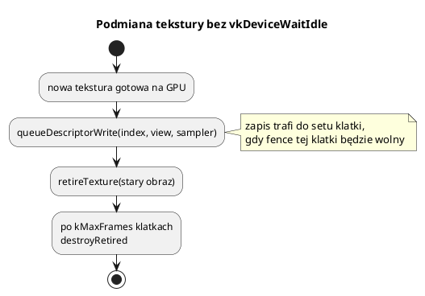

# Tekstury

Pliki: `engine/render/texture_manager.*`, `texture_asset_loader.*`,
`renderer_textures.cpp`, `engine/core/types.h` (`TextureHandle`, filtry).

Tekstury przechodzą trzy etapy:

1. **Dekodowanie** pliku (BMP/TGA/DDS) lub danych z pamięci → `TextureUploadData`,
2. **Utworzenie obrazu Vulkan** + kopiowanie danych + mipmapy,
3. **Rejestracja w tablicy bindless** → `TextureHandle` / indeks w shaderze.

---

## 1. Formaty

| Format | Obsługa | Uwagi |
|---|---|---|
| **BMP** | 24-bit, nieskompresowany | proste, bez alfa; wiersze od dołu, padding 4 B |
| **TGA** | 24/32-bit, raw i RLE | kanał alfa, kompresja RLE |
| **DDS** | DXT1/BC1, DXT3/BC2, DXT5/BC3 | gotowe mipmapy w pliku, bez dekompresji na CPU |

DDS z mipmapami jest najszybszy: dane blokowe idą wprost do VRAM, GPU
dekompresuje sprzętowo. DDS bez mipmap jest dekodowany do RGBA8 na CPU,
a mipmapy generuje GPU (`vk::generateMipmaps`).

`TextureAssetLoader` jest napisany ręcznie (bez stb_image), żeby pokazać
strukturę nagłówków. Obsługuje też `fromRgbaPixels(width, height, pixels)` dla
danych generowanych w kodzie.

---

## 2. Ładowanie

```cpp
Renderer* r = engine.getRenderer();

TextureHandle trawa = r->loadTexture("trawa", "assets/textures/trawa.dds", /*mirroredRepeat*/ true);
TextureHandle skala = r->loadTexture("skala", "assets/textures/skala.bmp");

// z pamięci (np. heightmapa terenu):
TextureHandle hm = r->loadTextureFromMemory("heightmap", dane, width, height);
```

`loadTexture`:

1. `TextureAssetLoader::load(path)`,
2. `uploadTexture` → `vk::createImage`, staging, `vkCmdCopyBufferToImage`,
3. mipmapy (jeśli ich brak),
4. `registerTextureInBindless` → wpis w `textures[]`,
5. zwraca `TextureHandle` (rejestruje w `AssetRegistry`).

### `mirroredRepeat`

Dla terenu i dużych powierzchni włączane, żeby szew kafelkowania nie był widoczny.
Dla GUI/UI — `false` (zwykle `ClampToEdge`).

### `disableAlpha`

Wymusza pełną nieprzezroczystość (przydatne, gdy BMP/TGA ma śmieciowy kanał alfa).

---

## 3. Filtrowanie i adresowanie

```cpp
engine.setTextureFilter(TextureFilter::Anisotropic16x);
```

| `TextureFilter` | Efekt |
|---|---|
| `Nearest` | pikselowy retro look |
| `Linear` | wygładzanie |
| `Trilinear` | linear + mipmapy |
| `Anisotropic2x..16x` | najlepsza jakość skośnych powierzchni |

Adresowanie (`AddressMode`): `Repeat`, `MirroredRepeat`, `ClampToEdge`.
Sampler jest tworzony razem z obrazem; `vk::createSampler` i
`vk::createClampSampler(device, filtr)` to gotowe funkcje.

---

## 4. Tekstury domyślne

Renderer tworzy cztery tekstury 1×1 (bez bufora pośredniego, hostImageCopy):

| Nazwa | Zawartość |
|---|---|
| `"default"` | biała (albedo bez tekstury) |
| `"default_normal"` | płaska normalna `(0.5, 0.5, 1)` |
| `"default_orm"` | ORM (AO=1, roughness=1, metal=0) |
| `"default_black"` | czarna (emissive) |

Dzięki nim shader zawsze ma poprawny sampler — brak tekstury w materiale nie
kończy się błędem ani różowym szachownicowym artefaktem.

---

## 5. Bindless i podmiana w locie

Bindless oznacza tu dużą tablicę deskryptorów tekstur, z której shader wybiera
zasób indeksem. Ogranicza wiązanie zestawów tekstur między obiektami.
Nie usuwa globalnego zestawu deskryptorów ani draw calli. `TextureHandle`
identyfikuje zasób w rejestrze, a renderer mapuje go na indeks tej tablicy.
Wyjaśnienie deskryptorów, flag i czasu życia:
[27_vulkan_od_podstaw.md](27_vulkan_od_podstaw.md).



`applyDescriptorWrites()` jest wołane na początku klatki, po czekaniu na fence
slotu. `queueDescriptorWrite` odkłada zapis na **każdą** klatkę w locie, żeby
wszystkie sety w końcu dostały nowy obraz.

**Nie używaj `vkDeviceWaitIdle`** do podmiany tekstury — zablokujesz GPU i CPU
na całą klatkę.

---

## 6. Kopiowanie z CPU (hostImageCopy)

Dla obrazów generowanych co klatkę (minimapa, mgła wojny) nie ma sensu staging
ani polecenia GPU:

```cpp
VkImage img = ...;                     // usage: HOST_TRANSFER | SAMPLED
vk::hostCopyToImage(device, img, pixels, width, height);
```

Wymagania:

* `VK_IMAGE_USAGE_HOST_TRANSFER_BIT`,
* układ `vk::hostCopyLayout()`,
* obraz nie jest w danej chwili czytany przez GPU.

Mgła wojny ma **osobny obraz na każdą klatkę w locie**, więc CPU pisze do tej,
której GPU właśnie nie czyta. GUI (minimapa) robi tak samo.

---

## 7. Mipmapy

`vk::generateMipmaps(cmd, image, width, height, mipLevels)`:

* poziom 0 jest w `TRANSFER_DST`,
* każdy kolejny powstaje przez `vkCmdBlitImage` (zmniejszenie o połowę),
* na końcu wszystkie poziomy są w `SHADER_READ_ONLY_OPTIMAL`.

Mipmapy zmniejszają migotanie odległych tekstur i poprawiają wydajność cache.
DDS z gotowymi mipmapami nie wymaga tego kroku.

---

## 8. Tekstury w `10_settlers`

* warstwy terenu: trawa, piasek, skała, śnieg (DDS),
* maski warstw: DDS w skali szarości,
* minimapa: obraz RGBA tworzony z danych mapy (`GuiMgr::createImage`),
* mgła wojny: `R8` aktualizowana z CPU.

Tekstury materiałów są przekazywane jako indeksy bindless w push constants,
a indeks mgły wojny jest w UBO. Obrazki GUI mają własną ścieżkę deskryptorów.
Kod gry nie musi sam wiązać zestawów Vulkan dla każdego obiektu.

---

## 9. Pułapki

* **BMP 32-bit nie jest obsługiwany** — tylko 24-bit. Użyj TGA/DDS dla alfa.
* **DDS z nieobsługiwaną kompresją** (np. BC7) — loader rzuci wyjątek. Wspierane
  są DXT1/3/5.
* **`mirroredRepeat` na GUI** — tekst wygląda dziwnie przy krawędziach; użyj
  `ClampToEdge`.
* **Brak mipmap + minifikacja** — migotanie i aliasing. Włącz `generateMipmaps`.
* **Aktualizacja tekstury w trakcie klatki** — poczekaj na fence lub użyj
  hostImageCopy z osobną kopią na klatkę.
* **Zbyt wiele unikalnych tekstur** — limit 1024 w bindless; aktualny kod nie
  sprawdza granicy i nie odzyskuje indeksów. Przekroczenie może dać nieprawidłowy
  zapis deskryptora, nie bezpieczne odrzucenie tekstury.
