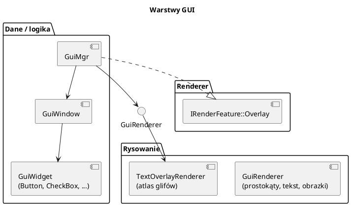

# GUI i HUD

Pliki: `engine/feature/gui/*`.

GUI jest zrobione „od zera” na prostokątach i tekstie — bez ImGui, bez HTML.
To celowo: widać cały mechanizm (okna, widgety, kolejność, rysowanie).
Rysowanie idzie jednym potokiem 2D w nakładce (`Stage::Overlay`).

---

## 0. Najważniejsze struktury GUI

| Struktura | Co to jest | Rola |
|---|---|---|
| `GuiMgr` | Menedżer GUI i `IRenderFeature` | Okna, HUD, kursor, obrazy, wejście myszy |
| `GuiWindow` | Okno GUI | Pozycja, belka, przeciąganie, lista widgetów |
| `GuiWidget` | Bazowy widget | `update/draw`, `isInside`, `isOpen` |
| `GuiButton`, `GuiCheckBox`, `GuiComboBox`, `GuiListBox`, `GuiMemo`, `GuiScrollBar`, `GuiStaticText`, `GuiTrackBar`, `GuiInputText` | Konkretne widgety | Callbacki i rysowanie w oknie |
| `GuiMsg` | Komunikat z okna | `CLICK/STRING/BOOL/REAL` |
| `GuiRenderer` | Renderer 2D | Prostokąty, tekst, obrazki w jednym potoku |
| `GuiVertex` | Wierzchołek GUI | Pozycja NDC, UV, kolor |
| `GuiToolbar` / `GuiCard` | Pasek ikon i karta informacji | Pasek budowy, tooltipy, skróty |
| `PixelIcon` | Ikona pixel-art z tekstu | Rysowana prostokątami HUD |

Pełny słownik: [00_slownik_pojec.md](00_slownik_pojec.md).

---

## 1. Architektura



`GuiMgr` jest `IRenderFeature`:

* `update(input, platform, w, h)` — obsługa myszy i okien,
* `renderGui()` / `build(frame)` — zbieranie geometrii,
* `render(cmd, frame, view)` — nagranie draw calli w nakładce.

---

## 2. Inicjalizacja

```cpp
#include "feature/gui/gui.h"
#include "feature/gui/gui_button.h"

auto gui = std::make_shared<GuiMgr>();

// Tekst: silnik rysuje go atlasem glifów.
gui->setTextDrawFn([&engine](const std::string& t, float x, float y, float s,
                            std::array<float,4> c, float z) {
    engine.setTextLabel(t, "times", x, y, s, c, z);
});
gui->setTextMeasureFn([&engine](const std::string& t, float s) {
    return engine.measureText(t, s);
});

engine.getRenderer()->addFeature(gui);
engine.loadFont("times", "assets/fonts/times.ttf", 28);
```

Bez `setTextDrawFn` GUI nie jest aktywne (`isActive()` zwraca `false`).

---

## 3. Okna i widgety

```cpp
auto* win = gui->addWindow("Sterowanie", 30, 30, 320, 260);
gui->setActive("Sterowanie");           // na wierzchu

auto* btn = new GuiButton(win, "reset", 10, 10, 140, 28);
btn->setText("Resetuj");
btn->setOnClick([&] { resetKamery(); });

auto* chk = new GuiCheckBox(win, "fps", 10, 50);
chk->setText("Pokaż FPS");
chk->setOnToggle([&](bool on) { showFps = on; });

auto* combo = new GuiComboBox(win, "tryb", 10, 80, 180);
combo->addItem("Łatwy");
combo->addItem("Trudny");
combo->setOnSelect([&](const std::string& s) { ustawTryb(s); });

auto* slider = new GuiTrackBar(win, "zoom", 10, 120, 200, 1, 50);
slider->setValue(20);
slider->setOnChange([&](int v) { zoom = v; });

auto* list = new GuiListBox(win, "obiekty", 10, 150, 180, 100);
list->addItem("Dom");
list->addItem("Wieża");
list->setOnSelect([&](const std::string& s) { wybierz(s); });

auto* memo = new GuiMemo(win, "log", 200, 10, 110, 200);
memo->addLine("start");
```

| Widget | Plik | Callback |
|---|---|---|
| `GuiButton` | `gui_button.h` | `setOnClick()` |
| `GuiCheckBox` | `gui_check_box.h` | `setOnToggle(bool)` |
| `GuiComboBox` | `gui_combo_box.h` | `setOnSelect(string)` |
| `GuiListBox` | `gui_list_box.h` | `setOnSelect(string)` |
| `GuiTrackBar` | `gui_track_bar.h` | `setOnChange(int)` |
| `GuiScrollBar` | `gui_scroll_bar.h` | `setOnChange(int)` |
| `GuiMemo` | `gui_memo.h` | brak (log) |
| `GuiStaticText` | `gui_static_text.h` | brak |
| `GuiInputText` | `gui_input_text.h` | historia tekstu |

Okno ma belkę tytułu, przeciąganie i zmianę rozmiaru. `setChromeVisible(false)`
usuwa ramkę (np. panel HUD). `GuiWindow::onMessage` dostaje `GuiMsg`
(klik, string, bool, real) — alternatywa dla callbacków widgetów.

### Aktualizacja co klatkę

```cpp
engine.onUpdate = [&](float, Engine& e) {
    const auto& in = e.input();
    gui->update(in, *e.getPlatform(), (float)e.getRenderer()->width(),
                (float)e.getRenderer()->height());
};
```

`GuiMgr::update` sam:

* wybiera aktywne okno (klik),
* przekazuje mysz do widgetów,
* obsługuje przeciąganie/rozmiar,
* ustawia `hoveredWindow_` (patrz `isPointerOverGui()`).

Kolejność: najpierw GUI, potem logika gry. Inaczej klik w przycisk zaznaczy
jednostkę pod spodem.

---

## 4. HUD w trybie immediate

Do pasków życia, ramek zaznaczenia, minimapy i napisów nie trzeba widgetów —
wystarczy dodać prymitywy **na jedną klatkę**:

```cpp
// prostokąt (x, y, w, h w pikselach)
gui->addOverlayRect(10, 10, 200, 20, {0.1f, 0.1f, 0.1f, 0.8f});

// ramka
gui->addOverlayFrame(10, 40, 200, 20, 2.0f, {1, 1, 1, 1});

// pasek 0..1
gui->addOverlayBar(10, 70, 200, 16, hp / maxHp, {0.8f, 0.2f, 0.2f, 1});

// linia (np. trasa)
gui->addOverlayLine(x0, y0, x1, y1, 2.0f, {1, 1, 0, 1});

// tekst
gui->addOverlayText("Złoto: 120", 10, 100, 1.0f, {1, 0.9f, 0.5f, 1});
gui->addOverlayTextCentered("Pauza", w * 0.5f, h * 0.5f, 2.0f, {1, 1, 1, 1});
```

Wszystkie prymitywy są rysowane **pod oknami GUI** i kasowane po `renderGui()`.
Domyślna głębokość: 0.95 (okna 0.1..0.9; mniejsza = bliżej).

### Obrazki (minimapa)

```cpp
int mapId = gui->createImage(256, 256);
gui->updateImage(mapId, rgba);                 // gdy treść się zmieni
gui->addOverlayImage(mapId, x, y, 200, 200, 0.95f);
```

Jedna tekstura zamiast tysięcy prostokątów. Działa przez hostImageCopy
(osobna kopia na każdą klatkę w locie).

---

## 5. `GuiToolbar` i `GuiCard`

Pasek narzędzi z ikonami (np. dolny pasek budowy) jest rysowany w trybie
immediate, nie jako okno.

```cpp
GuiToolbar toolbar;
toolbar.setGroups({
    {"Budynki", {
        {ID_DOM, iconDom, "1", kartaDom},
        {ID_TARTAK, iconTartak, "2", kartaTartak},
    }},
    {"Drogi", {
        {ID_DROGA, iconDroga, "T", kartaDroga},
    }},
});

// co klatkę:
toolbar.layout(screenW, screenH);
toolbar.item(ID_DOM)->enabled = stacNas;
const int klik = toolbar.update(mouseX, mouseY, lewyKlik);
if (klik == ID_DOM) rozpocznijStawianie(DOM);
toolbar.draw(*gui);
```

`GuiCard` to karta informacji (tytuł, opis, „żetony” kosztu, ostrzeżenie, stopka):

```cpp
GuiCard card;
card.title = "Dom";
card.lines = {{"Zwiększa limit populacji o 6."}};
card.chipsLabel = "Koszt:";
card.chips = {{woodColor, "20 drewna", true},
              {stoneColor, "10 kamienia", false}};   // false = czerwony
card.warning = "Brakuje: 5 kamienia";
card.footer = "Klawisz 1  |  LPM: postaw";
card.draw(*gui, anchorX, bottomY);
```

---

## 6. `PixelIcon` — ikony bez plików

```cpp
PixelIcon dom{{
    "....RR....",
    "...RRRR...",
    "..WWWWWW..",
    "..WKKWBW..",
}};                              // '.' = przezroczysty

drawPixelIcon(*gui, dom, x, y, /*px*/ 4.0f);
```

Każdy znak to piksel w kolorze z palety (`defaultPixelPalette`):
`R` dachówka, `W` tynk, `B` drewno, `K` czerń/okno, `G` zieleń, `S` kamień, ...
Można podać własną paletę (`PixelIcon::palette`). Ikona jest składana
z prostokątów HUD — zero tekstur, łatwa edycja w kodzie.

---

## 7. Kursor

```cpp
gui->enableCursor(true);
gui->setCursorMode(GuiMgr::CursorMode::Custom);  // rysowany przez GUI
gui->setCursorMode(GuiMgr::CursorMode::System);  // kursor systemowy
```

W trybie FPS kursor jest schowany (`Platform::grabPointer(true)`). W menu
włącz normalny kursor i wyłącz przechwytywanie.

---

## 8. Jak to jest rysowane

`GuiRenderer`:

* jeden potok 2D (pozycje w NDC, UV, kolor),
* prostokąty i tekst używają białej tekstury 1×1,
* obrazki mają własne tekstury (push descriptor),
* wierzchołki idą do bufora per klatka (`kMaxFrames`),
* `build(frame)` zbiera, `recordDrawCommands` nagrywa.

Kolejność w nakładce: najpierw HUD (`addOverlay*`), potem okna, potem karta
tooltipa i kursor. Dzięki temu kursor i karta są zawsze na wierzchu.

---

## 9. Przykład kompletnego menu pauzy

```cpp
auto* pause = gui->addWindow("Pauza", 500, 300, 280, 180);
pause->setVisible(false);

auto* resume = new GuiButton(pause, "wznow", 20, 20, 240, 32);
resume->setText("Wznów");
resume->setOnClick([&] { paused = false; pause->setVisible(false); });

auto* settings = new GuiButton(pause, "ustaw", 20, 60, 240, 32);
settings->setText("Ustawienia");
settings->setOnClick([&] { gui->getWindow("Ustawienia")->setVisible(true); });

engine.onUpdate = [&](float, Engine& e) {
    const auto& in = e.input();
    gui->update(in, *e.getPlatform(), w, h);

    if (e.keyPressed(SDL_SCANCODE_ESCAPE)) {
        paused = !paused;
        pause->setVisible(paused);
        e.getPlatform()->grabPointer(!paused);
    }
};
```

---

## 10. Pułapki

* **Brak `setTextDrawFn`** → GUI nieaktywne, nic nie widać.
* **`gui->update` po logice gry** → klik w przycisk trafia też w świat.
* **Nowe widgety `new` bez rodzica** → wyciek. Zawsze `new GuiX(win, ...)`;
  okno usuwa je w destruktorze.
* **Tekst co klatkę** — `addOverlayText`/`setTextLabel` trzeba wołać co klatkę.
* **Minimapa aktualizowana co klatkę** — `updateImage` kopiuje całe RGBA; rób to
  tylko, gdy treść się zmieni.
* **Zbyt głębokie z** — okna mają zakres 0.1..0.9; HUD 0.95. Trzymaj się tego.
