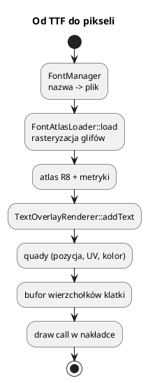

# Czcionki i tekst 2D

Pliki: `engine/feature/font/font_manager.*`, `font_atlas_loader.*`,
`text_overlay_renderer.*`, `utf8.h`, `engine/core/engine.cpp` (`loadFont`, `setTextLabel`).

Tekst w silniku nie jest rysowany z pliku TTF w każdej klatce. Zamiast tego:

1. TTF jest rasteryzowany **raz** do atlasu glifów (tekstura),
2. każdy znak to quad z UV w atlasie,
3. cały tekst klatki trafia do jednego bufora wierzchołków → jeden draw call.

## 0. Najważniejsze struktury tekstu

| Struktura | Co to jest | Rola |
|---|---|---|
| `FontAsset` | Opis czcionki | Nazwa, ścieżka TTF, wysokość, glify |
| `FontManager` | Rejestr czcionek | `add`, `get`, `require` |
| `FontAtlasData` | Atlas glifów + metryki | Tekstura R8, `lineHeight`, mapa kodepunktów |
| `FontAtlasGlyph` | Metryki jednego znaku | `advanceX`, bearings, rozmiar, UV |
| `TextOverlayRenderer` | Renderer tekstu 2D | `Overlay`, jeden bufor wierzchołków na klatkę |
| `TextVertex` | Wierzchołek tekstu | Pozycja, UV, kolor |
| `TextLabel` | Etykieta HUD | Tekst, pozycja, skala, kolor, wyrównanie |

Pełny słownik: [00_slownik_pojec.md](00_slownik_pojec.md).



---

## 1. Atlas glifów

`FontAtlasData`:

```cpp
struct FontAtlasData {
    uint32_t atlasWidth, atlasHeight, pixelHeight;
    float lineHeight;
    VkFormat format = VK_FORMAT_R8_UNORM;
    std::vector<uint8_t> pixelBytes;
    std::vector<VkBufferImageCopy> copyRegions;
    std::unordered_map<uint32_t, FontAtlasGlyph> glyphs;  // codepoint -> metryki + UV
};
```

`FontAtlasGlyph` ma `advanceX`, `bearingX/Y`, `width`, `height`, `u0/v0/u1/v1`.
Dzięki metrykom tekst można wyrównywać i mierzyć bez pytania SDL3_ttf co klatkę.

`FontAtlasLoader::load(fontAsset, codepoints)`:

* wczytuje TTF przez SDL3_ttf,
* rasteryzuje podany zestaw znaków,
* pakuje bitmapy do jednej tekstury (R8),
* zwraca dane gotowe do `vkCmdCopyBufferToImage`.

Podstawowy zestaw to ASCII + polskie znaki. Nowe znaki można dodać, wołając
`wantedCodepoints_` (w `TextOverlayRenderer::ensureGlyphs`).

---

## 2. `FontManager`

```cpp
engine.getFontManager()->add("times", "assets/fonts/times.ttf", 32);
const FontAsset* a = engine.getFontManager()->get("times");
```

`FontManager` to rejestr `nazwa → FontAsset{path, pixelHeight, glyphs}`.
Nie ładuje GPU — tylko opisuje czcionkę. Ładowanie robi `Engine::loadFont`.

```cpp
engine.loadFont("times", "assets/fonts/times.ttf", 32);
```

`pixelHeight` decyduje o rozdzielczości atlasu: większy = ostrzejszy tekst, ale
więcej VRAM i większe kwady.

---

## 3. `TextOverlayRenderer`

Jest `IRenderFeature` ze `Stage::Overlay`.

```cpp
TextOverlayRenderer* txt = ...;   // używane wewnątrz Engine
txt->clearTexts();
txt->addText("Witaj", 20, 40, 1.0f, {1,1,1,1}, screenW, screenH, /*depth*/ 0.0f);
txt->buildTexts(frameIndex);
txt->recordDrawCommands(cmd, frameIndex);
```

W praktyce używasz `Engine`:

```cpp
engine.setTextLabel("FPS: 60", "times", 20, 40, 1.0f, {1, 1, 1, 1});
float w = engine.measureText("FPS: 60", 1.0f);
```

`setTextLabel` dodaje napis do nakładki na **jedną klatkę** — wołaj co klatkę.
`measureText` zwraca szerokość w pikselach (dla wyrównania do prawej/środka).

Do wyrównania w GUI służy `TextHorizontalAlign` oraz `GuiMgr::setTextMeasureFn`.

---

## 4. UTF-8

`utf8.h` zawiera dekoder kodepunktów. Tekst jest przyjmowany jako `std::string`
w UTF-8:

```cpp
engine.setTextLabel("Zażółć gęślą jaźń", "times", 20, 40);
```

Dekoder obsługuje sekwencje 1–4 bajtowe. Jeśli glifu nie ma w atlasie,
`ensureGlyphs` doładowuje go (przebudowa atlasu) — dlatego pierwszy napis
z nowym znakiem może chwilę potrwać.

---

## 5. Jak powstaje quad

Dla każdego znaku:

```text
x += glyph.bearingX * scale
y += glyph.bearingY * scale
w  = glyph.width  * scale
h  = glyph.height * scale
quad: (x, y) .. (x+w, y+h)
UV:   (u0, v0) .. (u1, v1)
```

`advanceX * scale` przesuwa kursor. `lineHeight` decyduje o nowej linii.
Tekst jest rysowany w przestrzeni ekranu (piksele), z głębokością `z` w NDC.

Wszystkie kwady lądują w jednym buforze wierzchołków (`TextVertex`) na klatkę,
więc cały HUD to jeden draw call (o ile używa tej samej czcionki).

---

## 6. Przykład: licznik FPS

```cpp
engine.loadFont("times", "assets/fonts/times.ttf", 28);

engine.onUpdate = [](float, Engine& e) {
    char buf[64];
    std::snprintf(buf, sizeof(buf), "FPS: %.0f", e.getCurrentFPS());
    e.setTextLabel(buf, "times", 16, 32, 1.0f, {0.9f, 1.0f, 0.9f, 1.0f});
};
```

`getCurrentFPS()` jest aktualizowane w `Engine::run`.

---

## 7. Integracja z GUI

`GuiMgr` sam nie rysuje tekstu — dostaje callback:

```cpp
gui->setTextDrawFn([&engine](const std::string& t, float x, float y, float s,
                            std::array<float,4> c, float z) {
    engine.setTextLabel(t, "times", x, y, s, c, z);
});
gui->setTextMeasureFn([&engine](const std::string& t, float s) {
    return engine.measureText(t, s);
});
```

Bez tego okna i przyciski będą puste. `measureText` jest potrzebne do
wyśrodkowania i dopasowania szerokości kart.

---

## 8. Pułapki

* **Tekst znika po klatce** — `setTextLabel`/`addText` działają na jedną klatkę.
* **Brak `loadFont`** — `setTextLabel` nie ma atlasu i nic nie rysuje.
* **Zbyt mały `pixelHeight`** — rozmyty tekst przy powiększeniu.
* **Bardzo dużo unikalnych znaków** — atlas rośnie; dla HUD trzymaj się
  podstawowego zestawu.
* **Rysowanie tekstu poza nakładką** — `TextOverlayRenderer` jest `Overlay`;
  jeśli dodasz własny feature tekstowy, ustaw ten sam `Stage`.
* **Polskie znaki w źródle** — plik `.cpp` musi być UTF-8 (domyślnie w CMake/GCC).
