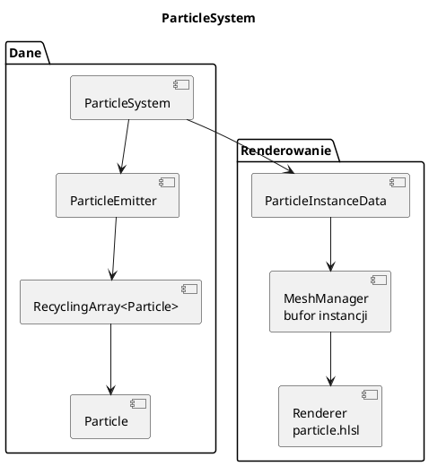

# System cząsteczek

Pliki: `engine/feature/particle/*`, `assets/textures/particles/*.particle`.

Cząsteczki to małe billboardy (kwadraty zwrócone do kamery) rysowane
**instancingiem** — jeden draw call na emiter. System jest zoptymalizowany pod
tysiące cząstek: recykling pamięci, brak alokacji w pętli, opcjonalna
równoległość.

---

## 0. Najważniejsze struktury cząsteczek

| Struktura | Co to jest | Rola |
|---|---|---|
| `ParticleSystem` | Grupa emiterów + `IRenderFeature` | Ładowanie, aktualizacja, instancje |
| `ParticleEmitter` | Emiter cząstek | Parametry, pula, zdarzenia, `update/updateParallel` |
| `Particle` | Stan cząstki | Pozycja, prędkość, kolor, rozmiar, masa, wiek |
| `ParticleEvent` | Zmiana w czasie życia | `at`/`fade` z pliku `.particle` |
| `RecyclingArray<T>` | Tablica z wolnymi slotami | Brak `new/delete` co cząstkę |
| `ParticleInstanceData` | Dane instancji | Pozycja, rozmiar, kolor dla GPU |

Pełny słownik: [00_slownik_pojec.md](00_slownik_pojec.md).

---

## 1. Architektura



* `ParticleSystem` — grupa emiterów + integracja z ECS/renderingiem,
* `ParticleEmitter` — parametry i pula cząstek,
* `Particle` — stan pojedynczej cząstki,
* `RecyclingArray` — stała tablica z listą wolnych slotów (bez `new` co cząstkę).

---

## 2. Ładowanie z pliku

```cpp
#include "feature/particle/system.h"

auto particles = std::make_shared<engine3d::particles::ParticleSystem>();
particles->initialize(*scene, *engine.getMeshManager(), *engine.getMaterialManager(),
                      *engine.getMaterialSystem(), *engine.getRenderer(),
                      *engine.getAssetRegistry(), &engine.getJobSystem());
particles->load("assets/textures/particles/przyklad.particle");
particles->setPosition({0, 2, 0});
engine.getRenderer()->addFeature(particles);
```

`load` parsuje plik tekstowy i tworzy emitery. Format:

```text
particles "nazwa"
{
    numparticles = 5000
    emitrate = 300
    gravity = Vector(0.0, -1.0, 0.0)
    texture = "assets/textures/particles/particle.dds"
    position = Vector(RealRandom(-3,3), RealRandom(-3,3), RealRandom(-10,10))
    velocity = Vector(0, 0, 0)
    size = RealRandom(0.02, 0.05)
    lifeTime = RealRandom(5.0, 7.0)
    mass = 0.0
    color = Vector4(RealRandom(0.1,1), RealRandom(0.1,1), RealRandom(0.1,1), 1.0)

    fade 1.5 at 0.5 size = 0.1
    fade 1.5 at 2.6 size = 0.01
    fade 1.2 at 0.6 color = Vector4(1.0, 0.0, 0.0, 1.0)
    at 4.0 mass = 1.0
}
```

Tokeny:

| Token | Znaczenie |
|---|---|
| `numparticles` | maksymalna liczba cząstek |
| `emitrate` | ile cząstek na sekundę |
| `gravity` | wektor grawitacji |
| `texture` | tekstura cząstki |
| `position`, `velocity`, `size`, `lifeTime`, `mass`, `color` | zakresy początkowe |
| `at <czas> parametr = wartość` | zdarzenie w danym wieku cząstki |
| `fade <czas> at <czas> parametr = wartość` | płynne przejście |

`RealRandom(min,max)`, `IntRandom(min,max)`, `Vector(...)`, `Vector4(...)`.
Wartości bez `at` ustawiają stan początkowy.

---

## 3. Symulacja

Na każdą cząstkę:

```text
age += dt
if (age > lifeTime) -> do puli wolnych
velocity += gravity * dt
position += velocity * dt
aplikuj zdarzenia, których czas minął (size/mass/color/...)
```

`ParticleEmitter::update` robi to jednowątkowo. `updateParallel` dzieli zakres
cząstek przez `JobSystem` — każda cząstka jest niezależna, więc nie ma wyścigów.

Po symulacji `fillInstanceData` buduje `ParticleInstanceData` (pozycja, rozmiar,
kolor) i wysyła do bufora instancji. Jeden emiter = jeden `mesh` + instancing.

---

## 4. Renderowanie

Shader `particle.hlsl`:

* pozycja w świecie + `size`,
* billboard z `camRight`/`camUp` z UBO,
* kolor i alfa z instancji,
* blending Additive/Alpha (zależnie od materiału),
* brak zapisu głębokości (cząstki przenikają).

Sortowanie nie jest wymagane dla addytywnych; dla alpha może powodować artefakty
(typowe dla systemów cząsteczek).

`ParticleSystem::update(dt)` (wersja ECS) woła `updateParallel`, jeśli ma
`JobSystem`, i ustawia kamerę (`setCameraPosition`).

---

## 5. Praktyczne wskazówki

* `numparticles` to **limit**, nie „ilość na start”. Emiter dochodzi do niego
  przez `emitrate`.
* `emitrate` licz na sekundę, nie na klatkę.
* Duże `numparticles` (100k+) testuj z `ENGINE_PROFILE=1`; symulacja może
  zdominować klatkę.
* Cząstki nie zapisują głębi — nie oczekuj poprawnego zasłaniania między
  emiterami.
* Tekstura cząstki powinna mieć alfa (DDS/TGA), inaczej dostaniesz kwadraty.
* `gravity = Vector(0,0,0)` + `velocity` w stożku = iskry; `gravity` w dół =
  deszcz/śnieg.

---

## 6. Przykład: własny emiter w kodzie

```cpp
auto* e = particles->addEmitter("dym");
e->setTextureHandle(engine.getRenderer()->loadTexture("dym", "assets/textures/particles/dym.dds"));
e->setNumParticles(2000);
e->setEmitRate(200);
e->setGravity({0, 1.5f, 0});
e->setPosition({-0.5f, 0, -0.5f}, {0.5f, 0, 0.5f});
e->setVelocity({-0.2f, 1.0f, -0.2f}, {0.2f, 2.0f, 0.2f});
e->setLifeTime(1.5f, 3.0f);
e->setSize(0.3f, 0.8f);
e->setColor({0.3f, 0.3f, 0.3f, 0.6f}, {0.6f, 0.6f, 0.6f, 0.2f});
e->createParticles();
```

---

## 7. Pułapki

* **Brak `createParticles()`** po ustawieniu parametrów — emiter nie ma puli.
* **Zmiana parametrów po `createParticles`** — część działa, ale pula ma stary
  rozmiar; bezpieczniej ustawić przed.
* **Tekstura bez alfa** — czarne lub białe kwadraty.
* **Zbyt wysoki `emitrate` przy małym `numparticles`** — cząstki są natychmiast
  recyklingowane, efekt „mruga”.
* **Brak `addFeature`** — system aktualizuje się, ale nic nie rysuje.
* **Współdzielenie `ParticleSystem` między scenami** — emiter ma jedną pozycję;
  dla wielu ognisk twórz wiele systemów/emiterów.
