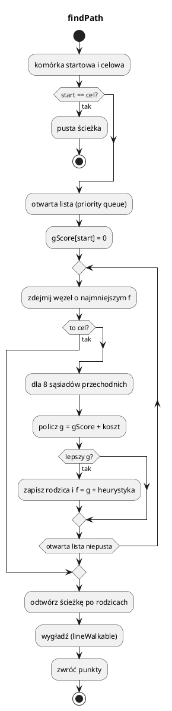

# Nawigacja i AI: `NavGrid` (A*)

Plik: `engine/feature/ai/nav_grid.*`.

`NavGrid` to siatka 2D na płaszczyźnie XZ z wyszukiwaniem ścieżek A*. Służy do
RTS-ów i gier ekonomicznych, gdzie jednostki chodzą po terenie, a budynki są
przeszkodami.

---

## 0. Najważniejsze struktury

| Struktura | Co to jest | Rola |
|---|---|---|
| `NavGrid` | Siatka 2D XZ | A*, przeszkody, regiony dostępności |
| `findPath` (metoda) | Wyszukiwanie ścieżki | Zwraca wygładzone punkty świata |
| `addObstacle` / `removeObstacle` | Przeszkody dynamiczne | Licznik referencji dla nakładających się obiektów |
| `computeRegions` / `regionAt` | Spójne obszary | Tanie sprawdzenie „czy da się dojść” |

Pełny słownik: [00_slownik_pojec.md](00_slownik_pojec.md).

---

## 1. Model siatki

```cpp
NavGrid grid;
grid.init(/*width*/ 128, /*height*/ 128, /*cellSize*/ 4.0f, /*origin*/ {-256, 0, -256});
```

* komórka `(cx, cz)` ma środek `cellCenter`,
* `origin` to lewy-dolny narożnik (XZ),
* ruch 8-kierunkowy **bez ścinania narożników** (nie da się przejść „po skosie”
  między dwiema zajętymi komórkami).

Dwa rodzaje blokad:

| Blokada | Ustawianie | Zastosowanie |
|---|---|---|
| statyczna | `setStaticBlocked(cx, cz, true)` | woda, strome zbocze |
| dynamiczna | `addObstacle/removeObstacle` | budynki, skały, drzewa |

Przeszkody dynamiczne mają **licznik referencji**: dwie nakładające się
przeszkody (np. budynek + ozdobnik) nie odblokują terenu po usunięciu jednej.

```cpp
grid.addObstacle(minX, minZ, maxX, maxZ);
grid.removeObstacle(minX, minZ, maxX, maxZ);
bool wolne = grid.isAreaFree(minX, minZ, maxX, maxZ);
```

---

## 2. Ścieżki

```cpp
std::vector<Vec3> path;
bool ok = grid.findPath(from, to, path, /*allowPartial*/ true, /*maxExpanded*/ 40000);
```

Wynik:

* punkty świata, `y = 0` (wysokość ustala gra, np. `Terrain::getHeight`),
* ścieżka **wygładzona**: zbędne punkty pośrednie są usuwane, jeśli linia prosta
  jest przechodnia,
* gdy cel jest zablokowany — ścieżka prowadzi do najbliższej przechodniej komórki
  (`findNearestWalkable`),
* gdy cel nieosiągalny i `allowPartial == false` — `false`.

`lineWalkable(a, b)` sprawdza odcinek (bez ścinania narożników).

### A* w skrócie



Heurystyka jest **oktylna**: `dx + dz + (sqrt(2) - 2) * min(dx,dz)`, dla
kosztu ruchu prostego 1 i skośnego √2. `maxExpanded` chroni przed długimi
wyszukiwaniami w labiryntach. Wyjaśnienie `g`, `h`, dopuszczalnej heurystyki
i znaczników odwiedzin: [29](29_algorytmy_silnika.md).

Bufory robocze (`gScore_`, `parent_`, `visitStamp_`, `closedStamp_`) są polami
`mutable` — `findPath` jest logicznie `const` i ponownie używa tych tablic.
Nie oznacza to braku wszystkich alokacji (np. kolejki i wyniku) ani możliwości
równoczesnego wywoływania na jednym `NavGrid` z wielu wątków.

---

## 3. Regiony dostępności

```cpp
grid.computeRegions(/*includeObstacles*/ true);

int r1 = grid.regionAt(a.x, a.z);
int r2 = grid.regionAt(b.x, b.z);
bool osiagalne = (r1 >= 0 && r1 == r2);
```

`computeRegions` robi BFS po przechodnich komórkach (4-sąsiedztwo, zgodnie z A*
bez ścinania narożników) i nadaje numery spójnym obszarem. To tanie sprawdzenie
„czy w ogóle da się dojść” — np. przed postawieniem budynku w odciętej dolinie.

`includeObstacles = true` uwzględnia też budynki/skały. Po zmianie przeszkód
trzeba przeliczyć regiony (albo zaakceptować chwilową nieaktualność).

---

## 4. Integracja z grą

```cpp
// po wygenerowaniu terenu:
for (int z = 0; z < grid.height(); ++z)
    for (int x = 0; x < grid.width(); ++x) {
        Vec3 c = grid.cellCenter(x, z);
        const float h = terrain.getHeight(c.x, c.z);
        const float slope = ...;   // z normalnej
        grid.setStaticBlocked(x, z, h < waterLevel || slope > maxSlope);
    }

// po postawieniu budynku:
grid.addObstacle(b.minX, b.minZ, b.maxX, b.maxZ);

// ruch jednostki:
std::vector<Vec3> path;
if (grid.findPath(unit.pos, target, path)) {
    unit.path = std::move(path);
    unit.pathIndex = 0;
}
```

W `10_settlers` `NavGrid` jest w `World`, a jednostki dostają ścieżki i idą po
nich, wygładzając ruch. Regiony służą do sprawdzania, czy nowy budynek nie
odcina osady.

---

## 5. Wydajność

* `findPath` na 128×128 to zwykle mikrosekundy; na 512×512 może być milisekundy.
* Nie licz ścieżki co klatkę dla każdej jednostki — licz przy zmianie celu lub
  co N kroków.
* `computeRegions` jest O(liczba komórek) — wołaj po większych zmianach mapy,
  nie co klatkę.
* `maxExpanded` ustaw rozsądnie (np. 20000–40000). Zbyt mały = brak ścieżki
  w dużych labiryntach.
* `lineWalkable` wygładza ścieżkę, ale nie omija dynamicznie pojawiających się
  przeszkód w trakcie ruchu. Ruch musi mieć własne „odepchnij się od przeszkody”.

---

## 6. Pułapki

* **Wysokość Y** — `findPath` zwraca `y = 0`; ustaw `y = terrain.getHeight(x,z)`
  dopiero przy ruchu.
* **Brak `computeRegions`** — `regionAt` zwraca -1.
* **Zmiana statycznych blokad bez przeliczenia regionów** — stare numery.
* **Przeszkody poza siatką** — `forEachCellInRect` je przytnie, ale sprawdzaj
  zakres, jeśli zależy ci na błędach.
* **Cel w wodzie** — użyj `findNearestWalkable` albo sprawdź `isWalkableWorld`
  przed wydaniem rozkazu.
* **Zbyt gęsta siatka** — więcej pamięci i wolniejsze A*; 2–4 jednostki świata
  na komórkę to typowy kompromis dla RTS.
