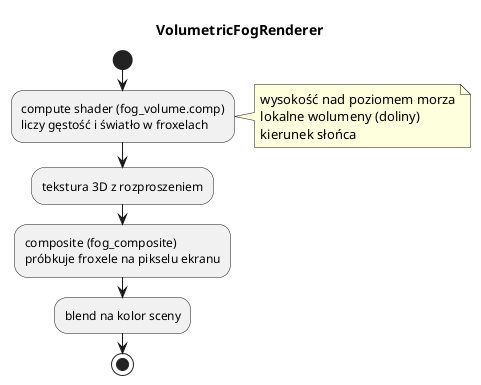

# Mgła: odległościowa, wolumetryczna i mgła wojny

Silnik ma **trzy niezależne efekty**, które często myli się ze sobą:

| Efekt | Plik | Zastosowanie |
|---|---|---|
| mgła odległościowa | `shared/surface_lighting.hlsl` (`applyAtmosphere`) | atmosfera, głębia sceny |
| mgła wolumetryczna | `feature/fog/volumetric_fog_renderer.*` | promienie słońca, mgła w dolinach |
| mgła wojny | `renderer_fog_of_war.cpp`, `shared/fog_of_war.hlsl` | ukrywanie nieodkrytego terenu w RTS |

Można ich używać razem — działają w różnych miejscach potoku.

---

## 1. Mgła odległościowa

Ustawiana na `Engine`/`Renderer`:

```cpp
engine.setFogEnabled(true);
engine.setFogColor(0.7f, 0.8f, 0.9f);
engine.setFogStart(150.0f);
engine.setFogEnd(3500.0f);
```

W shaderze:

```hlsl
float dist = distance(cameraPos.xyz, worldPos);
float fogFactor = saturate((fogEnd - dist) / (fogEnd - fogStart));
color = lerp(fogColor.rgb, color, fogFactor);
```

* `fogStart` — od tej odległości mgła zaczyna się pojawiać,
* `fogEnd` — tu pochłania scenę całkowicie,
* `fogDensity` jest używane przez mgłę wolumetryczną (nie przez tę prostą).

Zaleta: bardzo tanie. Wada: nie rozprasza światła, nie ma „smug” słońca.
Do tego służy mgła wolumetryczna.

---

## 2. Mgła wolumetryczna (froxele)

`VolumetricFogRenderer` liczy rozproszenie światła w **froxelach** — małych
komórkach 3D w przestrzeni kamery (`160 × 90 × 64`), a potem kompozytuje wynik na
ekranie.



### Konfiguracja

```cpp
auto fog = std::make_shared<VolumetricFogRenderer>();
fog->configure("bin/assets/shaders/fog");
fog->setEnabled(true);
fog->setFogDensity(0.002f);
fog->setHeightFalloff(0.004f);
fog->setSeaLevel(0.0f);
fog->setFogRadius(1500.0f);
fog->setFogColor({0.575f, 0.68f, 0.88f});
fog->setSunDirection({0.32f, -0.77f, 0.56f});

engine.getRenderer()->addFeature(fog);
```

`setSunDirection` ma sens, gdy jest słońce (kierunkowe światło). `Engine` robi to
automatycznie w `renderFrame`, jeśli mgła jest dodana.

### Lokalne wolumeny

```cpp
std::vector<LocalFogVolume> doliny;
LocalFogVolume v;
v.center = {x, y + 18, z};
v.halfExtents = {200, 42, 200};
v.density = 0.005f;
v.edgeFade = 0.4f;
doliny.push_back(v);
fog->setLocalVolumes(doliny);
```

* maks. `kMaxLocalVolumes = 32`,
* gęstość ujemna jest przycinana do 0, wymiary do dodatnich, `edgeFade` do [0,1],
* miękkie przejście na krawędziach (`edgeFade`).

Przykład `06_terrain` szuka najniższych punktów terenu i tworzy w nich 3 wolumeny
mgły — daje to efekt mgły w dolinach.

### Kiedy włączać

Mgła wolumetryczna to **compute + pełnoekranowy composite** — najdroższy efekt
atmosferyczny. Włączaj, gdy scena na tym zyskuje (duże widoki, wschód słońca).
Do zwykłej gry często wystarczy mgła odległościowa.

---

## 3. Mgła wojny (fog of war)

### Model

Kwadratowa tekstura `R8` `256×256` nad prostokątem mapy
`[originX, originX + size] × [originZ, originZ + size]`.
Wartość komórki:

| Wartość | Znaczenie |
|---|---|
| 0 | nieodkryte — prawie czarne |
| 128 | odkryte, ale nie widziane teraz — przyciemnione i wyszarzone |
| 255 | widoczne |

Między komórkami jest płynna interpolacja. Efekt działa w **deferred**, więc
obejmuje teren, roślinność i budynki (a nie np. tylko teren).

### Użycie

```cpp
engine.setFogOfWar(true, originX, originZ, worldSize, /*exploredBrightness*/ 0.45f);
engine.updateFogOfWar(visibility);   // 256*256 bajtów
```

Aktualizuj `visibility` tylko, gdy się zmieni. Renderer trzyma **osobną kopię
obrazu na każdą klatkę w locie** i wgrywa dane przez hostImageCopy po fence tej
klatki — bez wyścigu z GPU.

### Jak liczyć widoczność

W `10_settlers`:

* każda jednostka/budynek ma zasięg wzroku,
* komórki w zasięgu = 255,
* odkryte wcześniej, ale poza zasięgiem = 128,
* reszta = 0,
* widoczność pochodzi z kół na siatce — obecna implementacja nie sprawdza
  zasłaniania przez wzgórza ani budynki.

AI używa własnej mapy odkrytego terenu przez `AiPlanner::knows`.
Liczniki obserwatorów, aktualizacja przyrostowa, prostokąt zmian i ograniczenia:
[28_settlers_algorytmy.md](28_settlers_algorytmy.md).

### Shader

`shared/fog_of_war.hlsl`:

* `fogOfWarUv(worldPos, origin, size)`,
* `fogOfWarVisibility(tex, sampler, uv)` — zwraca 0 poza zakresem UV [0,1],
  wewnątrz próbkuje przekazanym samplerem,
* `applyFogOfWar(color, vis, exploredBrightness)` — mieszanie koloru.

Ważne: sampler bindless powtarza teksturę — bez sprawdzenia zakresu UV odkryte
miejsca pojawiałyby się drugi raz poza mapą. `fogOfWar.hlsl` pilnuje zakresu.

---

## 4. Kolejność w potoku

```text
G-Buffer -> deferred (shadeSurface + applyAtmosphere: mgła odległości + fow)
         -> kopia sceny (jeśli ocean)
         -> przezroczyste/ocean (forward: te same funkcje)
         -> mgła wolumetryczna (composite na kolor)
         -> GUI/tekst
```

`applyAtmosphere` jest wspólne dla deferred i forward, więc mgła odległościowa
i mgła wojny działają spójnie na wszystkich powierzchniach.

---

## 5. Pułapki

* **Mylenie `fogDensity` z mgłą odległościową** — `setFogDensity` należy do mgły
  wolumetrycznej; prosta mgła używa `start/end`.
* **Mgła wojny bez `fogOfWar.hlsl`** — ręczne liczenie UV bez clampowania daje
  „drugą mapę” poza obszarem.
* **Aktualizacja fow co klatkę** — niepotrzebne kopie; rób to przy zmianie.
* **Mgła wolumetryczna bez słońca** — efekt będzie płaski; ustaw `sunDirection`.
* **Zbyt duże lokalne wolumeny** — koszt compute rośnie; trzymaj się kilku
  dobrze dobranych obszarów.
* **Mgła wolumetryczna + przezroczyste** — composite jest po przezroczystych;
  bardzo bliskie obiekty mogą wyglądać „za mgłą”. To kompromis kolejności.
