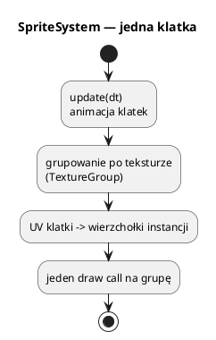

# Sprite'y

Plik: `engine/feature/sprite/sprite.*`.

`SpriteSystem` rysuje płaskie obrazy 2D w przestrzeni 3D (billboardy). Obsługuje
dwie formy animacji:

* **sprite sheet** — jedna tekstura, siatka klatek (`framesX × framesY`),
* **sekwencja** — lista osobnych tekstur (osobne encje/siatki).

W praktyce sprite'y są używane do ognia, wybuchów, dymu i efektów 2D nad sceną.

## 0. Najważniejsze struktury sprite'ów

| Struktura | Co to jest | Rola |
|---|---|---|
| `SpriteSystem` | System sprite'ów + `IRenderFeature` | Animacje, grupowanie, rysowanie |
| `SpriteSystem::Sprite` | Pojedynczy sprite | Pozycja, rozmiar, kolor, klatki, UV |
| `SpriteInstanceData` | Dane instancji sprite'a | Pozycja, kolor, UV dla bufora instancji |
| `TextureGroup` (wewnętrzna) | Grupa po teksturze | Jeden draw call na wspólną teksturę |

Pełny słownik: [00_slownik_pojec.md](00_slownik_pojec.md).



---

## 1. Model

```cpp
struct Sprite {
    Vec3 position;
    float size = 1.0f;
    std::array<float, 4> color{1, 1, 1, 1};
    TextureHandle textureHandle;
    bool active = false;

    bool isSequence = false;
    std::vector<TextureHandle> frameTextureHandles;

    int framesX = 1, framesY = 1;
    float timePerFrame = 0.1f;
    int startFrame = 0, endFrame = -1;
    bool playing = true, loop = true;
    int currentFrame = 0;
    float elapsed = 0.0f;
};
```

Pula ma `MAX_SPRITES = 1024`. `addSprite` zwraca indeks (uchwyt w puli), a nie
`Entity*`.

---

## 2. Inicjalizacja

```cpp
#include "feature/sprite/sprite.h"

auto sprites = std::make_shared<engine3d::SpriteSystem>();
sprites->initialize(*scene, *engine.getMeshManager(), *engine.getMaterialManager(),
                    *engine.getMaterialSystem(), *engine.getAssetRegistry());
engine.getRenderer()->addFeature(sprites);
```

`SpriteSystem`:

* grupuje sprite'y po teksturze (`TextureGroup`),
* tworzy dla grupy jedną siatkę i bufor instancji,
* aktualizuje UV klatek co klatkę,
* aktualizuje encje/sekwencje.

---

## 3. Dodawanie i animacja

```cpp
Sprite s;
s.position = {0, 2, 0};
s.size = 3.0f;
s.textureHandle = renderer->loadTexture("ogien", "assets/sprite/ogien/ogien.dds");
s.framesX = 4;
s.framesY = 4;
s.timePerFrame = 0.08f;
s.loop = true;

int id = sprites->addSprite(s);

// później:
sprites->setPosition(id, {x, y, z});
sprites->setSize(id, 2.0f);
sprites->setColor(id, {1, 0.6f, 0.2f, 1});
sprites->setAnim(id, 4, 4, 0.08f, /*start*/ 0, /*end*/ -1, /*loop*/ true);
```

`update(dt)` (wołane przez system/scenę) przesuwa `elapsed`, zmienia
`currentFrame` i liczy UV (`uvOffsetU/V`, `uvScaleU/V`). Rysowanie to jeden quad
na sprite (lub instancje w grupie).

### Sekwencja tekstur

```cpp
Sprite s;
s.isSequence = true;
s.frameTextureHandles = {
    renderer->loadTexture("wybuch0", "assets/sprite/wybuch/0.dds"),
    renderer->loadTexture("wybuch1", "assets/sprite/wybuch/1.dds"),
    renderer->loadTexture("wybuch2", "assets/sprite/wybuch/2.dds"),
};
s.timePerFrame = 0.1f;
s.loop = false;
```

Dla sekwencji system tworzy osobną encję/siatkę na klatkę (albo podmienia
materiał). Jest mniej wydajna niż sheet, ale wygodna, gdy klatki są osobnymi
plikami.

---

## 4. Batching

`TextureGroup` grupuje sprite'y o tej samej teksturze. Dla grupy:

* jedna siatka (quad),
* jeden bufor instancji (`ParticleInstanceData`-podobny format),
* jeden draw call.

To kluczowe przy setkach sprite'ów. Jeśli każdy sprite ma inną teksturę,
batching nie zadziała — używaj atlasu/sheetu.

---

## 5. Kiedy sprite, a kiedy cząsteczki?

| Potrzeba | Wybór |
|---|---|
| pojedynczy obraz (ikona, znak, portret w 3D) | `SpriteSystem` |
| animowany ogień/dym z wielu cząstek | `ParticleSystem` |
| efekt 2D przywiązany do obiektu | `SpriteSystem` |
| tysiące drobnych cząstek | `ParticleSystem` |

Oba systemy używają billboardów i instancingu, ale cząsteczki mają symulację
fizyki i cykl życia, a sprite'y — klatki animacji.

---

## 6. Pułapki

* **Brak `initialize`** — `addSprite` nie ma menedżerów i nic nie robi.
* **Tekstura bez alfa** — kwadrat zamiast ognia.
* **`endFrame = -1`** oznacza „do ostatniej klatki”; nie myl z „brak animacji”.
* **Za dużo unikalnych tekstur** — batching spada; łącz klatki w atlas.
* **Sprite w przezroczystym przebiegu** — musi mieć materiał z blendingiem
  (system tworzy go sam dla grup).
* **Brak `addFeature`** — animacja liczy się, ale nic nie widać.
