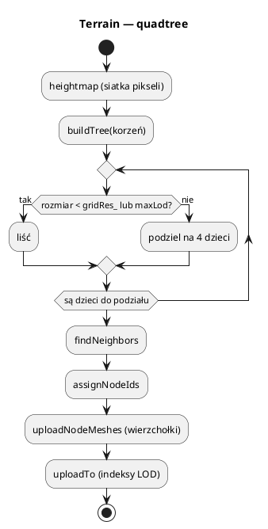

# Teren: quadtree, LOD, zszywanie, splatting

Dlaczego potrzebne są LOD i zszywanie oraz jak powstaje T-junction i wachlarz
trójkątów: [29_algorytmy_silnika.md](29_algorytmy_silnika.md).

Pliki: `engine/object/terrain/*`, `assets/shaders/terrain/*`,
`assets/shaders/shared/terrain_height.hlsl`, `assets/teren/*/terrain.json`.

Teren to heightfield (mapa wysokości) podzielony **drzewem czwórkowym**.
Węzły liści mają siatkę `17×17` wierzchołków (`gridRes_ = 16` komórek) i są
rysowane z LOD zależnym od odległości i nachylenia. Krawędzie między różnymi LOD
są zszywane, żeby nie było szczelin.

---

## 0. Najważniejsze struktury terenu

| Struktura | Co to jest | Rola |
|---|---|---|
| `Terrain` | Heightfield + quadtree | Ładowanie, LOD, paczki, `getHeight`, `raycast` |
| `Terrain::Node` | Węzeł quadtree | Obszar, wysokości, dzieci, sąsiedzi, LOD |
| `TerrainLayer` | Warstwa tekstur | Tekstura + maska (splatting) |
| `TerrainSurface` | Wspólne dane powierzchni | Warstwy/maski/wysokość dla paczek |
| `TerrainIndexGenerator` | Generator indeksów | LOD + 16 konfiguracji zszywania |
| `TerrainHeightmapGenerator` | Generatory proceduralne | Plasma, Fault, Deposition |
| `TerrainComponent` | Komponent terenu | `shared_ptr<Terrain>` + warstwy |
| `TerrainSystem` | System ECS | Aktualizacja LOD/widoczności |
| `TerrainPlacementSystem` | System ECS | Dopasowanie Y obiektów do terenu |

Pełny słownik: [00_slownik_pojec.md](00_slownik_pojec.md).

---

## 1. Ładowanie

### Z obrazu

```cpp
Terrain terrain;
terrain.loadFromImage("assets/teren/wyspa/height.bmp",
                     /*scaleXZ*/ 10.0f,   // jednostki świata / piksel
                     /*scaleY*/ 2.0f,     // mnożnik wysokości
                     /*texScale*/ 20.0f,  // ile razy tekstura na cały teren
                     /*maxLodLevels*/ 6);
terrain.buildMesh();
terrain.uploadTo(*engine.getMeshManager());
```

### Z JSON

```cpp
Terrain terrain;
if (terrain.loadFromJson("assets/teren/demo/terrain.json")) {
    terrain.buildMesh();
    terrain.uploadTo(*engine.getMeshManager());
}
```

`terrain.json`:

```json
{
    "heightMap": "height.bmp",
    "scaleMap": 20,
    "scaleHeight": 5.0,
    "scaleTexture": 300,
    "layers": [
        { "mask": "m1.dds", "texture": "../../textures/piasek.bmp" },
        { "mask": "m2.dds", "texture": "../../textures/drewno.dds" }
    ]
}
```

Ścieżki są względne względem pliku JSON. Pierwsza warstwa nie potrzebuje maski
(jest bazą), kolejne są mieszane maskami.

### Proceduralnie

```cpp
terrain.generatePlasma(256, /*roughness*/ 1.2f);
terrain.smoothEdges();       // krawędzie opadają do 0 (płynne przejście w wodę)
terrain.buildMesh();
terrain.uploadTo(*engine.getMeshManager());
terrain.setScale(5.0f, 2.0f, 20.0f, 6);
```

Generatory (statyczne metody `TerrainHeightmapGenerator`):

| Generator | Efekt |
|---|---|
| `generatePlasma(size, roughness)` | fraktal (Diamond–Square), naturalne wzgórza |
| `generateFault(size, iterations, maxDelta, minDelta, itersPerFilter, filter)` | uskoki tektoniczne |
| `generateDeposition(size, jumps, peakWalk, minPart, maxPart, caldera)` | wulkany tarczowe, pola lawy |

Wszystkie są deterministyczne przy tym samym ziarnie (seed).

---

## 2. Drzewo czwórkowe



* każdy węzeł ma `cx, cz`, `sizeXZ`, `minY/maxY` (do frustum cullingu),
* liście mają `meshId`, indeksy LOD i są rysowane,
* sąsiedzi (`neighbor[4]`) służą do zszywania.

### LOD

`updateLeafLods`:

```text
dist  = odległość kamery od środka węzła
slope = (maxY - minY) / (sizeXZ + 0.1)
mult  = min(1.0 + slope * 2.0, 4.0)
LOD rośnie, dopóki dist < (sizeXZ * 2 * (LOD+1) + sizeXZ*2) * mult
```

Efekt: płaskie obszary szybciej przechodzą na niski LOD, strome dłużej zachowują
szczegóły. Różnica LOD między sąsiadami jest ograniczana do 1 (relaksacja), żeby
zszywanie miało sens.

LOD 0 = pełna siatka, LOD 1 = co drugi wierzchołek, LOD 2 = co czwarty, itd.

### Zszywanie krawędzi

Gdy sąsiad ma niższy LOD, na wspólnej krawędzi węzeł o wyższym LOD wstawia
dodatkowe trójkąty („wachlarz” na krawędź). Bez tego powstałyby szczeliny
(T-junctions).

`TerrainIndexGenerator` generuje bufory indeksów dla:

* 5 poziomów LOD (0–4),
* 16 konfiguracji zszywania (bitmaska: lewa/prawa/dolna/górna).

To 80 współdzielonych buforów indeksów dla wszystkich liści. Wierzchołki są
osobne dla węzła (każdy liść ma własny bufor), indeksy — wspólne.

---

## 3. Renderowanie

`Terrain::collectRenderPackets` dla każdego widocznego liścia:

1. pobiera bufor wierzchołków,
2. liczy konfigurację zszywania z sąsiadów,
3. wybiera bufor indeksów (LOD + stitching),
4. tworzy `RenderPacket` z `terrain` = `shared_ptr<TerrainSurface>`,
5. ustawia `gbufferMaterialPass = true` (materiał `terrain` zapisuje G-Buffer),
6. `tessellationFactor` zależny od LOD.

Węzły poza kadrem, ale blisko kamery, trafiają do `shadowNodes_` — rzucają cień
(`shadowOnly`).

### Teselacja

Shader `terrain.hlsl` ma:

* `vertexMain` + hull/domain (teselacja),
* `vertexMainNoTess` (wariant bez teselacji).

Teselacja wygładza siatkę blisko kamery; współczynnik zależy od LOD węzła.
`terrain_shadow.hlsl` używa **tej samej** funkcji wysokości
(`shared/terrain_height.hlsl`), więc cień odpowiada widocznej geometrii.

> Jeśli zmieniasz wysokość terenu w shaderze, zmień ją w
> `shared/terrain_height.hlsl`, inaczej pojawią się „cienie znikąd”.

### Splatting

`TerrainSurface`:

```cpp
struct TerrainSurface {
    bool layerBlendEnabled;
    uint32_t layerCount;
    std::array<TextureHandle, 12> layerTextureHandles;
    std::array<TextureHandle, 12> layerMaskHandles;
    float layerWorldSize;
    TextureHandle heightmapTextureHandle;
    bool heightmapEnabled;
    float scaleY;
    // indeksy bindless uzupełnia renderer
};
```

Shader:

```hlsl
base = tekstura warstwy 0
for i in 1..layerCount:
    base = lerp(base, warstwa[i], maska[i])
```

Maska jest liczona z UV świata (`worldPos.xz / layerWorldSize`), więc warstwy
nie „pływają” przy ruchu kamery.

Ważne: `resolveTerrainSurfaces` w `Renderer::render` ustala indeksy bindless
raz na klatkę, na jednym wątku. `prepareRenderPacket` (równolegle) **nie może**
zmieniać `TerrainSurface`.

---

## 4. Zapytania o teren

```cpp
float y = terrain.getHeight(x, z);          // interpolacja bilinear
bool naTerenie = terrain.containsXZ(x, z);
Vec3 n = terrain.getNormal(x, z);           // różnice centralne
```

### Raycast

```cpp
Ray ray = screenPointToRay(*camera, mx, my, w, h);
Vec3 hit;
if (terrain.raycast(ray, 5000.0f, hit)) {
    postawBudnek(hit);
}
```

`raycast` to ray marching po wysokości + bisekcja w miejscu przecięcia. Działa
dla dowolnego kierunku, nie tylko z góry.

### Wysokość z pamięci

```cpp
std::vector<float> dane = ...;          // 0..255
terrain.setHeightmap(dane, size);
terrain.setScale(5.0f, 2.0f, 20.0f, 6);
terrain.buildMesh();
terrain.uploadTo(meshes);
```

Po `setHeightmap` trzeba przebudować siatkę (`buildMesh`) i wysłać do GPU.

---

## 5. ECS: komponenty i systemy

```cpp
scene->addSystem(std::make_unique<TerrainSystem>(*meshes, *mats, *matSystem));
scene->addSystem(std::make_unique<TerrainPlacementSystem>());

Entity* e = scene->createEntity("teren");
e->transform().position = terrain->worldOffset();
auto* tc = e->addComponent<TerrainComponent>(terrain);
tc->materialHandle = terrainMaterial;
tc->castShadows = true;
tc->layerBlendEnabled = true;
tc->layerCount = std::min<uint32_t>((uint32_t)terrain->layers.size(), kMaxTerrainLayers);
tc->layerWorldSize = terrain->worldSizeXZ();
// uchwyty tekstur i masek:
for (uint32_t i = 0; i < tc->layerCount; ++i) {
    tc->layerTextureHandles[i] = renderer->loadTexture(...);
    if (i > 0) tc->layerMaskHandles[i] = renderer->loadTexture(...);
}
```

`TerrainSystem` co klatkę woła `terrain->update(camera, ...)` (LOD, widoczność).
`TerrainPlacementSystem` ustawia Y encji z `TerrainPlacementComponent` na
wysokość terenu (+ offset) — używane przez modele i roślinność.

---

## 6. Sprzątanie

```cpp
terrain.releaseMeshes(*meshManager);
```

Usuwa wszystkie siatki węzłów i warianty LOD. **Nie zostawiaj** unikalnych nazw
bez usuwania — to wyciek VRAM. W `10_settlers` `~World` zwalnia teren i siatki
świata.

---

## 7. Pułapki

* **`setScale` po `uploadTo`** — nie przebudowuje siatek; wołaj przed `buildMesh`.
* **Brak `smoothEdges`** — ostre, wysokie krawędzie mapy wyglądają jak ściana.
* **`heightMap` w JSON z inną rozdzielczością niż maski** — maski są próbkowane
  po UV świata, więc powinny pokrywać ten sam obszar.
* **Teselacja + brak wsparcia GPU** — `isTessellationSupported()`; shadery mają
  wariant bez teselacji, ale pakiet musi go zawierać.
* **Zmiana wysokości tylko w shaderze ekranu** — cień terenu się rozjedzie.
* **Za duży `maxLodLevels`** — więcej węzłów i draw calli; dobieraj do rozmiaru mapy.
* **Teren poza `containsXZ`** — `getHeight` zwraca wartość brzegową; sprawdzaj
  zakres, jeśli stawiasz obiekty.

Szczegółowe wyprowadzenie algorytmów: [detalis/teren3d.md](detalis/teren3d.md).
