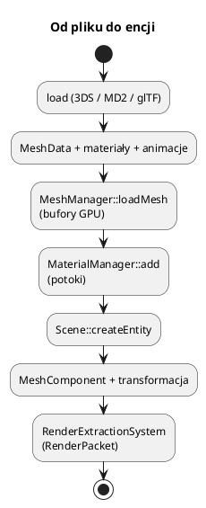

# Modele 3D: 3DS, MD2, glTF

Wyjaśnienie interpolacji klatek, macierzy inverse bind i ważonego skinningu:
[29_algorytmy_silnika.md](29_algorytmy_silnika.md).

Pliki: `engine/object/model_3ds.*`, `model_md2.*`, `gltf/model_gltf.*`,
`engine/core/engine_map.cpp` (ładowanie z map).

Silnik obsługuje trzy formaty o różnych zastosowaniach:

| Format | Typ | Animacja | Uwagi |
|---|---|---|---|
| **3DS** | statyczny, hierarchia obiektów | keyframe (opcjonalnie) | klasyka, własny parser |
| **MD2** | statyczny + klatki | morfing na CPU | Quake II, proste postacie |
| **glTF/GLB** | PBR, materiały | szkieletowa na GPU | nowoczesny standard |

Wszystkie trafiają do `MeshManager` jako `MeshData` + `Material`, więc dalszy
potok jest wspólny.

## 0. Najważniejsze struktury modeli

| Struktura | Co to jest | Rola |
|---|---|---|
| `Model3ds` | Loader 3DS | Chunki, obiekty, materiały, `MeshData` |
| `Model3ds::t3DObject` | Obiekt 3DS | Wierzchołki, twarze, UV, hierarchia |
| `Model3ds::tMaterialInfo` | Materiał 3DS | Kolory, tekstura, przezroczystość |
| `Md2ModelData` | Model MD2 | Klatki, trójkąty, UV, siatka |
| `Md2AnimationState` | Stan animacji MD2 | Zakres klatek, prędkość, interpolacja |
| `GltfModel` | Model glTF | Prymitywy, animacje, skiny, węzły |
| `GltfPrimitive` | Część modelu glTF | `MeshData`, materiał, tekstury, jointy |
| `GltfSkinnedModel` | Model szkieletowy | Ładowanie i prymitywy instancji |
| `GltfSkinnedInstance` | Instancja animowana | Encje, bufor kości, `update` |

Pełny słownik: [00_slownik_pojec.md](00_slownik_pojec.md).



---

## 1. 3DS

```cpp
#include "object/model_3ds.h"

Model3ds model;
if (!model.load("assets/models/3ds/ludz/chlop.3ds")) return;

// materiały z pliku:
std::vector<MaterialHandle> mats;
for (auto* src : model.materialList) {
    Material m = Convert3dsMaterialToEngineMaterial(*src);
    m.name = src->name;
    m.textureHandle = renderer->loadTexture(m.name, src->texturePath);
    mats.push_back(materialManager->add(m));
}

// obiekty (każdy to osobna siatka):
for (size_t i = 0; i < model.objectList.size(); ++i) {
    auto* obj = model.objectList[i];
    const std::string meshName = "chlop_" + std::to_string(i);
    meshManager->loadMesh(meshName, obj->mesh);

    Entity* e = scene->createEntity(meshName);
    e->addComponent<MeshComponent>(meshName)->materialHandle =
        obj->materialIndex >= 0 ? mats[obj->materialIndex] : MaterialHandle{};
}
```

`Model3ds`:

* parsuje chunki 3DS (drzewo),
* buduje `MeshData` (pozycje, normalne, UV),
* konwertuje materiały (`ambient`, `diffuse`, `specular`, `shininess`,
  przezroczystość, `twoSided`),
* rozwiązuje ścieżki tekstur względem pliku modelu.

W `03_flyaround` jest gotowa funkcja `add3dsModel`, która dodatkowo podstawia
teksturę zapasową, gdy plik z teksturą nie istnieje.

> 3DS jest formatem Z-up; loader konwertuje do Y-up silnika.

---

## 2. MD2

```cpp
#include "object/model_md2.h"

Md2ModelData model = loadMd2Model("assets/models/md2/goblin/goblin.md2");
Md2AnimationState anim;
anim.startFrame = 0;
anim.endFrame = 20;
anim.speed = 10.0f;

MeshManager* meshes = engine.getMeshManager();
meshes->loadMesh("goblin", model.triangles);

engine.onUpdate = [&](float dt, Engine&) {
    MeshData out;
    animateMd2(model, anim, dt, out);
    meshes->updateMesh("goblin", out);   // tylko wątek główny
};
```

MD2 to **animacja klatkowa** (morfing): każda klatka ma własne pozycje
wierzchołków, a `animateMd2` interpoluje między dwiema klatkami. Wynik jest
wysyłany do bufora host-visible (`updateMesh`), bo zmienia się co klatkę.

`Engine` potrafi robić to równolegle dla wielu instancji MD2 (patrz
`md2Instances_`, `md2Results_`).

---

## 3. glTF / GLB

### Statyczny model

```cpp
#include "object/gltf/model_gltf.h"

GltfModel model = loadGltfModel("assets/models/gLTF/toycar/toycar.gltf");

for (size_t i = 0; i < model.primitives.size(); ++i) {
    auto& prim = model.primitives[i];
    const std::string meshName = "auto_" + std::to_string(i);
    engine.getMeshManager()->loadMesh(meshName, prim.mesh);

    Material m;
    m.name = prim.materialName;
    m.textureHandle = renderer->loadTexture(meshName + "_albedo", prim.texturePath);
    if (!prim.normalMapPath.empty())
        m.normalMapHandle = renderer->loadTexture(meshName + "_normal", prim.normalMapPath);
    if (!prim.ormPath.empty())
        m.metallicRoughnessTextureHandle = renderer->loadTexture(meshName + "_orm", prim.ormPath);
    m.color = prim.baseColor;

    Entity* e = scene->createEntity(meshName);
    e->addComponent<MeshComponent>(meshName)->materialHandle =
        engine.getMaterialManager()->add(m);
}
```

`loadGltfModel` (tinygltf) obsługuje:

* geometrię (pozycje, normalne, UV, styczne),
* materiały PBR (baseColor, metallic/roughness, normal, occlusion, emissive),
* tekstury osadzone (GLB) i zewnętrzne,
* animacje i skiny (dane dla animacji szkieletowej),
* hierarchię węzłów (`nodeTransforms`, `nodeParents`).

### Animacja szkieletowa

```cpp
GltfSkinnedModel model;
model.load(renderer, meshes, materials, assets,
           "assets/models/gLTF/Suzanne/Suzanne.gltf");

GltfSkinnedInstance inst;
inst.initialize(renderer, model);
Entity* root = inst.instantiate(scene, "suzanne");

engine.onUpdate = [&](float dt, Engine&) {
    inst.update(dt, /*animIdx*/ 0, /*speed*/ 1.0f);
};
```

`GltfSkinnedInstance`:

* tworzy encje dla prymitywów,
* trzyma bufor macierzy kości (`kBoneSlots = 4` — GPU może czytać poprzednie
  klatki),
* aktualizuje animację (`evaluateAnimation`) i wysyła macierze,
* ma własny descriptor set dla kości (binding 1).

Shader `gbuffer_skinned` czyta `SkinVertex` (jointy + wagi) i macierze kości,
więc deformacja dzieje się **na GPU** — CPU tylko liczy macierze.

Szczegóły animacji:

* `GltfAnimation` — kanały (translacja/rotacja/skala) z czasami,
* `evaluateAnimation(model, animIdx, time, jointMatrices)` — interpolacja,
* `getAnimationDuration(model, animIdx)`.

---

## 4. Ładowanie z mapy

`Engine::loadMap` obsługuje sekcje:

```json
{
  "static_models_3ds": [
    { "file": "...", "positions": [{"x":0,"y":0,"z":0}], "scale": {"x":1,"y":1,"z":1},
      "snap_to_terrain": true, "terrain_offset": 0.0 }
  ],
  "characters_md2": [ { "file": "...", "position": {"x":0,"y":0,"z":0} } ],
  "gltf_models":    [ { "file": "...", "position": {"x":0,"y":0,"z":0} } ],
  "gltf_skinned_models": [ { "file": "..." } ]
}
```

Dla modeli wieloczęściowych tworzona jest **encja-korzeń** + encje-dzieci.
`snap_to_terrain` dodaje `TerrainPlacementComponent`, więc model stoi na terenie
nawet na zboczu.

---

## 5. Współrzędne i normalne

* 3DS: Z-up → konwersja do Y-up w loaderze.
* MD2: Y-up, skala zwykle 1 jednostka = 1 cal? — dopasuj `TransformComponent`.
* glTF: Y-up, jednostki metryczne.

Normalne:

* 3DS/MD2 — liczone lub z pliku,
* glTF — z pliku; jeśli brak stycznych, `perturbNormal` użyje przybliżenia.

Modele są dzielone na **prymitywy** (sub-meshe), każdy z własnym materiałem.
Jedna encja może mieć wiele `MeshComponent` (dzieci), albo jeden prymityw.

---

## 6. Sprzątanie

* `MeshManager::removeMesh(name)` dla siatek wczytanych w runtime,
* `GltfSkinnedModel::cleanup()` i `GltfSkinnedInstance::cleanup()` dla kości,
* `Model3ds::unload()` dla danych CPU.

W `Engine::clearMapFeatures` modele animowane z poprzedniej mapy są zwalniane
przed wczytaniem nowej.

---

## 7. Pułapki

* **Brak pliku tekstury w 3DS** — `texturePath` może być względny/inny; użyj
  fallbacku (jak w `03_flyaround`).
* **MD2 `updateMesh` z wątku roboczego** — Vulkan wymaga wątku głównego.
* **glTF z BC7/nieobsługiwaną kompresją** — tekstury są ładowane przez
  SDL3_image, więc format musi być obsługiwany.
* **Skala modelu** — glTF bywa w metrach, 3DS w calach; ustaw
  `transform().scale`.
* **Zbyt wiele unikalnych siatek** — każda instancja kopiuje dane; dla wielu
  takich samych obiektów lepiej użyć instancingu (cząsteczki/sprite) albo
  współdzielić `MeshHandle`.
* **Kości > 64** — shader ma `MAX_BONES = 64`; większe szkielety nie zmieszczą
  się w buforze.
