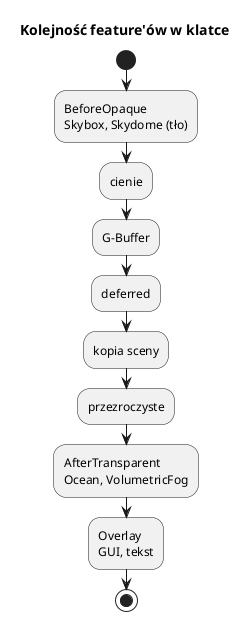

# Otoczenie: niebo, ocean, siatka, roślinność

Pliki: `engine/object/skydome_renderer.*`, `skybox_renderer.*`,
`ocean_renderer.*`, `grid_renderer.*`, `vegetation/*`.

Te elementy są `IRenderFeature` albo `ISceneSystem`. Dodaje się je do renderera
lub sceny i działają w określonym etapie klatki.

---

## 0. Najważniejsze struktury otoczenia

| Struktura | Co to jest | Rola |
|---|---|---|
| `SkyboxRenderer` | Panorama z tekstur | Sześcian wokół kamery, `BeforeOpaque` |
| `SkydomeRenderer` | Niebo proceduralne | Chmury, słońce, pora dnia |
| `OceanRenderer` | Woda | Fale, odbicia, `AfterTransparent` |
| `GridRenderer` | Siatka pomocnicza | Linie XZ, debug/edytor |
| `VegetationSystem` | Roślinność | Instancje, wiatr, gatunki |
| `VegetationSpecies` | Gatunek rośliny | Siatka, materiał, gęstość, skala |
| `SkyboxConfig`, `SkydomeConfig`, `OceanConfig`, `GridConfig` | Konfiguracje | Parametry sub-rendererów |

Pełny słownik: [00_slownik_pojec.md](00_slownik_pojec.md).

---

## 1. Etapy



`BeforeOpaque` rysuje tło, zanim pojawi się geometria. `AfterTransparent` widzi
gotowy kolor sceny (ocean) i może go zmodyfikować (mgła).

---

## 2. Skydome — niebo z chmurami

Dynamiczna kopuła nieba z chmurami, słońcem i cyklem dnia.

```cpp
auto skydome = std::make_shared<SkydomeRenderer>();
SkydomeConfig cfg;
cfg.enabled = true;
cfg.domeScale = 1.5f;
cfg.timeOfDay = 10.0f;          // godzina 0..24
cfg.cloudCoverage = 0.4f;
cfg.cloudSpeed0 = 0.3f;
cfg.cloudSpeed1 = 0.15f;
cfg.cloudScale0 = 1200.0f;
cfg.cloudScale1 = 800.0f;
cfg.sunElevation = 50.0f;
cfg.enableSunLight = true;      // skydome dostarcza kierunek/kolor słońca

skydome->configure(cfg, "bin/assets/shaders/skydome", "skydome");
skydome->setEnabled(true);
engine.getRenderer()->addFeature(skydome);

// co klatkę:
skydome->setTime(czasGry);
```

`computeSkyColors(timeOfDay, top, horizon, sun)` liczy kolory nieba dla pory dnia.
`getSunDirection()`, `getSunColor()`, `getSunIntensity()`, `getAmbientStrength()`,
`getAmbientColor()` pozwalają zsynchronizować oświetlenie sceny z niebem.

Shader `skydome.hlsl` rysuje sferę/kopułę i chmury proceduralnie (szum), bez
tekstur. Słońce jest liczbowo w shaderze, nie jako obiekt.

---

## 3. Skybox — panorama z tekstur

Sześcian otaczający scenę z teksturami (DDS). Tańszy i prostszy niż skydome,
ale statyczny.

```cpp
const std::string dir = "assets/skybox/noc";
auto skybox = std::make_shared<SkyboxRenderer>();

SkyboxConfig cfg;
cfg.enabled = true;
cfg.size = 3500.0f;
cfg.verticalOffset = 100.0f;

skybox->configure(cfg, "bin/assets/shaders/skybox");
skybox->setTextureHandles(
    renderer->loadTexture("skybox_fb", dir + "/box_12.dds"),
    renderer->loadTexture("skybox_lr", dir + "/box_34.dds"),
    renderer->loadTexture("skybox_top", dir + "/box_5.dds"));
skybox->setEnabled(true);
skybox->setExposure(0.5f);
renderer->addFeature(skybox);
```

Shader przesuwa skybox o pozycję kamery (kamera zawsze w środku) i wyłącza zapis
głębokości, więc niebo nie zasłania świata.

`skybox` vs `skydome`:

| | Skybox | Skydome |
|---|---|---|
| źródło | tekstury DDS | proceduralne chmury |
| koszt | bardzo mały | większy (szum) |
| pora dnia | statyczna | animowana |
| użycie | tło, menu, sceny statyczne | gry z cyklem dnia |

---

## 4. Ocean

Duża płaszczyzna z falami, odbiciami i załamaniem. Wymaga kopii koloru sceny
(`needsSceneColor() == true`).

```cpp
auto ocean = std::make_shared<OceanRenderer>();
OceanConfig cfg;
cfg.enabled = true;
cfg.waterLevel = 30.0f;
cfg.waveAmplitude = 1.4f;
cfg.waveSpeed = 1.0f;
cfg.waveFrequency = 10.0f;
cfg.foamThreshold = 2.95f;

ocean->configure(cfg, "bin/assets/shaders/ocean", "ocean");
ocean->setEnabled(true);
engine.getRenderer()->addFeature(ocean);

// co klatkę:
ocean->setTime(czasGry);
```

Shader `ocean.hlsl`:

* fale (suma sinusów),
* odbicia i załamanie z `sceneColor` + głębi,
* piana przy `foamThreshold`,
* przezroczystość przy brzegu.

Ocean jest rysowany po deferred, więc widzi już oświetloną scenę. Kopia koloru
jest wykonywana tylko, gdy ocean jest aktywny.

---

## 5. Grid — siatka pomocnicza

```cpp
auto grid = std::make_shared<GridRenderer>();
GridConfig cfg;
cfg.enabled = true;
cfg.size = 200.0f;
cfg.spacing = 10.0f;
cfg.color = {0.5f, 0.5f, 0.5f};

grid->configure(cfg, "bin/assets/shaders/grid");
grid->setEnabled(true);
renderer->addFeature(grid);
```

Rysowana po obiektach nieprzezroczystych, z testem głębokości. Przydatna
w edytorze/testach, nie w grze.

---

## 6. Roślinność

`VegetationSystem` to `ISceneSystem`, który generuje instancje roślin na terenie.

```cpp
auto veg = std::make_unique<VegetationSystem>(*meshes, *mats, *materialSystem);

VegetationSpecies trawa;
trawa.name = "trawa";
trawa.type = VegetationType::Grass;
trawa.meshName = "trawa_mesh";
trawa.materialHandle = grassMaterial;
trawa.density = 0.8f;
trawa.minScale = 0.8f;
trawa.maxScale = 1.4f;
trawa.slopeMax = 30.0f;
trawa.snapToTerrain = true;
veg->addSpecies(trawa);

veg->generate(*scene, worldSize, centerX, centerZ,
              [terrain](float x, float z) { return terrain->getHeight(x, z); });
scene->addSystem(std::move(veg));
```

Cechy:

* `density`, `minScale/maxScale`, `minHeight/maxHeight`, `slopeMax`,
* `snapToTerrain` — Y z terenu,
* dwa warianty (`generatePaired`) dla mieszanych lasów,
* wiatr: `setWindTime`, `setWindStrength` (shader `vegetation.hlsl`),
* gotowe siatki: `createGrassBladeMesh`, `createBushMesh`.

Renderowanie: materiał `vegetation` (alpha, dwustronny, bez zapisu głębi),
instancing. Trawa i liście używają `alphaMaskCutoff` — piksele poniżej progu są
odrzucane (bez sortowania).

---

## 7. Typowy zestaw sceny

```cpp
renderer->addFeature(skydome);     // BeforeOpaque
renderer->addFeature(ocean);       // AfterTransparent
renderer->addFeature(volumetricFog); // AfterTransparent
// grid tylko w debug
```

Kolejność dodawania ma znaczenie dla `Overlay` (odwrócona), ale dla
`BeforeOpaque`/`AfterTransparent` liczy się etap, nie kolejność.

---

## 8. Pułapki

* **Ocean bez kopii sceny** — `needsSceneColor` musi być `true`; inaczej dostanie
  śmieci albo nie zadziała.
* **Skybox zasłania scenę** — zapis głębokości musi być wyłączony; builder robi
  to przez `.depth(true, false, LESS_OR_EQUAL)`.
* **Dwa nieba naraz** — skydome i skybox rysują to samo; wybierz jedno.
* **Roślinność na wodzie** — `minHeight` i `slopeMax` filtrują, ale sprawdź
  `waterLevel`.
* **Brak `snapToTerrain`** — rośliny wiszą/toną na zboczach.
* **Mgła wolumetryczna bez słońca** — ustaw `sunDirection`; `Engine` robi to
  automatycznie, jeśli w scenie jest światło kierunkowe.
* **Zbyt gęsta roślinność** — tysiące instancji to dużo draw calli; używaj
  instancingu i ogranicz `density`.
