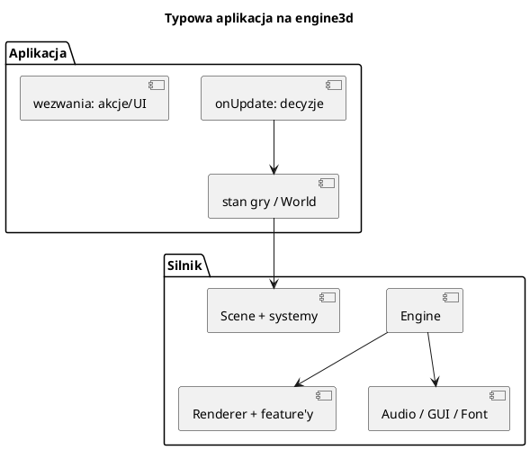

# Przykłady i przepis na własną grę

Katalog `examples/` to zarazem dokumentacja przez kod: każdy przykład pokazuje
jeden zestaw funkcji silnika. Czytaj je w kolejności rosnącej złożoności.



---

## 1. Przewodnik po przykładach

| Przykład | Co pokazuje | Czytaj, gdy... |
|---|---|---|
| `01_rotating_triangle` | minimalna aplikacja: siatka, materiał, kamera, `onUpdate` | zaczynasz |
| `02_rotating_cube` | tekstura, UV, obrót 3D | chcesz teksturę |
| `03_flyaround` | skybox, 3DS, MD2, glTF, PBR, kamera FPS | uczysz się modeli |
| `04_particles` | system cząsteczek, pliki `.particle` | robisz efekty |
| `05_gui_demo` | wszystkie widgety, paski, okna, ustawienia | robisz interfejs |
| `06_terrain` | teren LOD, splatting, ocean, skydome, mgła | robisz świat |
| `07_shadows` | światła kierunkowe/punktowe/reflektor, cienie | robisz oświetlenie |
| `08_game` | pełna gra: menu, mapy, ECS, GUI, dźwięk | łączysz wszystko |
| `09_vegetation` | roślinność, wiatr, teren | robisz lasy/trawę |
| `10_settlers` | RTS: ekonomia, AI, transport, mgła wojny | robisz grę strategiczną |

### 01 — minimalna aplikacja

Najważniejsze elementy:

```cpp
Engine engine;
engine.initialize("...", 800, 600);
auto* scene = engine.getSceneManager()->activeScene();

meshManager->loadMesh("triangle", mesh);
MaterialHandle mat = materialManager->add(Material{});
Entity* e = scene->createEntity("triangle");
e->addComponent<MeshComponent>("triangle")->materialHandle = mat;

CameraComponent* cam = scene->createEntity("camera")->addComponent<CameraComponent>();
scene->setActiveCamera(cam);

engine.onUpdate = [](float dt, Engine& e) { /* obrót */ };
engine.run();
```

To szkielet **każdej** aplikacji. Reszta to dodawanie komponentów, systemów,
feature'ów i logiki w `onUpdate`.

### 03 — modele

`03_flyaround` jest podzielony na funkcje-kroki (`setupLightingAndSky`,
`createFloorAndCubes`, `add3dsModel`, `addMd2Model`, `addGltfModel`, ...).
Czytaj `main()` od góry — każdy krok buduje kolejny element sceny.
Sterowanie: WASD + mysz, spacja/Ctrl, L — światło i cienie, Esc — wyjście.

### 06 — teren

Pokazuje:

* `Terrain::loadFromJson` albo `generatePlasma`,
* `TerrainComponent` + `TerrainSystem` + `TerrainPlacementSystem`,
* splatting warstw (maski DDS),
* ocean i skydome,
* mgłę wolumetryczną w dolinach,
* zmianę generatora klawiszami 1/2/3,
* `Terrain::raycast` do wskazywania punktu myszą.

### 07 — światła

Trzy typy świateł + markery (małe siatki w miejscu świateł). Klawisze
przełączają światła i cienie. Uczy, jak `LightSystem` zbiera światła i jak
renderer przydziela im mapy cieni.

### 08 — gra

Pełny przykład integracji: menu główne, pauza, ustawienia, kilka map, ECS,
modele, teren, ocean, GUI, dźwięk. To dobry punkt wyjścia dla własnej gry
„sandbox”.

### 10 — Osadnicy

Największy przykład. Podział:

* `World` (`settlers_world.h`, `world_*.cpp`) — **symulacja** bez GUI i wejścia:
  jednostki, budynki, drogi, transport, ekonomia, walka, AI, mgła wojny,
* `SettlersApp` (`settlers_app.h`, `app_*.cpp`) — **prezentacja**: silnik,
  kamera, HUD, menu, dźwięk, zapis, debug, testy.

Zasada: `World` nie wie, jak wygląda ekran; `SettlersApp` nie implementuje
ekonomii. Dzięki temu symulację można testować bez okna (autoplay, UITEST).

Mapa plików jest w komentarzu na górze `main.cpp`, a opisy klas w
`settlers_world.h` i `settlers_app.h`.

---

## 2. Przepis: nowa gra w 10 krokach

### 1. Katalog i CMake

```text
examples/11_moja_gra/
  main.cpp
  CMakeLists.txt
```

```cmake
add_executable(moja_gra main.cpp)
target_link_libraries(moja_gra PRIVATE engine3d)
```

Dopisz `add_subdirectory(11_moja_gra)` w `examples/CMakeLists.txt`.

### 2. Inicjalizacja

```cpp
Engine engine;
if (!engine.initialize("Moja gra", 1440, 900)) return 1;
engine.loadFont("times", "assets/fonts/times.ttf", 28);
engine.setLightingEnabled(true);
engine.setShadowsEnabled(true);
engine.configureDirectionalShadow(1200.0f);
```

### 3. Scena i kamera

```cpp
Scene* scene = engine.getSceneManager()->activeScene();
auto* cam = scene->createEntity("kamera")->addComponent<CameraComponent>();
cam->farPlane = 5000.0f;
scene->setActiveCamera(cam);
RtsCameraController rts;   // albo CameraController / FlyCamera
```

### 4. Teren (opcjonalnie)

```cpp
auto terrain = std::make_shared<Terrain>();
terrain->generatePlasma(256, 1.2f);
terrain->smoothEdges();
terrain->buildMesh();
terrain->uploadTo(*engine.getMeshManager());
scene->addSystem(std::make_unique<TerrainSystem>(...));
scene->addSystem(std::make_unique<TerrainPlacementSystem>());
```

### 5. Modele i materiały

* proceduralne: `MeshBuilder`,
* pliki: 3DS/MD2/glTF ([20_modele.md](20_modele.md)),
* każdy materiał przez `MaterialManager::add`.

### 6. Światło i niebo

```cpp
scene->createDirectionalLight("sun", {2, 3, 2}, {1, 1, 0.9f}, 3.0f);
auto skydome = std::make_shared<SkydomeRenderer>();
skydome->configure(cfg, "bin/assets/shaders/skydome", "skydome");
engine.getRenderer()->addFeature(skydome);
```

### 7. Wejście

```cpp
auto& map = engine.inputActions();
map.bindKey("move.forward", SDL_SCANCODE_W);
map.bindKey("build", SDL_SCANCODE_B);

engine.onUpdate = [&](float dt, Engine& e) {
    if (e.actionPressed("build")) trybBudowy = true;
};
```

### 8. GUI / HUD

```cpp
auto gui = std::make_shared<GuiMgr>();
gui->setTextDrawFn(...);
gui->setTextMeasureFn(...);
engine.getRenderer()->addFeature(gui);
auto* win = gui->addWindow("Gra", 20, 20, 300, 200);
```

### 9. Logika

Trzymaj stan w komponentach/scenie albo we własnej klasie `World`.
Systemy (`ISceneSystem`) do rzeczy masowych, `onUpdate` do decyzji.

### 10. Testy i uruchamianie

* `SETTLERS_UITEST`-podobny tryb: wstrzykuj zdarzenia i sprawdzaj stan,
* autoplay: AI gra za gracza,
* zrzuty ekranu: `spectacle`,
* `ENGINE_PROFILE=1` — wydajność.

---

## 3. Wzorce, które warto powtórzyć

### „Symulacja vs prezentacja”

`World` (stan, bez Vulkana) + `App` (render, wejście, GUI). Zalety:

* testy bez okna,
* zapis/wczytanie stanu,
* możliwość podłączenia innego renderera,
* AI i balans można stroić szybciej.

### „Ref<T> zamiast wskaźników”

W `10_settlers` odwołania między obiektami to `Ref<T>` (indeks + generacja).
Slot może zostać zwolniony i ponownie użyty — `Ref` wykrywa, że obiekt nie jest
już tym samym. Nowe pole-odwołanie deklaruj jako `Ref<...>`, nie `int`.

### „Systemy zamiast ifów w pętli”

Jeśli coś dotyczy wszystkich encji (ruch, AI, pogoda), zrób `ISceneSystem`.
Jeśli dotyczy jednego obiektu — `Component::update` albo `onUpdate`.

### „Zasoby przez nazwy i uchwyty”

Nie przekazuj `VkBuffer`/`VkImage` po kodzie gry. Używaj `MeshHandle`,
`MaterialHandle`, `TextureHandle`. Renderer sam znajdzie zasób.

---

## 4. Typowe zadania

### Dodać model na scenę

```cpp
MeshManager* meshes = engine.getMeshManager();
meshes->loadMesh("nazwa", meshData);

Material m; m.name = "mat";
MaterialHandle h = engine.getMaterialManager()->add(m);

Entity* e = scene->createEntity("obiekt");
e->addComponent<MeshComponent>("nazwa")->materialHandle = h;
e->transform().position = {x, y, z};
```

### Zmienić materiał istniejącej encji

```cpp
auto* mc = e->getComponent<MeshComponent>();
mc->materialHandle = nowyHandle;
mc->materialInstance.reset();          // WAŻNE: wyrzuć stary potok
```

### Zrobić HUD

```cpp
gui->addOverlayBar(x, y, w, h, frac, color);
gui->addOverlayText("Złoto: 120", x, y, 1.0f, color);
```

### Zrobić minimapę

```cpp
int id = gui->createImage(256, 256);
gui->updateImage(id, rgba);            // tylko gdy treść się zmieni
gui->addOverlayImage(id, x, y, 200, 200, 0.95f);
```

### Zapisać/wczytać stan

Wzór z `10_settlers`:

* zapis: ziarno mapy + listy obiektów + stan frakcji + RNG,
* wczytywanie: odtwórz mapę z ziarna, potem obiekty w tej samej kolejności,
* test `saveLoadTest`: zapis → wczytanie → zapis identyczny.

---

## 5. Gdzie szukać dalej

* [01_architektura.md](01_architektura.md) — jak to wszystko się spina.
* [09_render_potoki.md](09_render_potoki.md) — co dzieje się na GPU.
* [12_gui.md](12_gui.md), [19_teren.md](19_teren.md), [20_modele.md](20_modele.md).
* [24_rozwiazywanie_problemow.md](24_rozwiazywanie_problemow.md) — gdy coś nie działa.
