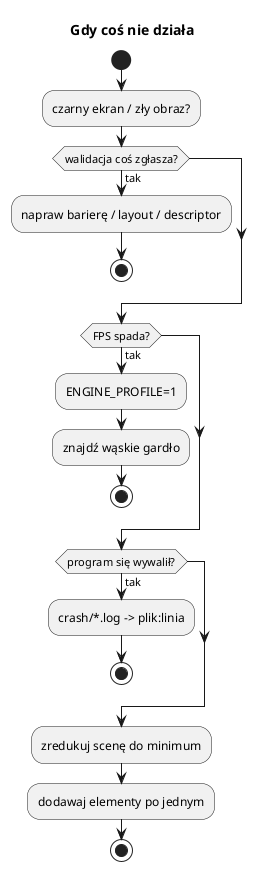

# Rozwiązywanie problemów

Zbiór objawów, przyczyn i napraw. Najpierw jednak **metoda**:

1. **Czytaj log.** `LOG_ERROR`/`LOG_WARN` zwykle mówią, czego brakuje.
2. **Uruchom z walidacją.** `ENGINE_VALIDATION=1` — większość błędów Vulkana
   wychodzi od razu.
3. **Włącz profil.** `ENGINE_PROFILE=1` — ustal, czy problem jest w logice,
   czy w renderze.
4. **Zredukuj scenę.** Zostaw jedną encję, jedną teksturę, jedno światło.
   Problem często znika — wtedy wracaj dodając elementy.
5. **Sprawdź raport awarii** (`crash/`) — plik:linia i stos.
6. **Nie zgaduj.** Zmieniaj jedną rzecz naraz i sprawdzaj efekt.

---

## 1. Nic nie widać (czarny ekran)

| Możliwa przyczyna | Sprawdź / napraw |
|---|---|
| brak aktywnej kamery | `scene->setActiveCamera(cam)`, `hasFrameView()` |
| kamera patrzy w złą stronę | `target`, `position`, `up` |
| `nearPlane`/`farPlane` | obiekt poza zakresem; ustaw `farPlane = 5000` |
| brak `MeshComponent` / materiału | `materialHandle.isValid()` |
| siatka poza kamerą | `transform().position`, skala |
| cull back + odwrócone trójkąty | `cullMode = CullMode::Disabled` do testu |
| brak `addFeature` dla nieba/oceanu | `renderer->addFeature(...)` |
| okno zminimalizowane | renderer celowo pomija klatkę |
| `lightingEnabled == false` i brak ambinetu | ustaw `setAmbientStrength` |

### Obiekt jest, ale czarny

* brak światła i ambient = 0,
* materiał `color = {0,0,0,1}`,
* tekstura czarna albo brak tekstury (sprawdź `default` w bindless),
* normalne odwrócone (światło „od tyłu”),
* `metallic = 1` i `roughness = 0` przy braku odbić — wygląda czarno.

---

## 2. Tekstury i materiały

* **Różowy/checkerboard** — brak tekstury; w tym silniku zamiast tego jest
  `default` (biała), więc raczej sprawdź, czy `textureHandle` jest ustawiony.
* **Tekstura się nie zmienia po podmianie** — zresetuj `materialInstance` po
  zmianie `materialHandle`.
* **Zła orientacja UV** — BMP jest odwrócony w Y; loader to koryguje, ale TGA
  może wymagać sprawdzenia.
* **Kafelkowanie widoczne jako szew** — włącz `mirroredRepeat` albo popraw UV.
* **Brak alfa** — BMP 24-bit nie ma alfa; użyj TGA/DDS.
* **Nowa tekstura w trakcie klatki** — użyj `queueDescriptorWrite`/`retireTexture`,
  nie `vkDeviceWaitIdle`.

---

## 3. Cienie

| Objaw | Przyczyna / naprawa |
|---|---|
| brak cieni | `setShadowsEnabled(true)`, światło kierunkowe, `configureDirectionalShadow` |
| cienie tylko blisko | zwiększ `halfSize` lub `startDistance`/`splitLambda` |
| „cienie znikąd” na terenie | teselacja/wysokość w shaderze cienia inna niż na ekranie → wspólny `terrain_height.hlsl` |
| paski/acne | pozycja świata w G-Bufferze musi być `RGBA32F`; bias/normal-offset |
| migotanie krawędzi | stabilizacja do siatki tekseli; nie kwantyzuj kierunku słońca |
| cienie lokalne obcięte | `depthClamp` tylko dla kaskad słońca; lokalne bez |

`configureDirectionalShadow(halfSize, startDistance, splitLambda)` dopasuj do
kamery. Osadnicy robią to co klatkę.

---

## 4. Teren

* **Teren „przebija” się przez wodę** — `smoothEdges` i poziom wody.
* **Szczeliny między węzłami** — zszywanie LOD; sprawdź `neighborLodDiff` i
  `computeStitchConfig`.
* **Teren znika przy oddaleniu** — `farPlane`, `maxLodLevels`, zasięg kaskad.
* **`getHeight` zwraca złe wartości** — `setHeightmap` bez `buildMesh`/`uploadTo`,
  zła skala, `containsXZ` poza mapą.
* **Raycast nie trafia** — promień z `screenPointToRay`, `maxDistance` za mały,
  albo kamera nie ma `autoAspect` aktualnego.
* **Wysokość w shaderze inna niż `getHeight`** — shader używa
  `terrain_height.hlsl`; musi być ta sama funkcja.

---

## 5. Modele

* **Model niewidoczny** — skala (3DS bywa w calach), pozycja, `materialHandle`.
* **Model biały** — brak materiału/tekstury.
* **MD2 nie animuje** — brak `animateMd2`/`updateMesh` co klatkę.
* **glTF skinned się nie rusza** — brak `GltfSkinnedInstance::update`,
  `animIdx` poza zakresem, kości > 64.
* **Model w złej orientacji** — 3DS Z-up konwertowany; sprawdź `rotation`.
* **Za dużo draw calli** — połącz prymitywy albo użyj instancingu.

---

## 6. GUI i tekst

* **GUI niewidoczne** — brak `setTextDrawFn`, brak `addFeature`, brak `update`.
* **Klik w przycisk zaznacza świat** — `gui->update` przed logiką gry i
  `isPointerOverGui()`.
* **Tekst znika** — `setTextLabel` na jedną klatkę; wołaj co klatkę.
* **Polskie znaki jako krzaki** — plik źródłowy nie jest UTF-8 albo brak glifu
  w atlasie.
* **Kursor skacze** — przechwytywanie kursora vs tryb GUI; `grabPointer`.

---

## 7. Dźwięk

* **Cisza** — `isReady() == false` (brak urządzenia), wyciszona głośność,
  `setListener` w złym miejscu.
* **Dźwięk 3D w środku głowy** — brak `setListener`/`setDistanceModel`.
* **Kakofonia** — `setSoundLimits`.
* **Trzaski** — `peakLevel() > 1`; zmniejsz głośność/warianty.
* **Muzyka nie startuje** — ścieżka OGG, `playMusic` po `init`, wątek strumienia.

---

## 8. Wydajność

| Objaw | Sprawdź |
|---|---|
| niski FPS w renderze | `[profil]` → `render.cienie`, `render.gbuffer`, `render.deferred` |
| niski FPS w update | `[profil]` → `update.gra`, `update.scena` |
| dużo draw calli | liczba encji, `GuiToolbar`, cząstki, roślinność |
| wolne ładowanie | tekstury DDS, modele, `buildMesh` terenu |
| mikroprzycięcia | alokacje co klatkę, `std::function` w pętli, `push_back` bez `reserve` |
| VRAM rośnie | `meshCount()`, unikalne nazwy siatek, tekstury bez `retire` |

Zasady:

* `reserve` na wektorach paczek (silnik to robi),
* unikaj `new`/`delete` co klatkę,
* duże bufory „na wątek” trzymaj jako pola (pamięć zostaje między klatkami),
* tekstury ładuj raz, nie co klatkę.

---

## 9. Wątki i wyścigi

* **Crash w `parallelFor`** — piszesz do wspólnego wektora; użyj
  `localBuffers[jobs.currentSlot()]`.
* **Zły indeks bufora** — `currentWorkerIndex()` zamiast `currentSlot()`
  (wołający też liczy kawałki).
* **Vulkan z wątku roboczego** — `updateMesh`, `loadMesh`, `createEntity`,
  `setParent` tylko wątek główny.
* **Wątek audio bierze muteks** — nie wolno; używaj kolejki poleceń.
* **TSan nie działa z NVIDIA** — testuj logikę na małych strukturach albo
  użyj ASan/UBSan.

---

## 10. Vulkan / walidacja

* **`ENGINE_VALIDATION=1` i błąd** — czytaj komunikat: zwykle zły layout,
  brak bariery, nieaktualny descriptor.
* **Brak Vulkan 1.4** — zaktualizuj sterownik (NVIDIA 550+, Mesa 25+).
* **Błąd swapchain przy resize** — nie przebudowuj go ręcznie; ustaw flagę
  `resized_` (robi to `Platform`).
* **`vkDeviceWaitIdle` w pętli** — zabija wydajność; używaj fence/emerytów.
* **Tekstura używana po zniszczeniu** — `retireTexture` + odroczenie o
  `kMaxFrames`.

---

## 11. Raport awarii

Plik `crash/<program>_<data>.log`:

* rodzaj sygnału i adres,
* miejsce (plik:linia) i stos,
* ostatnie 64 wpisy logu.

Gdy stos jest „surowy” (brak nazw), w systemie nie ma `addr2line` (binutils)
albo binarka nie ma tablic linii (`-g1` w Release).

Test: `ENGINE_CRASH_TEST=segv`, `abort`, `throw`.

---

## 12. Checklist przed zgłoszeniem błędu

1. Czy uruchamiasz z katalogu głównego repo?
2. Czy `bin/assets/shaders/` istnieje i jest aktualne?
3. Czy `ENGINE_VALIDATION=1` coś zgłasza?
4. Czy problem występuje na `SETTLERS_SEED=<n>` (powtarzalna mapa)?
5. Czy w `crash/` jest plik?
6. Czy problem jest w Release i Debug?
7. Czy inne przykłady działają (izolacja modułu)?
8. Dołącz log, seed, wersję sterownika i ewentualny zrzut ekranu.
