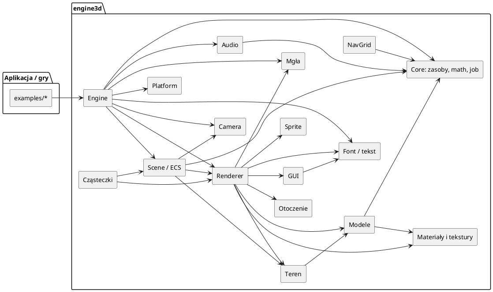
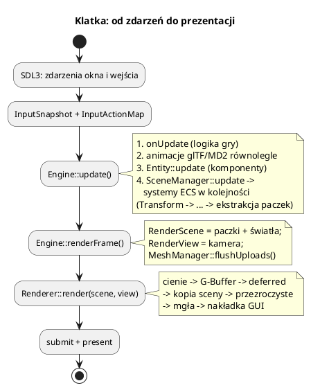

# Dokumentacja silnika engine3d (pyra-vulkan)

`engine3d` to edukacyjny silnik 3D w C++20 oparty na **Vulkanie 1.4** i **SDL3**.
Repo zawiera bibliotekę `libengine3d.so`, komplet shaderów HLSL, zestaw przykładów
(01–10) oraz pełną grę strategiczną `10_settlers`.

Dokumentacja zawiera **rozdziały modułów oraz lekcje przekrojowe**. Gdy nie wiesz, czym
jest dana struktura lub klasa (`RenderPacket`, `GraphicsPipelineBuilder`,
`MaterialInstance`, `GpuMesh`...), zajrzyj najpierw do
[00_slownik_pojec.md](00_slownik_pojec.md).

Opisy modułów łączą dwa poziomy:

1. **Jak używać** — konkretne API, przykłady kodu, typowe scenariusze.
2. **Jak to działa** — wyjaśnienie od środka: jakie struktury danych, jaka kolejność
   kroków, dlaczego rozwiązanie wygląda tak, a nie inaczej.

Do nauki zacznij od [ścieżki czytania i audytu](30_audyt_dokumentacji.md).
Szczególnie ważne są [podstawy Vulkana](27_vulkan_od_podstaw.md),
[algorytmy silnika](29_algorytmy_silnika.md) i
[algorytmy Osadników](28_settlers_algorytmy.md). Sam spis klas nie zastępuje
wyjaśnienia tych mechanizmów. Dokumentacja nie jest automatycznie generowaną
referencją każdego pola i każdej metody; zakres sprawdzenia opisuje audyt.

Diagramy są w **PlantUML** (`@startuml … @enduml`) — przepływ danych, zależności
modułów i sekwencje klatki. Można je renderować w VS Code (rozszerzenie PlantUML)
albo na <https://www.plantuml.com/plantuml>.

---

## Spis dokumentów

| Dokument | Moduł / temat |
|---|---|
| [00_slownik_pojec.md](00_slownik_pojec.md) | Słownik struktur i klas: co to jest i jaką rolę pełni w silniku |
| [01_architektura.md](01_architektura.md) | Cały silnik: warstwy, zależności, pętla gry, przepływ klatki |
| [02_core.md](02_core.md) | `Engine` — orkiestrator, `onUpdate`, mapy JSON, ustawienia |
| [03_ecs_scena.md](03_ecs_scena.md) | Encje, komponenty, `Scene`, systemy ECS, ekstrakcja renderu |
| [04_zasoby.md](04_zasoby.md) | `AssetRegistry`, uchwyty, `MeshManager`, `MeshBuilder` |
| [05_narzedzia_core.md](05_narzedzia_core.md) | Matematyka, szum, `JobSystem`, `Logger`, `Profiler`, crash handler |
| [06_platforma.md](06_platforma.md) | SDL3: okno, zdarzenia, migawka wejścia, akcje |
| [07_kamera.md](07_kamera.md) | Kamera, kontrolery FPS/RTS, picking myszą |
| [08_render_backend.md](08_render_backend.md) | Vulkan 1.4: kontekst, swapchain, synchronizacja, VMA, bariery |
| [09_render_potoki.md](09_render_potoki.md) | Przebiegi klatki: cienie, G-Buffer, deferred, przezroczyste, GUI |
| [10_render_materialy.md](10_render_materialy.md) | Materiały PBR, kompilacja potoków, shadery, hot reload |
| [11_render_tekstury.md](11_render_tekstury.md) | Ładowanie BMP/TGA/DDS, bindless, kopiowanie z CPU |
| [12_gui.md](12_gui.md) | Okna i widgety, HUD, `GuiToolbar`, ikony pixel-art |
| [13_fonty_tekst.md](13_fonty_tekst.md) | Atlas glifów, `TextOverlayRenderer`, UTF-8 |
| [14_audio.md](14_audio.md) | Mikser, dźwięk 3D, warianty, strumieniowana muzyka |
| [15_czastki.md](15_czastki.md) | System cząsteczek, emitery, zdarzenia, pliki `.particle` |
| [16_ai_nawigacja.md](16_ai_nawigacja.md) | `NavGrid`, A*, przeszkody, regiony dostępności |
| [17_mgly.md](17_mgly.md) | Mgła odległości, mgła wolumetryczna (froxele), mgła wojny |
| [18_sprite.md](18_sprite.md) | Sprite'y, animacje z atlasu, batching |
| [19_teren.md](19_teren.md) | Quadtree LOD, zszywanie krawędzi, splatting, raycast |
| [20_modele.md](20_modele.md) | 3DS, MD2, glTF, animacja szkieletowa, mapy |
| [21_otoczenie.md](21_otoczenie.md) | Skydome, skybox, ocean, siatka, roślinność |
| [22_budowanie_i_wdrazanie.md](22_budowanie_i_wdrazanie.md) | CMake, shadery, testy, paczka release, debugowanie |
| [23_przyklady.md](23_przyklady.md) | Przewodnik po przykładach i przepis na własną grę |
| [24_rozwiazywanie_problemow.md](24_rozwiazywanie_problemow.md) | Znane pułapki, walidacja, profilowanie, raport awarii |
| [25_settlers.md](25_settlers.md) | Gra `10_settlers`: ekonomia, walka, sterowanie, zapis, testy |
| [26_ograniczenia_i_plan.md](26_ograniczenia_i_plan.md) | Znane ograniczenia i kierunki rozwoju |
| [27_vulkan_od_podstaw.md](27_vulkan_od_podstaw.md) | Dlaczego i jak: swapchain, klatki w locie, synchronizacja2, deskryptory, bindless, pamięć |
| [28_settlers_algorytmy.md](28_settlers_algorytmy.md) | Dijkstra i cache, transport, rezerwacje, automaty, sloty z generacją, mgła, terytorium, AI |
| [29_algorytmy_silnika.md](29_algorytmy_silnika.md) | Ekstrakcja, równoległość, deferred/PBR, cienie, teren, A*, animacje, audio, froxele |
| [30_audyt_dokumentacji.md](30_audyt_dokumentacji.md) | Zakres przeglądu, mapa pokrycia, poprawione nieścisłości, kolejność nauki |

Dodatkowo:

* [detalis/teren3d.md](detalis/teren3d.md) — szczegółowe wyprowadzenie systemu terenu.
* [formaty/](formaty/) — dokumentacja formatu 3DS (PDF/RTF).
* [../TODO.md](../TODO.md) — techniczny backlog (zadania otwarte).
* [../changelog.md](../changelog.md) — historia zmian.

---

## Co potrafi silnik

* **Vulkan 1.4** — synchronizacja 2, push descriptors, hostImageCopy, dynamic
  rendering, VMA, swapchain i bufor głębokości.
* **Deferred PBR** — G-Buffer, oświetlenie Cook–Torrance, cienie PCF,
  4 kaskady słońca i atlas świateł lokalnych.
* **Materiały i tekstury** — cache potoków, bindless (1024 sloty), normal
  mapping, BMP/TGA/DDS (DXT1/3/5), hot reload shaderów.
* **Modele** — 3DS, MD2 (animacja klatkowa), glTF/GLB (PBR, animacja
  szkieletowa na GPU).
* **Teren** — quadtree LOD, zszywanie krawędzi, teselacja, splatting do 12
  warstw, generatory proceduralne, raycast.
* **Scena** — ECS-lite, hierarchia, kamery FPS/RTS, picking myszą, `NavGrid`
  z A*.
* **Efekty** — cząsteczki, sprite'y, ocean, skydome/skybox, mgła
  odległościowa i wolumetryczna, mgła wojny, roślinność z wiatrem.
* **Interfejs** — okna i widgety GUI, HUD w trybie immediate, `GuiToolbar`,
  ikony pixel-art, atlas glifów UTF-8.
* **Dźwięk** — efekty WAV/OGG z wariantami i limitami, dźwięk 3D,
  strumieniowana muzyka z przenikaniem.
* **Narzędzia** — `JobSystem`, `GameSettings`, `Logger`, `Profiler`, raport
  awarii, `MeshBuilder`.

---

## Wymagania

* C++20 (GCC 13+), CMake 3.20+
* Vulkan **1.4** (nagłówki + loader; funkcje rdzenia 1.4 są używane wprost)
* SDL3, SDL3_ttf, SDL3_image
* `glslangValidator` **lub** `dxc` (kompilacja HLSL → SPIR-V)
* `nlohmann/json.hpp` (nagłówek)

Fedora:

```bash
sudo dnf install gcc-c++ cmake vulkan-loader-devel glslang SDL3-devel \
    SDL3_ttf-devel SDL3_image-devel json-devel
```

Ubuntu 25.04+:

```bash
sudo apt install g++ cmake pkg-config libvulkan-dev glslang-tools \
    libsdl3-dev libsdl3-ttf-dev libsdl3-image-dev nlohmann-json3-dev
```

## Budowanie i uruchamianie

```bash
cmake -S . -B build -DCMAKE_BUILD_TYPE=Release
cmake --build build -j11
./bin/10_settlers_example          # uruchamiaj z katalogu głównego repo!
```

Aplikacje czytają `assets/` **względem katalogu bieżącego** — dlatego uruchamiamy je
z katalogu głównego repo, nie z `bin/`. Shadery trafiają do
`bin/assets/shaders/<bundle>/`.

Skróty:

```bash
./bin/01_rotating_triangle_example
./bin/06_terrain_example
SETTLERS_UITEST=1 ./bin/10_settlers_example
```

Pełna lista zmiennych środowiskowych i trybów testowych: [22_budowanie_i_wdrazanie.md](22_budowanie_i_wdrazanie.md).

---

## Mapa modułów

| Katalog | Odpowiedzialność | Dokument |
|---|---|---|
| `engine/core/` | pętla, encje, komponenty, zasoby, matematyka, logi | 02–05 |
| `engine/platform/` | okno i wejście SDL3 | 06 |
| `engine/camera/` | kamery, kontrolery, picking | 07 |
| `engine/render/` | Vulkan, przebiegi, materiały, tekstury | 08–11 |
| `engine/scene/` | scena, hierarchia, systemy ECS | 03 |
| `engine/feature/gui/` | GUI i HUD | 12 |
| `engine/feature/font/` | atlas glifów i tekst 2D | 13 |
| `engine/feature/audio/` | dźwięk i muzyka | 14 |
| `engine/feature/particle/` | cząsteczki | 15 |
| `engine/feature/ai/` | nawigacja A* | 16 |
| `engine/feature/fog/` | mgła wolumetryczna | 17 |
| `engine/feature/sprite/` | sprite'y 3D | 18 |
| `engine/object/terrain/` | teren LOD | 19 |
| `engine/object/` (modele) | 3DS, MD2, glTF | 20 |
| `engine/object/` (otoczenie) | niebo, ocean, siatka, roślinność | 21 |

---

## Zależności modułów



Zasada: **strzałka pokazuje kierunek użycia**. `Engine` zna scenę i renderer,
ale renderer nie zna `Engine` — dostaje gotowe `RenderScene` i `RenderView`.
Dzięki temu renderowanie da się testować i rozwijać niezależnie od logiki gry.

---

## Przepływ jednej klatki (skrót)



Szczegóły każdego kroku: [01_architektura.md](01_architektura.md) i
[09_render_potoki.md](09_render_potoki.md).

---

## Pierwszy program

Minimalna aplikacja to inicjalizacja `Engine`, jedna siatka, materiał, kamera
i callback `onUpdate`.

```cpp
#include "core/engine.h"
#include "core/entity.h"
#include "core/mesh_component.h"
#include "camera/camera_component.h"

using namespace engine3d;

int main() {
    Engine engine;
    if (!engine.initialize("moja gra", 1280, 800)) return 1;

    Scene* scene = engine.getSceneManager()->activeScene();

    MeshData tri;
    tri.vertices = {
        {{{0.0f, -0.5f, 0.0f}}, {{0, 0, 1}}, {{1, 0, 0}}, {{0.5f, 0.0f}}},
        {{{0.5f,  0.5f, 0.0f}}, {{0, 0, 1}}, {{0, 1, 0}}, {{1.0f, 1.0f}}},
        {{{-0.5f, 0.5f, 0.0f}}, {{0, 0, 1}}, {{0, 0, 1}}, {{0.0f, 1.0f}}},
    };
    tri.indices = {0, 1, 2};
    engine.getMeshManager()->loadMesh("trojkat", tri);

    Material mat;
    mat.name = "domyslny";
    const MaterialHandle matHandle = engine.getMaterialManager()->add(mat);

    Entity* e = scene->createEntity("trojkat");
    e->addComponent<MeshComponent>("trojkat")->materialHandle = matHandle;

    Entity* camE = scene->createEntity("kamera");
    CameraComponent* cam = camE->addComponent<CameraComponent>();
    camE->transform().position = {0.0f, 0.0f, 2.0f};
    scene->setActiveCamera(cam);

    engine.onUpdate = [](float dt, Engine& e) {
        if (auto* scene = e.getSceneManager()->activeScene())
            if (auto* tri = scene->getEntity("trojkat"))
                tri->transform().rotation.z += dt * 0.5f;
    };

    engine.run();
    return 0;
}
```

Krok po kroku wyjaśnia to [23_przyklady.md](23_przyklady.md). Jeśli coś nie działa,
najpierw sprawdź [24_rozwiazywanie_problemow.md](24_rozwiazywanie_problemow.md).
